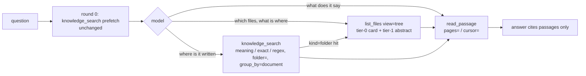

# Search finds, list orients, read reads: the office's files become navigable beside RAG, and a folder is a card

## Context and Problem Statement

Piloti answers questions about the office's own files mostly by ranked search. It
already has the navigation verbs: `list_files` (ls), `knowledge_search(match="exact")`
(a literal Ctrl+F) and `read_passage` (open a Punkt, a page or an outline). They are
used too little, and the audit says why (the design session's file audit; the measurement gap is already in
[`agent-tool-surface.md`](../architecture/agent-tool-surface.md) §5):

- **Steering.** Round 0 always prefetches a `knowledge_search`
  (`agents/piloti/decisions.py`, `prefetch_calls`). The prompt's kind definitions say
  "Retrieve first", its worked examples are searches, and the file verbs are one
  sentence that begins "can also" (`prompts/piloti_static.md`, `<sources>`).
- **A missing read primitive.** `read_passage` returns at most 12 chunks, with no page
  range and no continuation. A 40-page Gutachten cannot be read through, so reading
  beats searching only for a single Punkt.
- **A listing that cannot orient.** `list_files` shows one folder level and one line
  per file. It carries no page counts and no summary of a folder. A folder of 300 files
  arrives as 300 lines.
- **Grep without regex, context or folder pushdown.** The exact mode is literal only,
  shows no surrounding lines, and turns a folder into a `file_name $in` list.
- **No measurement.** The answer suite skips own-file questions. Two loop-eval rows are
  about the office's files, and both are skipped. Nobody has measured `list_files` or
  exact search, and production has no per-tool usage signal.

The product owner's position: a good file system can beat RAG on some questions; we
want both. RAG stays the foundation. A folder is the product of all its children, so it
should carry more than a name. Use Qdrant properly. Keep the pipeline changes small.

## Decision Drivers

* **Hybrid beats either alone on mixed corpora.** Anthropic recommends "a hybrid
  strategy, retrieving some data up front for speed" with just-in-time exploration, and
  calls it "better suited for ... legal or finance work"
  ([context engineering](https://www.anthropic.com/engineering/effective-context-engineering-for-ai-agents)).
  Cursor measured +12.5 % answer accuracy (6.5–23.5 % by model) for semantic search
  added to grep, and says "the combination ... leads to the best outcomes"
  ([Cursor](https://cursor.com/en-US/blog/semsearch)). LlamaIndex found a file-system
  agent more correct at 5 documents and plain RAG ahead at 100–1,000
  ([LlamaIndex](https://www.llamaindex.ai/blog/did-filesystem-tools-kill-vector-search)),
  and has since shipped hybrid retrieve, list, grep and read as one product
  ([Retrieval Harness](https://www.llamaindex.ai/blog/announcing-retrieval-harness)).
* **The "grep beats RAG" evidence is from code.** Claude Code's team calls its own
  comparison "mostly vibes" ([Latent Space](https://www.latent.space/p/claude-code)).
  Grep cannot read PDFs, scans or drawings, and "revenue recognition" never matches
  "ASC 606" ([LlamaIndex, "Is grep all you need?"](https://www.llamaindex.ai/blog/is-grep-all-you-need-lexical-vs-sematic-search-for-agents)).
  Results depend on the harness ([arXiv 2605.15184](https://arxiv.org/abs/2605.15184)).
  An office holds PDFs, drawings and German compounds, so navigation runs over the parsed
  chunks we already index, not over raw bytes, and we measure on our own corpus before
  claiming a gain.
* **Progressive disclosure, inline.** Agent Skills load in levels: description first,
  then body, then linked files
  ([Agent Skills](https://www.anthropic.com/engineering/equipping-agents-for-the-real-world-with-agent-skills)).
  Our own `CLAUDE.md` names the trap: a nested guide that only arrives after a file is
  opened arrives too late. A folder card must come back with the listing, not behind a
  second call.
* **Bottom-up summaries help global questions, but top levels lose detail.** RAPTOR
  improved QuALITY by 20 points absolute ([RAPTOR](https://arxiv.org/abs/2401.18059)).
  GraphRAG's root summaries are cheap to read and the weakest for quality
  ([GraphRAG](https://arxiv.org/abs/2404.16130)). LazyGraphRAG shows that LLM work at
  index time is the cost driver
  ([LazyGraphRAG](https://www.microsoft.com/en-us/research/blog/lazygraphrag-setting-a-new-standard-for-quality-and-cost/)).
  So a card routes to its children rather than replacing them, the exact part costs no
  model call, and the written part is built only when something changed.
* **Folder location is a primary signal in professional document work.** Harvey's agent
  reads "which folder a file sits in, what the client's naming convention tends to mean"
  ([Harvey](https://www.harvey.ai/blog/agentic-vault-search-and-organization)).
* **Tools return bounded, high-signal output that names the next call**
  ([writing tools](https://www.anthropic.com/engineering/writing-tools-for-agents)).
  Use the standard's own words: Claude Code's `Read` takes `pages` for a PDF
  ([tools reference](https://code.claude.com/docs/en/tools-reference)), MCP paginates
  with an opaque `cursor`
  ([MCP pagination](https://modelcontextprotocol.io/specification/2025-06-18/server/utilities/pagination)),
  and Qdrant groups with `group_by`
  ([Qdrant search](https://qdrant.tech/documentation/search/search/)).
* **The tool surface is already past OpenAI's line of 20** (32 tools, about 17.9k
  tokens; [`agent-tool-surface.md`](../architecture/agent-tool-surface.md) §2). A new
  capability extends an existing verb; it does not add a tool.
* **Tenancy and restricted folders are not negotiable** (ADR-0087, ADR-0088, ADR-0116).
  A card summarises documents, so it must never let a restricted file's name or content
  reach a turn that has not admitted it.

## Considered Options

* **RAG only, tuned.** Keep ranked search as the one way in. Tune BM25, add contextual
  chunk headers, raise `top_k`.
* **File tools only.** Replace ranked search with ls/glob/grep/read over parsed text, as
  Claude Code does for code.
* **Hybrid: navigation on the existing tools beside RAG, with folder cards.** Keep the
  ranked search and its round-0 prefetch. Extend `list_files`, `read_passage` and
  `knowledge_search` with the navigation moves, teach three moves in the prompt, and make
  every folder a card: an exact part computed when it is read, and a written part built
  bottom-up only on change.

## Decision Outcome

Chosen option: "Hybrid: navigation on the existing tools beside RAG, with folder
cards", because it is the only option the evidence supports for a corpus of PDFs,
drawings and German legal text. It also adds no tool, keeps the citable-passage contract
(ADR-0061) intact, and is measured against both alternatives on our own files before it
is called a gain.

What it decides:

1. **Measure first.** An office-file eval set (`pf-*` rows, `task be:eval:answer-suite
   -- --set files`) runs on a fixture project grown from
   `tests/fixtures/intake_eval/project.yaml`. Its rows cover orientation, locate,
   aggregate, read-through, exact and scoped questions, and each row states
   `expect.tools`. It runs three arms: search only, navigate only, both. Production gets a
   per-turn `file-tools-used` score, so usage is a query rather than a guess.
2. **Search finds, list orients, read reads.** RAG stays the round-0 prefetch. The prompt
   teaches three moves with when-to-use rules and one worked example of list, then exact
   search, then a ranged read. "Retrieve first" stops being the only rule, and the
   per-tool rules live in the tool descriptions (ADR-0060 (d)).
3. **No new tool; three verbs grow.**
   - `list_files(view="tree", depth=…)` returns the folder tree with a card inlined per
     folder, and page counts per file. `tree` is the Unix name for the view, and
     `list_files` is the name stored turns already hold.
   - `read_passage(pages="4-6")` reads a page range (Claude Code's `Read` parameter), and
     `read_passage(cursor=…)` continues where the last read stopped (MCP's pagination
     word). Both read the chunks Qdrant already holds, scrolled in `reading_order` under
     the document filter, with the chunk overlap removed. `page=` stays as one page.
   - `knowledge_search(match="regex")` and `context=N` (grep's `-C`) join the exact mode,
     whose `folder=` becomes a `folder_ancestors` pushdown instead of a file list.
     `knowledge_search(group_by="document")` returns one line per document, keyed by
     `grid_document_id` (Qdrant's own word for it). Same verb and same scope as today,
     which is why exact search was merged into `knowledge_search` rather than made a tool
     (agent-tool-surface §3).
4. **A folder is a card.**
   - *Tier 0* is deterministic and computed when it is read, from the turn's inventory
     rows (Postgres `document_metadata`, already loaded uncapped and already stripped of
     restricted collections). It holds: document count (direct and subtree), child
     folders, counts by Dokumentart, date range, the latest Fassung per series, the
     newest change, and total pages. Nothing is stored, so nothing goes stale.
   - *Tier 1* is a short German abstract plus up to 8 key facts. Each fact cites a child
     document. It is built bottom-up from the per-document summaries that already exist,
     only when a folder changed (dirty-mark the ancestors, debounce, skip when the input
     hash is unchanged). It is stored in a new `folder_cards` table under row-level
     security, written through the BFF (ADR-0003), and upserted as a Qdrant point
     `kind=folder` in the office collection, so a search can land on a folder and drill
     down. A card is an index: it is never cited, and a fact on it is read back from the
     document it names before an answer states it. A person's folder description
     (migration 0145) is an input and wins over the abstract. Tier 1 ships after tier 0
     and after the eval has a baseline.
5. **Qdrant, small and high-value.** Group by `grid_document_id`. Use facets for the
   per-file count of a capped exact search. Add `document_date` and `added_at` as
   datetime payload fields with a datetime index (payload backfill through the existing
   `refresh-document-facts`, no re-embedding). Tune BM25 `avg_len`, `k` and `b` in a
   separately scheduled `_vN` rebuild, after the parity sweep. Keep `is_tenant` on
   `scope`. Exclude `kind=folder` points from every chunk read in `scope.scope_filter`,
   the only constructor of read filters.
6. **Observable.** Each tool span carries its mode (`view`, `match`, `pages`), a tier-1
   build is an `observed_generation`, and `file-tools-used` and `folder-card-fresh` are
   declared in `SCORE_DEFINITIONS`.

### Consequences

* Good, because every question shape gets the move that fits it. Aggregates ("how
  many Einreichunterlagen, latest Fassung") are answered from counts that are exact by
  construction. Orientation needs one call. A long document can be read through in one
  round of parallel ranged reads.
* Good, because the tool count stays at 32. The added description text is about 250
  tokens, a fraction of one tool.
* Good, because tier 0 costs no model call and cannot be stale, and the eval baseline
  exists before any LLM-written card is built.
* Good, because the round ceiling does not move. A read-through is one listing (or the
  prefetch) plus one round of up to 12 parallel ranged reads; `max_tool_iterations: 7`
  and `max_calls_per_round: 12` hold it. The eval's read-through rows report
  `status:budget`, and a firing there is what reopens the ceiling.
* Bad, because tier 1 adds a background job, a queue, an LLM cost line and a second
  copy of each card (Postgres and Qdrant). The Qdrant copy is derived and rebuilt from
  the table.
* Bad, because a folder point in the office collection is one more kind of point that
  every chunk read must exclude. The exclusion sits in the one filter constructor and is
  pinned by a test; a sibling collection is the fallback if that test ever has to grow
  exceptions.
* Bad, because a stale or wrong abstract can mislead routing. A card is shown with its
  `generated_at` and a stale flag, a fact whose cited document was deleted or superseded
  is hidden when the card is read, and an answer cites documents, never cards.
* Bad, because `match="regex"` runs a model-written pattern over chunk text. It runs
  under the `regex` package's timeout with a length cap, and a pattern with no literal
  token runs only inside a folder, file or Dokumentart.
* Neutral: no scratch-note tool. The working directory's `write_file` emits a
  `document_draft` card meant for commissioned documents, the transcript and the
  „Bereits gelesen" digest already carry a chat turn's notes, and work that outgrows
  7 rounds is a task (`create_task`). Revisit when a `pf-*` multi-turn row fails for
  lost state.

### Confirmation

* `task be:eval:answer-suite -- --set files --arm search|navigate|both`, before and
  after each slice that changes an answer (the AGENTS.md obligation). Rows live in
  `tests/fixtures/files_eval/files_questions.yaml`; `tests/test_files_eval_rows.py`
  fails a row without `expect.tools`, and a row that names a file the fixture does not
  hold.
* `tests/knowledge_layer_tests/test_browse_tree.py`: tier-0 counts, latest Fassung, the
  bound, and that no row of a restricted collection reaches a card.
* `tests/knowledge_layer_tests/test_read_passage_ranges.py` and
  `sources/knowledge_layer/tests/test_qdrant_structural_fetch.py`: ranges, the cursor
  and overlap removal.
* `tests/knowledge_layer_tests/test_exact_search_regex.py`: regex timeout, the
  no-literal refusal, context lines, and the folder pushdown.
* `sources/knowledge_layer/tests/test_qdrant_scope_kind.py`: no chunk read, scroll, facet
  or count returns a `kind=folder` point unless it asks for one.
* `tests/aiq_agent/observability/test_langfuse_scores.py` for the two new scores, and
  `test_model_calls_are_traced.py` for the tier-1 generation.
* `task db:test:rls` for `folder_cards`.
* `tests/aiq_agent/common/test_backend_tools_schema.py`: the door's `files-list`,
  `passage-read` and `knowledge-search` operations carry the new arguments, so an
  outside agent gets what Piloti gets.

## Pros and Cons of the Options

### RAG only, tuned

* Good, because it is the measured stack: contextual BM25 with a reranker cut top-20
  retrieval failures by 67 %
  ([contextual retrieval](https://www.anthropic.com/news/contextual-retrieval)).
* Bad, because it cannot answer aggregates ("how many", "the latest") or orientation
  questions exactly, and it cannot read a document through. Those are the questions an
  office asks about its own files.

### File tools only

* Good, because there is no index to go stale, and models are trained on ls, grep and
  read ([Letta](https://www.letta.com/blog/benchmarking-ai-agent-memory),
  [Vercel](https://vercel.com/blog/we-removed-80-percent-of-our-agents-tools)).
* Bad, because the evidence comes from code and from small samples, grep misses German
  inflection and synonymy, and the legal corpus is large and stable, which is where
  indexed retrieval wins. It would also throw away a measured pipeline.

### Hybrid with folder cards (chosen)

* Good, because it follows the one direct lab statement for legal work and the measured
  hybrid results above.
* Bad, because there are more moving parts (see Consequences), and because nobody has
  published a benchmark for "folder card, then chunk" routing. The `pf-*` arms are our
  evidence, which is why they come first.

## More Information

* The implementation lands as independent slices, each PR linking this record. The
  roadmap rows this closes are [`agent-tool-surface.md`](../architecture/agent-tool-surface.md)
  §5 rows 1 and 4; that document is updated in the slices that land them.
* [`piloti-filesystem-design.md`](../architecture/piloti-filesystem-design.md) stays an
  exploration. This decision builds none of its namespace or mounts.
* Revisit when: the navigate-only arm matches the both arm on the `pf-*` set (the
  prefetch may then become a tree prefetch); the both arm loses to search-only on any
  question family (roll back that family's prompt rule); read-through rows hit
  `status:budget` in more than 1 run in 10 (raise `max_tool_iterations` by one, measured);
  the `kind=folder` exclusion needs a second exception (move folder points to a sibling
  collection).
