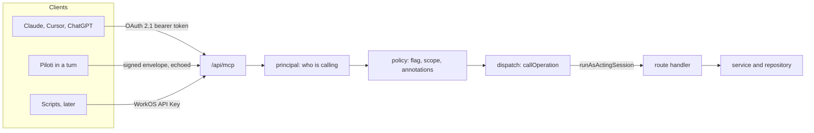

# The agent surface: one MCP server for everything a person can do

Everything a person can do in Piloti, an agent can do on that person's behalf,
through one MCP server at `/api/mcp`. This page is the long form of
[ADR-0121](../adr/0121-everything-a-person-can-do-an-agent-can-do.md): how the
server works, how to add an operation, how to connect a client, and how to set up
WorkOS. The rule for contributors, in short, is
[`../contributing/headless-first.md`](../contributing/headless-first.md).

Code: `frontends/ui/src/lib/agent-api/`. The route is `/api/mcp`.

## How it works



1. **The client calls `/api/mcp`.** An external agent presents a bearer token
   issued by WorkOS AuthKit. Piloti, inside a turn, echoes the turn's signed
   request-context envelope. Neither can reach a route any other way.
2. **Principal.** `principal.ts` turns the credential into a principal: the
   person the call is for (the subject), the agent acting (the actor:
   `external_agent` or `piloti`) and the OAuth client, in the words of token
   exchange (RFC 8693). A token is
   checked for signature, issuer (`https://<WORKOS_AUTHKIT_DOMAIN>`) and audience
   (the MCP URL, RFC 8707). A token carries no permissions, so the person's
   membership, role and permissions are resolved on every call with
   `resolvePinnedRequesterSession` (ADR-0108). Then the request is charged one
   unit of `mcp-request` (`lib/limits/rules.js`: 600 per ten minutes, 30 per five
   seconds, per member, shared by every client of that person); a spent budget
   answers 429 with `Retry-After` before any tool runs. One POST carries one
   JSON-RPC message: a batch (a body that is an array, dropped from MCP in its
   2025-06-18 revision) is refused with 400 before the caller is resolved, so
   one charge cannot cover a hundred calls. When WorkOS cannot answer who is
   calling, the door answers a JSON 503 the client can retry.
3. **Policy.** `policy.ts` decides whether this call may run. The organization
   needs the `agent-mcp` flag for an external agent. Piloti in-product has no
   such flag, but its writes never run directly, and its reads are held to the
   conversation's audience (see below).
4. **Dispatch.** `dispatch.ts` builds a `Request` from the operation's method and
   path and calls the route's exported handler in-process, inside
   `runAsActingSession`. The handler's factory then resolves the session (now the
   acting one), checks `authz`, charges the rate limit, opens the tenant slot and
   parses the body with the route's own schema.
5. **Route handler to service.** From here the call is the call the browser makes.

The dispatcher does not loop back over HTTP. A loopback request would need a
credential every route accepts, which is a second door.

### The acting session

Route handlers learn who is asking from `getGridSession()`, which reads the
AuthKit cookie. An agent has no cookie, so `getGridSession()` has one more
answer: the session bound by `runAsActingSession` (`acting-session.ts`) to the
async execution of one call. The binding ends with the callback, so a call cannot
leak its person into the next one.

**Only `lib/agent-api/dispatch.ts` enters it**, and only with a session built by
`resolvePinnedRequesterSession`. Never call `runAsActingSession` anywhere else.

### How long a revocation takes

A token outlives the membership it was issued for, so how soon a removal bites
is how old the answers about the person may be:

| What changed | When the agent door notices |
|---|---|
| Removed from the organization, or the organization role changed | Within a minute on the external door: its membership lookup is cached for `FRESH_MEMBERSHIP_TTL_MS` (60 s) under its own key, not the ten minutes the session cache keeps. A lookup WorkOS does not answer refuses. Piloti's door reads the envelope's person through the ten-minute cache; a turn is minutes long |
| A project role or a folder's access changed | As fast as the route's own check: the project and folder decisions read WorkOS through their own caches, exactly as for a browser |
| The `agent-mcp` flag turned off | Within 30 seconds: the flag is read per call, through the flag cache (`lib/workos/feature-flags.ts`) |
| The token revoked in WorkOS | Not before it expires. The server verifies the signature and claims and does not introspect; the membership check above is what makes a revoked person's token useless |

### The person says yes or no

| Client | A read | A write |
|---|---|---|
| External agent | Runs | The client asks its user, driven by the tool annotations |
| Piloti in-product, in a conversation that is the person's alone | Runs if it names nothing outside the turn's project, after the restricted folders it may draw on are recorded (below) | Becomes an `operation` proposal. The person accepts it (it runs as them) or dismisses it (ADR-0105) |
| Piloti in-product, in a shared conversation | Refused, with a sentence the model relays | As above |

### Shared conversations

A read runs as the requester, and its answer lands in a transcript everyone the
conversation is shared with reads. Piloti's own retrieval is held to that
audience (ADR-0093, ADR-0094: it searches only what every reader may read, and
records what it used before the model sees it). A route's answer is one
person's and does not say which folder or project its content came from, so
`read-gate.ts` fails closed, once per MCP request:

- **Shared** (named grantees, or visible to the project or the office): no
  workspace read and no backend read runs. The model gets
  `SHARED_CONVERSATION_READ_REFUSAL` ("This conversation is shared, so Piloti
  reads nothing from the workspace in it …"), in English whatever the person's
  locale, and words it for the reader (see [English only](#english-only)). A redirect or a
  presigned link is never handed on there either. `AUDIENCE_SAFE_READ_DOMAINS`
  is empty: a domain belongs in it only when every reader of the conversation
  may read every answer of every operation in it.
- **Solo** (private, the requester's alone, or not created yet): first,
  `soloReadRefusal` resolves what the call names (`operation-targets.ts`: the
  path's `projects/[id]`, `documents/[id]`, `folders/[folderId]`,
  `conversations/[id]`, `models/[modelId]` and the like, and `projectId`,
  `documentId`, `folderId`, `conversationId` keys at any depth of the query and
  body) to where each lives. A read that names another project, or any project
  in a turn that has none, is refused with a sentence the model relays; so is a
  read of another conversation that drew on another project. Then, before the
  first read of the request, `recordSoloWorkspaceRead` takes the
  conversation's audience lock (`lockConversationAudience`, the one every
  share takes), reads the audience again under it, and records every folder of
  the turn's project that restricts someone and that the requester may read,
  and marks the turn's answer, in that one transaction. A conversation shared
  in the meantime records nothing and the read is refused. A later share is
  judged against the record. This over-records on purpose: the answer's own
  provenance is unknown. The answer's id comes from the agent in
  `x-grid-answer-message-id` (`turn_answer_message_id`), as the other internal
  tools send `answerMessageId`.
- **No conversation** (an external agent, a run with no chat): nothing to judge.

A read in a solo conversation of another project is refused rather than
recorded as a cross-project hand-out (`recordCrossProjectHandOut`,
`conversation_source_projects`): that record says the conversation drew on the
project as its audience may read it, and a route's answer is the requester's,
with every restricted folder they may open. A read whose answer can carry any
project's content without naming one declares `spansProjects` in the catalog
(`always`: similar passages, the project list, the inbox, the holds, quarantine
and deletion queues, the download log; `unlessScoped`: the conversation and
proposal lists without a `projectId`) and is refused in a project's
conversation. `read-gate.spec.ts` lists every other Piloti read that names no
place, each with the reason it carries no project's content, and fails on a new
one. A read naming something the lookup does not find (a held upload a
reviewer could open, a mistyped id, a `resourceType` it cannot place) is
refused as well, except the
conversation's own id before its row exists. Not covered: in a conversation
outside any project a cross-project read still runs on the turn's record.
`read-gate.integration.spec.ts` proves the refusals and the record against
Postgres.

`read-gate.spec.ts` walks the real catalog and every backend operation and fails
if any read Piloti can name reaches `callOperation` or `callBackendOperation` in
a shared conversation.

`annotationsOf` in `operation.ts` states every hint: `readOnlyHint`,
`destructiveHint`, `idempotentHint`, `openWorldHint`. A hint left out would
default to "destructive" in the MCP specification.

## Modes

The server has two modes, as PostHog's does. MCP has no standard tool search, and
a client that lists 300 tools pays for them in every conversation.

| Mode | The client sees | Use it when |
|---|---|---|
| `search` (default) | `search-operations`, `describe-operation`, `call-operation`, `report-missing-operation` | Almost always. The agent searches, reads one schema, calls |
| `tools` | One MCP tool per operation, each with its annotations | A client or model that copes with a long list |

`report-missing-operation` is how an agent says "I wanted to do X and found
nothing". It emits `agent_operation_missing`, which carries the length of the
description and never its words; the tool's own description says so.

The meta-tools are written once, `metaToolsFor` in `discovery.ts`, per caller:
in-product Piloti is never offered the `platform` domain, and its `call-operation`
says a write comes back as a proposal. Piloti's client reads its variant from
`src/aiq_agent/tools/workspace/meta_tools.json`, which `meta-tools.spec.ts`
writes (`UPDATE_FIXTURES=1`) and holds current; Python keeps no copy and renames
only the tool names to its own (`workspace__call`).

`search-operations` matches plain words, never a pattern (a regular expression
built from an agent's text would let one catastrophic pattern hold the event loop
for every tenant). Words of one letter are dropped, a query is at most 200
characters, and text with no usable word matches nothing.

What a client pays up front, measured with `tools/list` in October 2026 (about
four characters a token):

| Mode | Piloti | External agent |
|---|---|---|
| `search` | 4 tools, 3.5k characters | 4 tools, 3.5k characters |
| `tools` | 241 tools, 203k characters (was 267k for 250) | 301 tools, 277k characters (was 354k for 310) |

`tools` mode lists only what says something: `ifMatch` only where the route reads
it, no `additionalProperties: true` (JSON Schema's default), each annotation hint
only where it differs from the specification's default or applies (a read states
`readOnlyHint` and `openWorldHint`, a write `destructiveHint`, `openWorldHint` and
an `idempotentHint` that is true), and the title once. `describe-operation` and
the OpenAPI document state all four hints. `mcp-server.spec.ts` holds the average
under 1,000 characters a tool. Claude clients defer MCP tools by default; the
entry points carry `_meta["anthropic/alwaysLoad"]` so they stay loaded: the four
meta-tools, and `project-list`, `knowledge-search` and `files-list` in `tools`
mode.

Both protocol eras answer one JSON body to a client that accepts JSON
(`createAgentDoorHandler`, `mcp-server.ts`): the SDK's 2025-era fallback streams
whatever the handler's `responseMode`, and refuses (406) a client that does not
name both `application/json` and `text/event-stream`.

The mode was called `discovery` until October 2026, and the server still
accepts that name (header `x-piloti-mcp-mode` or `?mode=`). MCP's own
"discovery" is `server/discover`, so the old name said something it was not.

## English only

Everything an agent reads from this server is English, one word per concept:
operation names, summaries, descriptions, schema descriptions, the meta-tools,
the server instructions, refusals and proposal summaries (AGENTS.md, "Industry
standard first"). German is for people, through i18n, and for domain data
(document names, addresses, legal citations such as "OIB-Richtlinie 2"). The
words are in [`../glossary.md`](../glossary.md#agent-surface-and-standard-terms).

- A route that words a refusal in the person's locale (`getLocale()`) answers an
  agent in English: `dispatch.ts` runs the call with the reader `agent`
  (`ActingReader`, `acting-session.ts`), and `getLocale()` returns `en` for it.
  A person applying a proposal reads the route's words in their own language.
- The backend operations carry their own English descriptions
  (`backend-operations.ts`), layered over the fixture's: those are Piloti's
  native tool descriptions, written for a German office, and stay as they are
  until the core-agent wave. Their input schemas keep the fixture's text with
  `ENGLISH_GLOSSES` applied.
- `english-only.spec.ts` reads what `initialize` and `tools/list` hand a client
  in both modes, the OpenAPI document and every string literal under
  `lib/agent-api/` and `app/api/mcp/`, and fails on a German word (an umlaut,
  a stem or a prose word of `ci/german_stems.json`). Domain data passes only
  through its `DOMAIN_DATA` list, each entry with a reason. Its Python half is
  `tests/aiq_agent/tools/workspace/test_english_only.py`, for what the workspace
  tools tell Piloti's model.
- Not yet: the internal routes Piloti's native tools call still refuse in German
  (`AGENT_REFUSAL_LOCALE`); see ADR-0121, "Follow-ups".

## What deserves a tool

| Layer | What | Where |
|---|---|---|
| 1. Atomic operations | One per route method. The layer the rule is checked on | `lib/agent-api/catalog/` |
| 2. Task-shaped tools | Where an agent needs more than CRUD: retrieval, IFC, canvas | `src/aiq_agent/tools/`, served through the MCP in phase 2 |
| 3. Skills that teach composition | "To close out a project, do these five things" | Served as MCP prompts. Later |

The Python-only reads (`knowledge_search`, `read_passage`, `list_files`,
`view_knowledge_image`, `ifc_query`, `ifc_measure`, `ris_lookup`) reach the
server in phase 2 through an internal backend endpoint, so an external agent
searches with the retrieval Piloti uses.

A new workspace capability (a thing a person does) is a route and an operation.
It is not a new Python tool.

## Adding an operation

Do this in the same change that adds or changes the route. The exemplar is
`catalog/projects.ts`; copy its shape.

1. **Find the domain file** in `catalog/` (`projects`, `documents`, `folders`,
   `review`, `conversations`, `collaboration`, `tasks`, `skills`, `knowledge`,
   `bim`, `organization`, `platform`). A new domain is a new file, an entry in
   `AGENT_DOMAINS` (`operation.ts`) and a spread in `catalog/index.ts`.
2. **Share the schema.** The operation's `body` is the route's own zod schema,
   imported. If the schema is declared inside the route file, move it to a
   `lib/<area>/<x>-wire.ts` module (no `server-only`, no drizzle) and import it in
   both the route and the catalog (`lib/projects/project-wire.ts` is the
   example). Do the same for a query parsed with `parseQuery`. A second copy is
   the drift ADR-0055 exists to prevent.
3. **Write the entry.**

   ```ts
   {
     name: 'project-member-add',
     domain: 'projects',
     summary: 'Give someone a role on a project',
     description:
       'Assigns a project role to an organization member, or an empty `roleSlug` to clear it. ' +
       '`organizationMembershipId` comes from organization-member-list, not a user id. ' +
       'Needs project:members:manage. Check the result with project-member-list.',
     method: 'POST',
     path: '/api/projects/[id]/members',
     params: projectParams,
     body: addMemberSchema,
     idempotent: true,
     load: () => import('@/app/api/projects/[id]/members/route'),
   },
   ```

4. **Describe each path segment** in `params`: one key per `[segment]`, each with
   `.describe()` saying where the id comes from (`'The project id, from project-list.'`).
5. **State the annotations** the defaults do not get right (below).
6. **Give an example** when the input is hard to get right from the schema
   alone (a patch, a placement, an upload): `examples`, one to three realistic
   inputs. They reach the agent as the input schema's JSON Schema `examples`, and
   `operation-examples.spec.ts` parses each against the operation's schemas.
7. **Run the gate**: `cd frontends/ui && bunx vitest run src/lib/agent-api/`. If
   your route was in the baseline, the "baseline only shrinks" test lists it;
   rewrite the file with `UPDATE_FIXTURES=1` and commit the diff.

### Naming

`<entity>-<verb>`, kebab-case, at most 52 characters, unique: `project-member-add`,
`document-version-approve`, `inbox-item-archive`. The verbs in use are list, get,
create, update, delete, rename, move, add, remove, search, export, start, cancel,
approve, reject, publish, submit, restore, archive, allow and release (a legal hold,
a hand-off; a held upload is allowed, never released, because "release" collides
with approval). Pick one of them before inventing another. One operation per route
method; never two on the same.

The entity is the glossary's word: a `task` is a task definition (standing or
one-off) and a `task-run` one attempt at it; `job` names only a claim-queue item
and is never an operation's entity. The renames of October 2026 (`job-*` to
`task-*`, `run-*` and `task-review` to `task-run-*`,
`document-quarantine-release*` to `document-quarantine-allow*`) are accepted under
their old names for one release (`RENAMED_OPERATIONS`, `catalog/index.ts`), for
proposals filed before and agents that remember them. PostHog's
`agent_operation_called` carries the new names from then on: an insight over the
history needs both.

### Descriptions

The description is the only guidance that reaches the model. It is at least 40
characters, in English, and says when to call the operation, what comes back,
where its ids come from and what to call next. Name the permission it needs when
that decides whether the call works. `summary` is one line, for search and for
`tools` mode.

### Schemas

`body`, `query` and `params` are zod and are exported to JSON Schema by
`lib/api/zod-json-schema.ts`, which refuses a node it cannot describe. If a shared
schema fails that (`z.custom`, `z.date`), extend the exporter when the node is
describable. Otherwise give the operation a looser `body` written for the agent
(`z.object({...}).passthrough()` with the describable fields) and a comment that
the route's schema is the gate. The route's schema is always the gate.

One convention for the version a write was made against. A route that reads the
`If-Match` header (the project profile's PUT) flags its operation `ifMatchHeader`,
and only that operation's input takes a top-level `ifMatch`, sent as the header. A
route that takes the version in its body (a document version's content, approve,
reject and request-changes) declares `ifMatch` in its body schema, and the agent
sends it there. A top-level `ifMatch` on any other operation is refused, never
dropped: a version check nobody makes is a lost update. A proposal keeps it, so
accepting later still refuses to overwrite a newer version.

The dispatcher validates the agent's input against the operation's schemas and
forwards the input **as the agent sent it**, never zod's parsed output: the route
parses with its own schema and is the gate, and a transform (`organization-download-log-list`
turns its days into `Date`s) would hand the route something it refuses. A
proposal stores the same original input.

### Annotations

| Field | Set it when | Default |
|---|---|---|
| `readOnly: true` | A POST that only searches or computes. Read the route's service first: a row, a file, a grant or a credential is a write. Add the operation to `read-only-writes.spec.ts` with one line saying why it writes nothing | `method === 'GET'` |
| `destructive: true` | A person confirms it in a dialog: delete, revoke, allow, purge | `method === 'DELETE'` |
| `idempotent: true` | Calling twice leaves the same state (a PUT-like PATCH) | GET, PUT, DELETE |

A hard delete with no restore is still catalogued, `destructive: true`, and says
in the description that it cannot be undone. The client asks the person.

### Bytes in and out

The dispatcher speaks JSON to an agent and the route's own encoding to the route.

**Out.** A route that answers a file (PDF, Word, a BCF zip, an Excel workbook) is catalogued like any
read, with `binaryResponse` listing its media types for OpenAPI. `dispatch.ts` reads the bytes; up
to `MAX_INLINE_BYTES` (5 MiB) the result is an MCP `resource` content item (`blob` is the base64,
`uri` is `piloti://operation/<name>/<file name or result>`) next to a one-line text summary. The
base64 never enters `structuredContent` or the 40k text cap. Over the limit nothing is sent, and
the text names the other ways in: `document-text-get` for the text in pages, `document-download` for
a time-limited link. A route that redirects (3xx with `Location`) is handed on as a
`resource_link` and never followed server-side; the link is a credential and expires.
`document-download`, `document-preview-get`, `document-thumbnail-get` and `bim-model-source-get`
answer JSON holding such a URL, so they are plain reads, and never run for Piloti in a shared
conversation (`LINK_BEARING_OPERATIONS`).

A JSON or text answer is streamed with a cap too, `MAX_TEXT_BYTES` (5 MiB): past it nothing more
is read and the agent is told to narrow the call. The backend operations' answers are read by the
same reader (`readResponseBody`), and their refusals are normalised once, in
`callBackendOperation`, to the routes' error envelope (`{ error, code, details }`), so the agent
reads a refusal from either the same way. The tool result shows `MAX_RESULT_CHARS` (40k
characters) of compact JSON: the one cap, which Piloti's client does not cut again. Input that does
not fit an operation comes back with the reason and, when it is short, the input schema itself.

**In.** An operation says `bodyEncoding`:

| Value | The agent sends | The route receives |
|---|---|---|
| `json` (default) | the body | `application/json` |
| `multipart` | `{ files: [{ name, mimeType, contentBase64 }], fields? }` | a `FormData` with a `file` part and the `fields` as text parts, as the UI's uploader builds it |
| `raw` | `{ contentBase64 }` | those bytes as `application/octet-stream`, with `Content-Length` |

The schemas are `uploadBodySchemaWith({ ...fields })` and `rawBodySchema` in
`lib/agent-api/upload-wire.ts`: one file per call, at most 32 MiB decoded (the mail import's part
size). The route's own parsing stays the gate, so name the real form fields in `fields` and add a
`agent-upload.spec.ts` beside the route that proves the dispatcher's form passes its parser. An
Outlook archive is three operations: `mail-import-start`, `mail-import-part-upload` (once per
part), `mail-import-complete`.

### Sensitive operations

`sensitivity: 'access'` marks an operation that widens who may do what (sharing
grants, folder access, project roles, custom role definitions). `sensitivity:
'secret'` marks one that touches the organization's secrets (LLM provider keys)
or hands out a credential (an Admin Portal link). `sensitivity: 'control'` marks
one that turns a security or compliance control down or off: zero data
retention, upload screening, letting a held file through, lifting a legal hold,
how long the download log and a purged folder's content are kept. A sensitive
operation is always
`destructiveHint` (`annotationsOf`, reads included), is a write except for the
reads `read-only-writes.spec.ts` lists with why they return no secret, and:

- **Piloti in-product never sees one** and `proposeOperation` refuses to file one
  (403): accepting a card the agent worded is not the confirmation such a change
  needs. Piloti never sees the `platform` domain either (`PILOTI_HIDDEN_DOMAINS`),
  nor the person's own decisions: `proposal-apply`, `proposal-dismiss` and
  `piloti-change-undo` (`PILOTI_HIDDEN_OPERATIONS`), which the applier also
  refuses at the click, so a card Piloti worded never applies another.
- **An external agent sees one only when its organization switched the class
  on**: the entitlements `agent-mcp-access`, `agent-mcp-secrets` and
  `agent-mcp-controls`, off by
  default, read per organization into `AgentPrincipal.sensitiveOptIns` when the
  token is verified (`SENSITIVE_OPT_IN_FLAGS`, `principal.ts`), and checked by
  `maySeeSensitive` (`policy.ts`). Rows in
  [`workos-provisioning.md`](../deployment/workos-provisioning.md).
- **And only with the step-up scope `piloti:sensitive`,
  and only once `SENSITIVE_SCOPE_ENFORCED_BY_WORKOS` (`policy.ts`) is true.** It
  is false: WorkOS does not define the scope yet, so a token carrying the string
  proves nothing. Flip it in the change that records here how the scope is
  defined and granted (on the person's step-up consent) in each WorkOS
  environment.

- **A secret is write-only.** `organization-llm-credential-create` takes the key;
  no answer carries it back, the list shows `keyHint` (the last four characters)
  and a fingerprint, and the door's telemetry carries no input.
  `secret-operations.spec.ts` runs the key operations through `runOperation` and
  the real routes and fails if the key appears in a result, a refusal or a
  telemetry event.

The catalogued ones, and their class, are the `SENSITIVE` map of
`agent-reachability.spec.ts`, which fails when an operation carries a sensitivity
the map does not give it, or none where it does:

| Class | Operations |
|---|---|
| `access` | `project-folder-access-set`, `sharing-visibility-set`, `sharing-grant-add`, `sharing-grant-update`, `sharing-grant-revoke`, `organization-role-create`, `organization-role-update`, `organization-role-delete`, `project-member-add`, `project-member-remove` |
| `secret` | `organization-llm-credential-list`, `organization-llm-credential-create`, `organization-llm-credential-revoke`, `organization-llm-credential-verify`, `organization-llm-provider-mode-set`, `organization-audit-portal-link-create`, `platform-audit-portal-link` |
| `control` | `organization-zdr-set`, `organization-upload-screening-set`, `project-upload-screening-set`, `document-quarantine-allow`, `hold-release`, `organization-download-log-retention-set`, `organization-deleted-folder-content-set`, `organization-web-search-set` |

A new operation that widens access, touches a credential or turns a control down
gets its line in `SENSITIVE` in the same change. Its description says that the
organization switches it on and that the person confirms every call; a secret's
says the key is write-only.

Applying a proposal checks again: an operation that became sensitive, or moved
to a domain Piloti does not see, after the proposal was filed fails instead of
running (`operation-applier.ts`).

## Exemptions

A route that is not something a person does goes in `NOT_AN_AGENT_CAPABILITY` in
`agent-reachability.spec.ts`, keyed `METHOD /api/path` or `* /api/path`, with a
reason that fits in a line. The accepted reasons are transport (SSE, the realtime
channel, the proxies), browser sign-in plumbing (the AuthKit callback and
redirect) and typing indicators. "Nobody would ask an agent to do that" is not a
reason; an operation costs a few lines.

## The ratchet

`agent-reachability.spec.ts` walks every `app/api/**/route.ts` and fails when:

- a route method has no operation, no exemption and no baseline entry;
- the baseline lists a route that is now covered, exempt, or gone (it only
  shrinks);
- an operation is malformed: a duplicate or badly formed name, a short
  description, a `load` that imports a different route than `path`, params that
  disagree with the path, or a schema the JSON Schema export cannot describe.

`agent-reachability-baseline.json` held the routes that predate the rule. It is
empty now and never grows. `UPDATE_FIXTURES=1 bunx vitest run src/lib/agent-api/` rewrites it
after you cover a route, and the diff is the review.

## Telemetry

Each MCP tool call is one Langfuse trace, `agent-tool-call`, holding one `TOOL`
observation `mcp.<operation>` with the operation, domain, door, mode, decision,
status and duration as metadata (`lib/langfuse/tool-call-trace.ts`,
[`../observability/langfuse.md`](../observability/langfuse.md)). Never the input
or the answer.

And two PostHog events, sent through the collector (ADR-0119):

| Event | When | Use |
|---|---|---|
| `agent_operation_called` | Each call: operation name (null for a name no operation has: that is the agent's own text), client, status | Which operations agents use, and which fail |
| `agent_operation_missing` | An agent calls `report-missing-operation` | The backlog of operations nobody has written |

## How Piloti uses it

Piloti reaches the workspace through the same server, as one more client. In a
turn it echoes the turn's signed request-context envelope; the BFF resolves the
person it names and builds the pinned session. Python never signs an envelope. A
read runs, unless the conversation is shared ([above](#shared-conversations)). A
write never runs: it becomes an `operation` proposal, shown as a card,
that the person accepts or dismisses (ADR-0105). The accepting person's session is
the one the operation runs in. A turn in no project files the proposal on the
organization, and the same call repeated for the same person while its proposal
is open files nothing new (0176). The proposal is filed in the person's tenant
scope, carries the turn's answer as its origin message, and is refused (404)
when the call names a project, document, folder or conversation the person may
not read: a member's Piloti cannot put a change to a project the member cannot
see in front of an admin who can. An input longer than
`MAX_PROPOSED_INPUT_CHARS` (20,000 characters of JSON) is refused (422). The
card names each target for its reader, by name where they may read it, shows
every input whole, and keeps „Apply“ waiting until each value shown in part has
been unfolded ([`proposed-changes.md`](proposed-changes.md#operation)). The server answers a proposed write with the short text the model reads and
`structuredContent` `{ decision: 'propose', proposalId, summary, operation }`;
`workspace__call` shows the card from that shape
([`proposed-changes.md`](proposed-changes.md#operation)).

What Piloti knows before its first call, and how it reports
([ADR-0122](../adr/0122-piloti-works-the-office-through-its-door.md)):

- **The WORKSPACE block** of each turn's context (`lib/turn-context/workspace-block.ts`):
  the asker's organization and project role, the project's name and id, whether
  the conversation is solo or shared, how many inbox items wait, the runs in
  flight, and this conversation's proposals with every status. Ids it names are
  not looked up again, and a waiting proposal is not proposed twice.
- **The prompt's `<workspace>` facts** (`piloti_static.md`): queries in English,
  in the catalog's words; search and describe in one round, call in the next;
  a record is named, never cited; files and memory have their own native doors.
- **The work report** (`kind: work`): an operations turn ends with what it
  proposed (with the proposal ids), what is blocked and on whom, and what is
  next, drawn after the prose.
- **German requests on the server.** `discovery.ts` ranks with
  `operationScorer` (`lib/text/operation-search.ts`): both sides folded, so a
  German query no longer breaks at its umlauts, and the office's words mapped to
  the catalog's (`operation-search-vocabulary.json`). A term matches itself and
  its inflections (the file's `inflections`), never a longer word it starts:
  „Auftraggeber" is not „Auftrag". A one-letter word ranks
  nothing and is dropped; a blank query lists everything, and text with no usable
  word in it finds nothing. When an operation the caller is not offered (one
  with a `sensitivity`) would have ranked first, the search's `next` says so
  without naming it (`SENSITIVE_MATCH_NOTE`): „Mitglied hinzufügen" then lists
  the people list, which grants no access, with that note. The prompt still
  asks for English queries, which need no vocabulary entry.
- **The text after a write.** `workspace__call` reads the server's „Proposed"
  line with the proposal's id and summary after it, so the work report and the
  next turn name the same proposal. A 429, from the door or from the route an
  operation runs, reads „rate limited; call again in the next round".

The workspace set of the answer suite measures all of it
([testing-and-verification.md](../contributing/testing-and-verification.md#the-workspace-set)).
## Consulting Piloti, and the A2A door

An agent can also ask Piloti itself (ADR-0123,
[`../adr/0123-agents-consult-piloti-over-mcp-and-a2a.md`](../adr/0123-agents-consult-piloti-over-mcp-and-a2a.md)).
`piloti-ask-create` (`catalog/consult.ts`) calls `POST /api/piloti-asks`, which
runs a headless turn (ADR-0106) as the person in their own private thread, with
the trigger `agent_consult`, waits up to 40 seconds and otherwise answers
`working` for `piloti-ask-get` to poll. The organization's `piloti-ask` switch
gates it, and the turn's budget pays for it.

**The recursion lock.** In-product Piloti only proposes writes, and
`lib/proposals/operation-applier.ts` neither files nor applies an ask, so no
turn asks Piloti again. Piloti does not see the three operations either
(`canSee` in `policy.ts`), so it cannot name one or run `piloti-ask-get`.

**The A2A door.** `POST /api/a2a` serves the same asks to agents that speak A2A
(1.0, and 0.3 without an `A2A-Version` header), through the official SDK
(`@a2a-js/sdk`). The agent card is at `/.well-known/agent-card.json`. It
authenticates with `resolvePrincipal` like this server, refuses Piloti's own
credential, charges `mcp-request`, and answers every method by calling the ask
routes through `callOperation` as the person, so their gate is the gate. Its
token's audience is `/api/a2a` or the MCP door's (`acceptedAudiences` in
`mcp-config.ts`): two resources of this server (RFC 8707), each with its own
protected-resource metadata (`/.well-known/oauth-protected-resource/api/mcp` and
`…/api/a2a`, RFC 9728), each accepted with or without a trailing slash. Any
other audience is refused. The audience check is `jwtVerify`'s; the verified
token's `AuthInfo.resource` is the audience it names.

## Connecting a client

The server's URL is `https://<app-host>/api/mcp`, for example
`https://app.piloti.at/api/mcp`. Sign-in is the WorkOS sign-in the person already
uses, run as OAuth. An organization admin must turn on the `agent-mcp` feature
flag for the organization first; without it the server refuses the person's
agent.

**Claude Desktop** (custom connector): Settings, Connectors, add a custom
connector, paste the URL, sign in when the browser opens.

**Claude Code**:

```bash
claude mcp add --transport http piloti https://<app-host>/api/mcp
```

Then run `/mcp`, pick `piloti`, and sign in.

**Cursor**: in `~/.cursor/mcp.json` or the project's `.cursor/mcp.json`:

```json
{ "mcpServers": { "piloti": { "url": "https://<app-host>/api/mcp" } } }
```

Cursor opens the sign-in on first use.

A client that does not support OAuth cannot connect yet. Scripts get WorkOS API
Keys later.

`GET /api/openapi` describes the same operations as an OpenAPI 3.1 document
(`openapi.ts`), for anyone who reads HTTP contracts in the standard form. Its
paths accept the app's signed-in session cookie (`securitySchemes.sessionCookie`),
not a bearer token: an agent calls the operations at `/api/mcp`. The operator
console's operations (`platform`) are in it for platform staff only.

The person-facing version of this section, with the copyable address, lives in
the profile (`features/agent-connect/`) and in the user guide
[`../user-guides/connect-your-agent.md`](../user-guides/connect-your-agent.md).
Change a client's steps in both.

## WorkOS dashboard setup

Once per WorkOS environment, by a person with dashboard access. Nothing here is
applied by the deploy.

1. **Enable MCP auth** for the environment (AuthKit, Connect, MCP).
2. **Enable Client ID Metadata Documents (CIMD).** This is how current MCP
   clients register. Prefer it.
3. **Enable Dynamic Client Registration (DCR)** for older clients that predate
   CIMD.
4. **Register the MCP URL and the A2A URL as Resource Indicators** (RFC 8707):
   `https://<app-host>/api/mcp` and `https://<app-host>/api/a2a`. Tokens are
   audience-bound to one of them; either door takes a token for either, and
   rejects a token that names another audience.
5. **Create the feature flag `agent-mcp`**, off by default, in the same
   environment. Turn it on per organization.
6. **Set the environment variables** on the frontend service, and add their rows
   to the deployment (they are in
   [`../deployment/environment-variables.md`](../deployment/environment-variables.md)):
   - `WORKOS_AUTHKIT_DOMAIN`: the AuthKit domain, without scheme. Unset, the
     external door answers 503 and Piloti in-product still works.
   - `GRID_MCP_RESOURCE_URL`: the MCP URL, when it differs from the origin of
     `WORKOS_REDIRECT_URI` plus `/api/mcp`.

The protected-resource metadata (RFC 9728) is served by the app and names the
authorization server; a client reads it from the `WWW-Authenticate` challenge on
its first, unauthenticated call. The routes that serve it use `publicApiRoute`
and are covered by ADR-0121.

## Related

- [ADR-0121](../adr/0121-everything-a-person-can-do-an-agent-can-do.md): the decision and the options that lost.
- [ADR-0055](../adr/0055-api-first-workspace-primitives.md): one HTTP surface per primitive.
- [ADR-0105](../adr/0105-piloti-works-on-shared-objects.md) and [`proposed-changes.md`](proposed-changes.md): proposals, the person decides.
- [ADR-0108](../adr/0108-background-runs-act-as-the-person-who-commissioned-them.md): resolving the person on every call.
- [`adding-a-tool.md`](adding-a-tool.md): the Python tools, for task-shaped reasoning.
