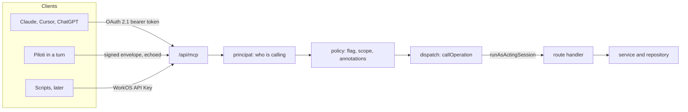

# The agent surface: one MCP server for everything a person can do

Everything a person can do in Piloti, an agent can do on that person's behalf,
through one MCP server at `/api/mcp`. This page is the long form of
[ADR-0121](../adr/0121-everything-a-person-can-do-an-agent-can-do.md): how the
server works, how to add an operation, how to connect a client, and how to set up
WorkOS. The rule for contributors, in short, is
[`../contributing/headless-first.md`](../contributing/headless-first.md).

Code: `frontends/ui/src/lib/agent-api/`. The route is `/api/mcp`.

## How it works



1. **The client calls `/api/mcp`.** An external agent presents a bearer token
   issued by WorkOS AuthKit. Piloti, inside a turn, echoes the turn's signed
   request-context envelope. Neither can reach a route any other way.
2. **Principal.** `principal.ts` turns the credential into a person. A token is
   checked for signature, issuer (`https://<WORKOS_AUTHKIT_DOMAIN>`) and audience
   (the MCP URL, RFC 8707). A token carries no permissions, so the person's
   membership, role and permissions are resolved on every call with
   `resolvePinnedRequesterSession` (ADR-0108).
3. **Policy.** `policy.ts` decides whether this call may run. The organization
   needs the `agent-mcp` flag for an external agent. Piloti in-product has no
   such flag, but its writes never run directly (see below).
4. **Dispatch.** `dispatch.ts` builds a `Request` from the operation's method and
   path and calls the route's exported handler in-process, inside
   `runAsActingSession`. The handler's factory then resolves the session (now the
   acting one), checks `authz`, charges the rate limit, opens the tenant slot and
   parses the body with the route's own schema.
5. **Route handler to service.** From here the call is the call the browser makes.

The dispatcher does not loop back over HTTP. A loopback request would need a
credential every route accepts, which is a second door.

### The acting session

Route handlers learn who is asking from `getGridSession()`, which reads the
AuthKit cookie. An agent has no cookie, so `getGridSession()` has one more
answer: the session bound by `runAsActingSession` (`acting-session.ts`) to the
async execution of one call. The binding ends with the callback, so a call cannot
leak its person into the next one.

**Only `lib/agent-api/dispatch.ts` enters it**, and only with a session built by
`resolvePinnedRequesterSession`. Never call `runAsActingSession` anywhere else.

### The person says yes or no

| Client | A read | A write |
|---|---|---|
| External agent | Runs | The client asks its user, driven by the tool annotations |
| Piloti in-product | Runs | Becomes an `operation` proposal. The person accepts it (it runs as them) or dismisses it (ADR-0105) |

`annotationsOf` in `operation.ts` states every hint: `readOnlyHint`,
`destructiveHint`, `idempotentHint`, `openWorldHint`. A hint left out would
default to "destructive" in the MCP specification.

## Modes

The server has two modes, as PostHog's does. MCP has no standard tool search, and
a client that lists 300 tools pays for them in every conversation.

| Mode | The client sees | Use it when |
|---|---|---|
| `discovery` (default) | `search-operations`, `describe-operation`, `call-operation`, `report-missing-capability` | Almost always. The agent searches, reads one schema, calls |
| `tools` | One MCP tool per operation, each with its annotations | A client or model that copes with a long list |

`report-missing-capability` is how an agent says "I wanted to do X and found
nothing". It emits `agent_capability_missing`.

## What deserves a tool

| Layer | What | Where |
|---|---|---|
| 1. Atomic operations | One per route method. The layer the rule is checked on | `lib/agent-api/catalog/` |
| 2. Task-shaped tools | Where an agent needs more than CRUD: retrieval, IFC, canvas | `src/aiq_agent/tools/`, served through the MCP in phase 2 |
| 3. Skills that teach composition | "To close out a project, do these five things" | Served as MCP prompts. Later |

The Python-only reads (`knowledge_search`, `read_passage`, `list_files`,
`view_knowledge_image`, `ifc_query`, `ifc_measure`, `ris_lookup`) reach the
server in phase 2 through an internal backend endpoint, so an external agent
searches with the retrieval Piloti uses.

A new workspace capability (a thing a person does) is a route and an operation.
It is not a new Python tool.

## Adding an operation

Do this in the same change that adds or changes the route. The exemplar is
`catalog/projects.ts`; copy its shape.

1. **Find the domain file** in `catalog/` (`projects`, `documents`, `folders`,
   `review`, `conversations`, `collaboration`, `tasks`, `skills`, `knowledge`,
   `bim`, `organization`, `platform`). A new domain is a new file, an entry in
   `AGENT_DOMAINS` (`operation.ts`) and a spread in `catalog/index.ts`.
2. **Share the schema.** The operation's `body` is the route's own zod schema,
   imported. If the schema is declared inside the route file, move it to a
   `lib/<area>/<x>-wire.ts` module (no `server-only`, no drizzle) and import it in
   both the route and the catalog (`lib/projects/project-wire.ts` is the
   example). Do the same for a query parsed with `parseQuery`. A second copy is
   the drift ADR-0055 exists to prevent.
3. **Write the entry.**

   ```ts
   {
     name: 'project-member-add',
     domain: 'projects',
     summary: 'Give someone a role on a project',
     description:
       'Assigns a project role to an organization member, or an empty `roleSlug` to clear it. ' +
       '`organizationMembershipId` comes from organization-member-list, not a user id. ' +
       'Needs project:members:manage. Check the result with project-member-list.',
     method: 'POST',
     path: '/api/projects/[id]/members',
     params: projectParams,
     body: addMemberSchema,
     idempotent: true,
     load: () => import('@/app/api/projects/[id]/members/route'),
   },
   ```

4. **Describe each path segment** in `params`: one key per `[segment]`, each with
   `.describe()` saying where the id comes from (`'The project id, from project-list.'`).
5. **State the annotations** the defaults do not get right (below).
6. **Run the gate**: `cd frontends/ui && bunx vitest run src/lib/agent-api/`. If
   your route was in the baseline, the "baseline only shrinks" test lists it;
   rewrite the file with `UPDATE_FIXTURES=1` and commit the diff.

### Naming

`<entity>-<verb>`, kebab-case, at most 52 characters, unique: `project-member-add`,
`document-version-approve`, `inbox-item-archive`. The verbs in use are list, get,
create, update, delete, rename, move, add, remove, search, export, run, cancel,
approve, reject, publish, submit, restore, archive and release. Pick one of them
before inventing another. One operation per route method; never two on the same.

### Descriptions

The description is the only guidance that reaches the model. It is at least 40
characters, in English, and says when to call the operation, what comes back,
where its ids come from and what to call next. Name the permission it needs when
that decides whether the call works. `summary` is one line, for search and for
`tools` mode.

### Schemas

`body`, `query` and `params` are zod and are exported to JSON Schema by
`lib/api/zod-json-schema.ts`, which refuses a node it cannot describe. If a shared
schema fails that (`z.custom`, `z.date`), extend the exporter when the node is
describable. Otherwise give the operation a looser `body` written for the agent
(`z.object({...}).passthrough()` with the describable fields) and a comment that
the route's schema is the gate. The route's schema is always the gate.

### Annotations

| Field | Set it when | Default |
|---|---|---|
| `readOnly: true` | A POST that only searches or computes | `method === 'GET'` |
| `destructive: true` | A person confirms it in a dialog: delete, revoke, release, purge | `method === 'DELETE'` |
| `idempotent: true` | Calling twice leaves the same state (a PUT-like PATCH) | GET, PUT, DELETE |

A hard delete with no restore is still catalogued, `destructive: true`, and says
in the description that it cannot be undone. The client asks the person.

### Not catalogued

A route that sends or returns bytes (multipart upload, binary download) is not
catalogued yet, because the dispatcher speaks JSON. It stays in the baseline.

### Sensitive operations

`sensitivity: 'access'` marks an operation that widens who may do what (sharing
grants, folder access, custom role definitions). `sensitivity: 'secret'` marks one
that touches the organization's secrets (LLM provider keys). The mechanism exists:
a sensitive operation is always `destructiveHint`, needs the organization's second
opt-in and a step-up OAuth scope (`403 insufficient_scope` without it), is only
proposed by Piloti, and a secret is write-only and never returned.

**No sensitive operation is catalogued yet.** They wait for an explicit
permission decision in the agent tooling. Until then the ratchet lists their
routes as uncovered. Do not catalogue one on your own initiative.

## Exemptions

A route that is not something a person does goes in `NOT_AN_AGENT_CAPABILITY` in
`agent-reachability.spec.ts`, keyed `METHOD /api/path` or `* /api/path`, with a
reason that fits in a line. The accepted reasons are transport (SSE, the realtime
channel, the proxies), browser sign-in plumbing (the AuthKit callback and
redirect) and typing indicators. "Nobody would ask an agent to do that" is not a
reason; an operation costs a few lines.

## The ratchet

`agent-reachability.spec.ts` walks every `app/api/**/route.ts` and fails when:

- a route method has no operation, no exemption and no baseline entry;
- the baseline lists a route that is now covered, exempt, or gone (it only
  shrinks);
- an operation is malformed: a duplicate or badly formed name, a short
  description, a `load` that imports a different route than `path`, params that
  disagree with the path, or a schema the JSON Schema export cannot describe.

`agent-reachability-baseline.json` holds the routes that predate the rule. It
never grows. `UPDATE_FIXTURES=1 bunx vitest run src/lib/agent-api/` rewrites it
after you cover a route, and the diff is the review.

## Telemetry

Two PostHog events, sent through the collector (ADR-0119):

| Event | When | Use |
|---|---|---|
| `agent_operation_called` | Each call: operation name, client, status | Which operations agents use, and which fail |
| `agent_capability_missing` | An agent calls `report-missing-capability` | The backlog of operations nobody has written |

## How Piloti uses it

Piloti reaches the workspace through the same server, as one more client. In a
turn it echoes the turn's signed request-context envelope; the BFF resolves the
person it names and builds the pinned session. Python never signs an envelope. A
read runs. A write never runs: it becomes an `operation` proposal, shown as a card,
that the person accepts or dismisses (ADR-0105). The accepting person's session is
the one the operation runs in.

## Connecting a client

The server's URL is `https://<app-host>/api/mcp`, for example
`https://app.piloti.at/api/mcp`. Sign-in is the WorkOS sign-in the person already
uses, run as OAuth. An organization admin must turn on the `agent-mcp` feature
flag for the organization first; without it the server refuses the person's
agent.

**Claude Desktop** (custom connector): Settings, Connectors, add a custom
connector, paste the URL, sign in when the browser opens.

**Claude Code**:

```bash
claude mcp add --transport http piloti https://<app-host>/api/mcp
```

Then run `/mcp`, pick `piloti`, and sign in.

**Cursor**: in `~/.cursor/mcp.json` or the project's `.cursor/mcp.json`:

```json
{ "mcpServers": { "piloti": { "url": "https://<app-host>/api/mcp" } } }
```

Cursor opens the sign-in on first use.

A client that does not support OAuth cannot connect yet. Scripts get WorkOS API
Keys later.

## WorkOS dashboard setup

Once per WorkOS environment, by a person with dashboard access. Nothing here is
applied by the deploy.

1. **Enable MCP auth** for the environment (AuthKit, Connect, MCP).
2. **Enable Client ID Metadata Documents (CIMD).** This is how current MCP
   clients register. Prefer it.
3. **Enable Dynamic Client Registration (DCR)** for older clients that predate
   CIMD.
4. **Register the MCP URL as a Resource Indicator** (RFC 8707):
   `https://<app-host>/api/mcp`. Tokens are audience-bound to it, and the server
   rejects a token that names another audience.
5. **Create the feature flag `agent-mcp`**, off by default, in the same
   environment. Turn it on per organization.
6. **Set the environment variables** on the frontend service, and add their rows
   to the deployment (they are in
   [`../deployment/environment-variables.md`](../deployment/environment-variables.md)):
   - `WORKOS_AUTHKIT_DOMAIN`: the AuthKit domain, without scheme. Unset, the
     external door answers 503 and Piloti in-product still works.
   - `GRID_MCP_RESOURCE_URL`: the MCP URL, when it differs from the origin of
     `WORKOS_REDIRECT_URI` plus `/api/mcp`.

The protected-resource metadata (RFC 9728) is served by the app and names the
authorization server; a client reads it from the `WWW-Authenticate` challenge on
its first, unauthenticated call. The routes that serve it use `publicApiRoute`
and are covered by ADR-0121.

## Related

- [ADR-0121](../adr/0121-everything-a-person-can-do-an-agent-can-do.md): the decision and the options that lost.
- [ADR-0055](../adr/0055-api-first-workspace-primitives.md): one HTTP surface per primitive.
- [ADR-0105](../adr/0105-piloti-works-on-shared-objects.md) and [`proposed-changes.md`](proposed-changes.md): proposals, the person decides.
- [ADR-0108](../adr/0108-background-runs-act-as-the-person-who-commissioned-them.md): resolving the person on every call.
- [`adding-a-tool.md`](adding-a-tool.md): the Python tools, for task-shaped reasoning.
