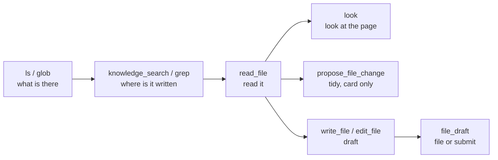

# Agent tool surface

> Which tools Piloti's chat agent is given, what each costs on every call, why
> the set looks the way it does, and what to change next. Code comments in
> `packages/knowledge-layer/src/browse.py`, `packages/agent/src/agent/tools/files/register.py`
> and `configs/config_oib_openrouter.yml` point here for the reasons behind a
> merge or a split. Written 2026-09-30. Token counts are the tool serialized as
> OpenAI tool JSON, divided by four, on a project turn.

## 1. Principles

We apply the published guidance:

- **Consolidate tools a person thinks of as one act**, return names rather than
  IDs, paginate with a default, and make truncation and errors name the next
  call ([Anthropic, writing tools for agents][a-tools]).
- **Fetch just in time by identifier.** A bloated tool set is "one of the most
  common failure modes" ([Anthropic, context engineering][a-context]).
- **Keep fewer than 20 functions**, use enums so invalid states cannot be
  expressed, combine functions always called in sequence, and do not make the
  model fill arguments the caller already knows ([OpenAI, function
  calling][oai-fc]).
- **Parameter guidance goes in the description or the schema.** NAT's
  `FunctionInfo.from_fn` builds the schema from the signature with bare
  `Field(default=…)` and the LangChain wrapper passes only `fn.description`, so a
  docstring `Args:` section never reaches the model
  (`nat/builder/function_info.py`, `nat/plugins/langchain/tool_wrapper.py` in
  the installed `nvidia-nat` 1.9.0). Fixed values belong in a `Literal`.

Tool retrieval pays off on catalogs of
hundreds or thousands of tools ([RAG-MCP][rag-mcp], [Less is More][less-more],
[Gorilla/BFCL][bfcl]). Piloti binds 32, past OpenAI's line of 20 since the canvas group (§2). Of a 33.4k-token research call,
26.1k are a cached prefix, and tool execution is 1.3 s of a 31.3 s median turn
([turns audit](../audit/turns-per-answer-audit-2026-09.md),
[turn latency](../audit/turn-latency-measured-2026-09.md) §2). Seconds follow rounds and
reasoning tokens: one round thought for 4,335 tokens (54 s) before asking for
two passages ([turns audit](../audit/turns-per-answer-audit-2026-09.md)). At this size,
the lever is how many rounds a question takes and what each result tells the
model to do next.

## 2. The surface today

A project turn binds 32 tools, about 17.9k tokens (the workspace group added four, 635; the canvas group replaced
the one `document_annotations` tool, 940 tokens, with seven, 1,625; parity with
a person, 2026-10-13, added `canvas__update` and `canvas__delete` and `mark`'s
`open`, +502, to nine and 2,127). Tool schemas were 38 % of a
research call's input ([turns audit](../audit/turns-per-answer-audit-2026-09.md)).

| Tool | What it does | ~Tokens | Owner |
|---|---|---|---|
| `ifc_measure` | Runs IfcOpenShell/OCCT over the model's bytes: areas, heights, clearances | 6,350 | `packages/agent/src/agent/tools/bim/measure_register.py` |
| `ifc_query` | Reads the extracted IFC index | 2,300 | `packages/agent/src/agent/tools/bim/register.py` |
| `knowledge_search` | On Piloti's chat (ADR-0133 slice 6): ranked search only, with `path=` for scope and the result budget in its description; `folder`, `shelf`, `file_name` stay accepted, hidden, for one release, and a `match=` call is rejected naming the `grep` call that replaces it (`common/retired_calls.py`); only where `filesystem` is configured. For deep research, intake and the door, the full contract: ranked search; `match="exact"` is Ctrl+F across the files, `match="regex"` is grep (Python syntax, case-insensitive, needs a literal word or `folder`/`file_name`/`doc_class`, refused when it backtracks), `context=0..3` adds lines around each hit, and a scan that hits its 500-passage limit says its counts are lower bounds with a per-file upper bound from one Qdrant facet; `stemmed=true` (exact only) adds the inflected forms through a German-stemmed full-text index on a second text field (`text_stem`), the literal matches kept. `group_by="document"` (ranked only) returns one entry per document keyed by `grid_document_id`: its best passage, and a trailer table of passages in the ranked pool and pages, grouped client-side because a fused query cannot be grouped by Qdrant. For an organization with the `folder-cards` flag, one dense query over the folder card points (`kind=folder`) prints up to three `Folder:` lines after the passages, never a citation | 650 on Piloti's chat (o200k, 2026-10-27); 1,450 with the literal modes | `packages/knowledge-layer/src/register.py`, Piloti's contract `packages/knowledge-layer/src/chat_binding.py` |
| `ris_lookup` | Austrian law by citation | 760 | `packages/ris-adapter/src/lookup/tool.py` |
| `read_passage` | Opens one Punkt, page, page range (`pages="4-6"`, ≤30 pages, ~6k tokens, `cursor` to continue) or outline. Deep research, intake and the door; Piloti's chat reads with `read_file`; a `read_passage` call there is answered by the tool node with the tools it has | 730 | `packages/knowledge-layer/src/read_passage.py` |
| `list_files` | Browse: folder, name, Dokumentart, date, paged, uncapped; opens with the selection's document types (`Dokumentart (assigned by Piloti): …`); output labels are English, domain words (Dokumentart, Fassung, Plankopf) and file names stay. `view="tree"` (`depth` 1-4) returns a tier-0 card per folder instead (direct and subtree counts, Dokumentart mix, pages, dates, current Fassung per series), bounded at 30 cards, and rows show page counts when stored and closes by saying unreadable files are not listed (they are in `documents_unreadable:`). `revisions_of=<file name>` returns one document's chain of Fassungen instead, and with `compare_to=` what changed between two of them. On Piloti's chat the tree view is left out (`ls(depth=…)` draws the tree); the date filter, paging and Fassungen stay | 770 | `packages/knowledge-layer/src/browse.py` |
| `surface_documents` | Shows a file or a 1–3 thumbnail choice | 510 | `packages/agent/src/agent/cards/surface_documents.py` |
| `ask_user` | Blocking multiple-choice question | 490 | `packages/agent/src/agent/agents/piloti/ask_user.py` |
| `remember` | Project memory capture | 420 | `packages/agent/src/agent/memory/register.py` |
| `create_task` | Delegates work as a task | 400 | `packages/agent/src/agent/tools/tasks/register.py` |
| `propose_file_change` | Move, rename, create folder, assign; proposes only | 390 | `packages/agent/src/agent/tools/files/register.py` |
| `canvas__room`, `canvas__point`, `canvas__highlight`, `canvas__marks`, `canvas__mark`, `canvas__update`, `canvas__delete`, `canvas__reply` | The review canvas, one NAT function group (looking is `look`, below): who is in the document and where, point and highlight for everyone, read Anmerkungen, propose one (a person takes it over) or, with `open=true`, set one the person asked for, change one (status, assignee, date, kind, text, with a required `note` posted in its thread) or delete one when the person asks, answer in a thread. Each takes an optional `document`; the default is the document open on the canvas, then the conversation's subject | 217 / 161 / 184 / 216 / 140 / 578 / 303 / 141 / 187 (2,127) | `packages/agent/src/agent/tools/canvas/register.py` |
| `workspace__search`, `workspace__describe`, `workspace__call`, `workspace__report_missing` | Piloti as a client of its own MCP server (ADR-0122), the same four meta-tools an external agent gets in `search` mode: find an operation, read its schema, call it as the asker (a write comes back as a proposal), or report a missing operation. Four tools instead of the hundreds of operations behind them. Each call echoes the turn's envelope. English since October 2026, like everything an agent reads | ~200 / ~120 / ~160 / ~105 (~585, estimated from length after the English rewrite, not re-measured) | `packages/agent/src/agent/tools/workspace/register.py` |
| `look` | Shows a page, a region of it or an embedded image to the model, in every context (ADR-0128) | 300 | `packages/agent/src/agent/tools/look/register.py` (renderer `packages/knowledge-layer/src/view_image.py`) |
| `ls`, `read_file`, `glob`, `grep` | The filesystem verbs over one namespace (ADR-0133, [`agent-filesystem.md`](agent-filesystem.md)): the office's documents under `/project/`, `/office/`, `/chat/`, `/law/oib/` (read-only, `read_file` and `grep(output_mode="content")` return grounding blocks, one per page, citing `file, p.N`), the drafts under `/drafts/` (stock DeepAgents) and the turn's skills under `/skills/` (ADR-0135, `read_file` only, read-only). `grep` is literal by default, `mode="regex"` opts in, and an incomplete search is never a no. Bound on every turn with `filesystem: knowledge_search`, in place of `read_passage` and the literal `knowledge_search` (slice 6). Each description is a contract and the schema fields are bare, apart from `conclusion` on `grep` and `read_file`. Without an estate backend the drafts' four verbs and the skills' `read_file` are bound as before | 229 / 390 / 187 / 586 (o200k, description and schema, 2026-10-27; 348 / 648 / 370 / 823 as OpenAI tool JSON / 4 before slice 6) | `packages/agent/src/agent/tools/documents/filesystem.py`, `packages/knowledge-layer/src/estate*.py` |
| `write_file`, `edit_file` | Draft working directory (DeepAgents stock), `/drafts/` only, write-once | 160 / 176 (o200k, 2026-10-27) | `packages/agent/src/agent/tools/documents/tools.py` |
| `file_draft` | Files a draft; `submit=True` sends it for review | 190 | `packages/agent/src/agent/tools/documents/register.py` |
| web search, advanced web search | Tavily | ~400 together | `packages/tavily-web-search/src/register.py` |

The `ifc_*` pair is 8.65k of the 17.3k (the turns audit measured ~8.2k).

The first three steps are the list, search and read split that OpenAI's deep
research connectors ([search/fetch][oai-mcp]), Glean ([Read
Document][glean-read]) and Claude Code ([tools reference][cc-tools]) all
converge on. Writes are proposals a person accepts, as the MCP filesystem
server's `dryRun` is ([servers][mcp-fs]).

## 3. Decisions and why

**Merged in this change set.**

- Four proposal tools became `propose_file_change(operation=move|rename|create_folder|assign)`.
  They shared the card, resolver and refusals, and cost ~760 tokens for one act
  (`packages/agent/src/agent/tools/files/register.py`). The card's `operation`
  vocabulary is unchanged, so stored cards still read.
- `submit_draft` became `file_draft(submit=…)` (`packages/agent/src/agent/tools/documents/register.py`).
- Exact search is `knowledge_search(match="exact")`, not a `find_in_files` tool:
  same verb, same scope, same narrowing arguments, and the same base-corpus store
  filter (`_base_collection_filters`: no excluded edition, no cover page), so both
  modes cite the same passages (`packages/knowledge-layer/src/browse.py`). A store
  outage is reported as "the search did not run", never as "no match".
  `match="regex"` is the same search over a person's pattern: Python syntax via the
  `regex` package (it has the match timeout `re` lacks; 0.2 s per chunk, the first
  overrun stops the search and says it is not a result), at most 300 characters,
  never one that matches the empty string. The scan is narrowed on the server by the
  literal words every match must hold (`qdrant/retrieval.user_literal_tokens`, which
  prefers no word to a wrong one), so a pattern with no such word runs only inside a
  `folder`, `file_name` or `doc_class`. A folder is pushed into the query as
  `folder_ancestors` through `scope_filter`, as in the ranked search, not turned into
  a file list. `context=0..3` prints the lines around every hit (at most 40 lines,
  marked `>` on the hit) under the passages; it is an index, only the passages are
  citable. When a collection's scan stops at 500 matching passages the table says
  "at least" and adds one facet over `file_name` (`store.facet_counts`) under the same
  word filter: per file, the passages that hold the words, an upper bound beside the
  counted lower bound.
  A count is one per place in the document, not per stored chunk
  (`packages/knowledge-layer/src/chunk_positions.py`). The heading breadcrumb a section
  or Punkt chunk opens with (`A › B`, the Richtlinie's label, a table caption repeated
  on every part) is never matched; a section's own heading, which the breadcrumb is the
  only copy of, counts once, on the section's first part. A match inside the overlap a
  chunk repeats from its predecessor (`chunk_ordinal − 1` among the returned chunks) is
  the predecessor's, and a chunk left without a match of its own is no passage. The
  context lines, the distinct strings of a regex and the Herleitung row's hits and
  documents are counted the same way. A point without `chunk_ordinal` is matched
  against the ordinal-less chunks of its own page and otherwise counts as stored. A
  capped scan whose passages held the words only in breadcrumbs or overlaps says it is
  not a no.
- `list_files` replaces the 50-row prompt inventory as the way to see a
  project. It is uncapped and paged, facets by folder, name, `doc_class` and
  date, and lists in-flight files. It drops the shelves the turn did not ask for,
  as the search does, and its rows are an index: they register no citable source
  (`packages/agent/src/agent/citations/session.py`). Tools resolve names against the uncapped
  inventory, which fixes the 51st-file bug, and rows carry `added_at`.
- Earlier: `emit_card` left chat, `ris_lookup` collapsed, parallel calls are
  capped at 12, and errors teach (`packages/agent/src/agent/common/tool_errors.py`).

**Kept separate.**

- `ifc_query` and `ifc_measure`: separate entry points so `ifc_query` works
  where IfcOpenShell and shapely are not installed (`pyproject.toml`,
  `aiq_bim_measure`). The cost fix is scope (§5 row 2), not a merge.
- `knowledge_search` and `read_passage`: the search and read split above.
- The draft verbs keep their names. They are DeepAgents stock names, stored
  turns hold them, and names persist in `functionName` and
  `get_source_id_for_tool`. The real fix is the single namespace in
  [`piloti-filesystem-design.md`](piloti-filesystem-design.md) §3 and §6.

**Measured and rejected.** Do not re-propose without new evidence.

- Client BM25 tool narrowing (`piloti/tool_search.py`, removed 2026-10-27):
  off, 71 % recall of the answering tool
  ([hobble register](hobble-register-2026-09.md) row 20).
- A `search_tools` tool: it costs a round.
- Provider-native deferral ([ADR-0048](../adr/0048-tool-schemas-stay-with-the-provider.md)):
  luna, sol, sonnet-5 and gemini-3.7-flash echoed the flag and billed the
  schemas in full ([turns audit](../audit/turns-per-answer-audit-2026-09.md)). Off
  since 2026-09-25, code removed 2026-10-27; a standards-based tool search
  replaces it in its own change.
- Narrowing tools on a guess about intent:
  [ADR-0052](../adr/0052-one-answering-agent-no-intent-router.md) and
  [ADR-0064](../adr/0064-a-decision-model-decides-and-never-withholds.md)
  forbid withholding a tool on a decision. Scope is a fact, not a guess, which
  is why a turn without a project gets no `ifc_*`.
- `response_format: concise`: the verifier parses the grounding block.
- Programmatic tool calling: needs a sandbox, and code-execution MCP adds 16
  attack classes ([arXiv 2602.15945][ce-mcp]).

**Pending.**

- `surface_documents` retires from chat (§6). File names in an answer already
  render as openable chips (`apps/workspace/ui/features/chat/lib/file-references.ts`),
  `list_files` covers discovery, and four tools over one index each spend a
  paragraph saying not to call the others ([hobble register](hobble-register-2026-09.md) row 13).
  The loss is the 1–3 thumbnail grid unless `list_files(show=true)` replaces it.
- `look` could become `read_passage(view="image")`. Effort M.

## 4. What a person can do to a file and the agent cannot

| Act | Person's route | Verdict | Effort |
|---|---|---|---|
| Read a page range or a whole short document | PDF viewer, `/api/documents/[id]/preview` | Page ranges: built (`read_passage(pages=…, cursor=…)`, ADR-0127). A whole short document: a range over all its pages | M |
| Archive | `POST /api/documents/[id]/archive` | Propose. The chunks are purged and bytes and versions stay (`apps/workspace/bff/documents/version-content.ts`); `POST /api/documents/[id]/unarchive` brings it back and reads it again (`lib/documents/unarchive.ts`) | S |
| Rename, move or delete a folder | `PATCH`/`DELETE /api/projects/[id]/folders/[folderId]` | Propose. Delete re-files the folder's documents first | S |
| Retag | `PATCH /api/documents/[id]/tags` | Propose | S |
| Revise any Markdown project document | `POST /api/documents/[id]/versions` | Build. Today only the conversation's subject (`packages/agent/src/agent/tools/documents/filing.py`) | M |
| See version history, uploader, lifecycle state | `GET /api/documents/[id]/versions` | Fassungen under other file names: done (`list_files(revisions_of=…)`). Same-name versions and uploader: add to `list_files` rows | S |
| Compare versions | `GET /api/documents/[id]/versions/diff` | Fassungen under other file names: done (`list_files(revisions_of=…, compare_to=…)`, ADR-0104). Same-name versions once every Fassung stays indexed | M |
| Share | `/api/sharing/[resourceType]/[resourceId]` | Person only | none |
| Set Dokumentart | platform-only `/api/platform/knowledge/documents/[fileName]/doc-class` | Waits for a project route | n/a |
| Delete a document | `DELETE /api/documents/[id]` | Never. Hard delete, one-way | none |

## 5. Roadmap, ranked by value per effort

Row 1 comes first: nothing below it is measurable without it. Every
turn measurement so far ran without a project (`scripts/turn_census/suite.py`),
the answer suite skips own-file questions
([testing](../contributing/testing-and-verification.md#the-answer-suite)),
`list_files` and exact search have never been measured, and PostHog holds no
LLM events for 30 days, so there is no per-tool usage or error rate.
**PD** marks a product decision.

| # | Item | Why | Files | Effort | Measure |
|---|---|---|---|---|---|
| 1 | Project-file eval fixture with `expect.tools` (`must`, `must_not`, `max_research_calls`) | 2 of 29 loop-eval rows are own-file, both skipped; `Run.tool_calls` is already recorded | `tests/fixtures/derivation/loop_eval_questions.yaml`, `scripts/turn_census/suite.py`, `evals/oib-retrieval` | S–M | ~20 `pf-*` rows: pass rate, research calls, `status:repeat`/`width`/`budget` = 0 |
| 2 | Bind `ifc_*` only when the project has a readable model | −8.2k tokens and a distractor; outside that scope both return "no model" | `packages/agent/src/agent/agents/piloti/register.py` (`_tools_in_scope`), BFF project context | S–M | Input tokens per call by scope; model questions in the answer suite; a model uploaded mid-conversation binds next turn |
| 3 | Prefetch the IFC `briefing` in round 0 | `modell` prefetches nothing while the tool says "CALL 'briefing' FIRST"; a taught sequence is an incomplete contract ([ADR-0060](../adr/0060-three-instruction-layers-and-tools-that-answer.md)); OpenAI: combine sequential calls | `packages/agent/src/agent/agents/piloti/decisions.py`, `packages/agent/src/agent/tools/bim/measure_register.py` | S–M | Rounds on model questions |
| 4 | Read page ranges (built: `pages`, `cursor`), and whole documents under ~15–25k tokens | A printed page ≠ stored page cost two extra rounds; Claude Code `Read(pages)`; long context beats RAG when affordable ([Li et al.][li-2024], [contextual retrieval][a-cr]) | `packages/knowledge-layer/src/read_passage.py`, a per-page store at ingest, decided in [ADR-0134](../adr/0134-extracted-page-text-is-stored-per-version.md) and read through `read_file` ([`agent-filesystem.md`](agent-filesystem.md)) | M | Rounds and truncation on outline and page rows |
| 5 | Truncation notes that name the next call | Grounding hits end in a bare `[truncated]` (`packages/agent/src/agent/common/grounding_block.py`), BIM lists say "N weitere" (`packages/agent/src/agent/tools/bim/rendering.py`); `list_files` already names `offset=` | those two, `packages/ris-adapter/src/lookup/grammar.py` | S | Re-fetches of the same document per turn |
| 6 | Count argument rejections per tool, then `Literal` enums for fixed-value parameters | `is_argument_rejection` only sets a log level (`packages/agent/src/agent/common/callbacks.py`); NAT drops `Args:`; OpenAI: enums | `packages/agent/src/agent/common/callbacks.py`, tool input models | S, then M | `status:tool_rejected:<tool>`; schema work above ~2 % |
| 7 | New `propose_file_change` operations: folder rename/move/delete, retag, archive with warning. **PD** for archive | Routes exist (§4); the BFF stays the single writer | `packages/agent/src/agent/tools/files/`, UI card executor | S each | Card accept rate; tidy-up fixture rows |
| 8 | ~~Re-probe `openrouter:tool_search`~~ **Closed 2026-10-27**: the self-rolled deferral (`common/deferred_tool_loading.py`) is removed and ADR-0048 superseded; a standards-based tool search is built new in its own change | Now server-managed and "works on any model and any provider" ([tool search][or-ts]); ADR-0048 measured the provider-native path | none | - | The new change measures: ballast probe tokens; BIM recall; NAT trace parses it (#635) |
| 9 | Title-block metadata (Plannummer, Index, Maßstab, Datum, Geschoss) as `list_files` facets | v4 analysis has none of these; title-block reading is a VLM strength ([visual ingestion](visual-ingestion.md)); a drawing-layout benchmark reports F1 0.911 for Qwen3-VL ([arXiv 2607.18997][aec-layout]); Autodesk extracts them ([Autodesk][adsk]) | `packages/knowledge-layer/src/llamaindex/visual_analysis.py`, `packages/knowledge-layer/src/browse.py` | M | Field exact-match on the fixture |
| 10 | `list_changes(since)` | "What came in since Monday"; Gemini Drive updates ([Drive][gdrive-updates]); `added_at` is on rows | `packages/knowledge-layer/src/browse.py` | S–M | Fixture row |
| 11 | `extract_table` across documents, as a background job. **PD** | The dominant multi-document shape ([Harvey][harvey], [NotebookLM][nblm], [Box][box]); one agent holding the grid hallucinated calls ([Hebbia][hebbia]) | new tool, task runner | L | Cell accuracy against the fixture |
| 12 | `compare_versions` | Every version's bytes are kept ([ADR-0054](../adr/0054-document-versions-and-the-publish-door.md)); [Bluebeam][bluebeam] overlay is the reference | new tool over `/versions/diff` | L | Planted changes in a two-revision fixture |
| 13 | `open_document` with native PDF input | Tool outputs may carry `input_file` ([Responses tool calling][or-resp-tools]); gate on the model's `file` modality and pin `engine: native`, because the `mistral-ocr` fallback bills OpenRouter's key (bypasses BYOK) and ZDR does not cover plugins ([PDF][or-pdf], [ZDR][or-zdr]) | `packages/knowledge-layer/src/view_image.py` | M | Tokens per page against 3,896 rendered; the `EI2 30-C` scan |
| 14 | Contextual chunk headers | −35 % top-20 failures, −49 % with BM25 ([contextual retrieval][a-cr]); only `file_name` and `page_label` reach the embedded text | `packages/knowledge-layer/src/llamaindex/section_chunking.py` | S | Dense and lexical arms on fixture qrels |
| 15 | German compound splitting. Inflection is done: `knowledge_search(match="exact", stemmed=true)` matches `Fluchtwegbreite` and `Fluchtwegbreiten` both ways through a Snowball German index ([ADR-0127](../adr/0127-search-finds-list-orients-read-reads.md)); a compound part still is not | `Fluchtwegbreiten` is unreachable from `Fluchtweg` (`packages/agent/src/agent/common/german_text.py`); [Braschler & Ripplinger][braschler]; [Postgres Hunspell][pg-dict] | `packages/agent/src/agent/common/german_text.py`, the `tsv` config | M | Lexical recall@k |
| 16 | EU in-region routing. **PD** (plan tier) | No provider-region constraint today (`docs/compliance/external-dependencies.md`); needs Business/Enterprise; web search unavailable there ([IRR][or-irr]) | model picker, org settings | S–M | Latency; override models that drop out |
| 17 | `cache_control` for Claude and Gemini overrides | A Claude override re-sends its prefix uncached 3–6 times per turn ([prompt caching][or-cache]) | `packages/agent/src/agent/common/prompt_caching.py` | S | `cached_tokens` per model family |
| 18 | Provider metadata in traces | `X-OpenRouter-Metadata` returns routing decisions ([router metadata][or-meta]); rows 8 and 17 need it | LLM client headers | S | Provider and fallback per call |

## 6. Open decisions for the product owner

1. **Retire `surface_documents` from chat?** Saves ~510 tokens and one of four
   overlapping tools. Loses the 1–3 thumbnail grid unless `list_files(show=true)`
   renders one.
2. **May the agent propose archiving?** Archiving purges chunks; unarchiving
   (`document-unarchive`) reads the document again, so undoing it costs a re-ingest.
3. **EU in-region routing** needs an OpenRouter Business or Enterprise plan and
   removes OpenRouter web search in that region.

## 7. Sources

Repo: `pyproject.toml`; `configs/config_oib_openrouter.yml`;
[ADR-0003](../adr/0003-nextjs-bff-and-stateless-python-agent.md),
[0048](../adr/0048-tool-schemas-stay-with-the-provider.md),
[0052](../adr/0052-one-answering-agent-no-intent-router.md),
[0054](../adr/0054-document-versions-and-the-publish-door.md),
[0060](../adr/0060-three-instruction-layers-and-tools-that-answer.md),
[0064](../adr/0064-a-decision-model-decides-and-never-withholds.md);
[turns audit](../audit/turns-per-answer-audit-2026-09.md),
[turn latency](../audit/turn-latency-measured-2026-09.md),
[hobble register](hobble-register-2026-09.md),
[filesystem design](piloti-filesystem-design.md),
[visual ingestion](visual-ingestion.md); the code paths in the tables above.

External:

[a-tools]: https://www.anthropic.com/engineering/writing-tools-for-agents
[a-context]: https://www.anthropic.com/engineering/effective-context-engineering-for-ai-agents
[a-cr]: https://www.anthropic.com/news/contextual-retrieval
[oai-fc]: https://developers.openai.com/api/docs/guides/function-calling
[oai-mcp]: https://developers.openai.com/api/docs/mcp
[cc-tools]: https://code.claude.com/docs/en/tools-reference
[mcp-fs]: https://github.com/modelcontextprotocol/servers/tree/main/src/filesystem
[glean-read]: https://docs.glean.com/agents/actions/glean/read-document
[rag-mcp]: https://arxiv.org/abs/2505.03275
[less-more]: https://arxiv.org/abs/2411.15399
[bfcl]: https://gorilla.cs.berkeley.edu/leaderboard.html
[ce-mcp]: https://arxiv.org/abs/2602.15945
[li-2024]: https://arxiv.org/abs/2407.16833
[aec-layout]: https://arxiv.org/abs/2607.18997
[braschler]: https://doi.org/10.1023/B:INRT.0000011208.60754.a1
[pg-dict]: https://www.postgresql.org/docs/current/textsearch-dictionaries.html
[harvey]: https://www.harvey.ai/blog/collaborative-review-tables
[hebbia]: https://www.hebbia.com/blog/divide-and-conquer-hebbias-multi-agent-redesign
[nblm]: https://blog.google/innovation-and-ai/models-and-research/google-labs/notebooklm-data-tables/
[box]: https://developer.box.com/guides/box-ai/ai-tutorials/extract-metadata-structured
[gdrive-updates]: https://support.google.com/drive/answer/16686465
[adsk]: https://construction.autodesk.com/workflows/artificial-intelligence-construction/
[bluebeam]: https://support.bluebeam.com/revu/how-to/use-smart-overlay.html
[or-ts]: https://openrouter.ai/docs/guides/features/server-tools/tool-search
[or-resp-tools]: https://openrouter.ai/docs/api_reference/responses/tool-calling
[or-pdf]: https://openrouter.ai/docs/guides/overview/multimodal/pdfs
[or-zdr]: https://openrouter.ai/docs/guides/features/zdr
[or-irr]: https://openrouter.ai/docs/guides/features/in-region-routing
[or-cache]: https://openrouter.ai/docs/guides/best-practices/prompt-caching
[or-meta]: https://openrouter.ai/docs/guides/features/router-metadata

- Anthropic: [writing tools for agents][a-tools], [context engineering][a-context], [advanced tool use](https://www.anthropic.com/engineering/advanced-tool-use), [code execution with MCP](https://www.anthropic.com/engineering/code-execution-with-mcp), [contextual retrieval][a-cr], [building agents](https://www.anthropic.com/engineering/building-effective-agents), [Files](https://platform.claude.com/docs/en/build-with-claude/files), [citations](https://platform.claude.com/docs/en/build-with-claude/citations), [search results](https://platform.claude.com/docs/en/build-with-claude/search-results), [Claude Code tools][cc-tools]
- OpenAI: [function calling][oai-fc], [tool search](https://developers.openai.com/api/docs/guides/tools-tool-search), [file search](https://developers.openai.com/api/docs/guides/tools-file-search), [retrieval](https://developers.openai.com/api/docs/guides/retrieval), [Codex #13062](https://github.com/openai/codex/issues/13062), [MCP for deep research][oai-mcp]
- MCP: [filesystem server][mcp-fs]
- Enterprise: [Microsoft 365 Copilot retrieval](https://learn.microsoft.com/en-us/microsoft-365/copilot/extensibility/api/ai-services/retrieval/copilotroot-retrieval), [Glean filters](https://docs.glean.com/user-guide/advanced/advanced-search-filter), [Glean facets](https://developers.glean.com/guides/search/faceted-filters), [Glean Read Document][glean-read], [Box AI extract][box], [Harvey review tables][harvey], [Harvey actions](https://www.harvey.ai/blog/review-table-agent-actions), [Hebbia][hebbia], [NotebookLM data tables][nblm], [Gemini in Drive folders](https://workspaceupdates.googleblog.com/2024/12/adding-folder-support-to-gemini-in-side-panel-of-google-drive.html), [Drive updates][gdrive-updates], [Notion](https://www.notion.com/help/enterprise-search)
- AEC: [Autodesk AI][adsk], [AU2026](https://architosh.com/2026/09/au2026-autodesk-expands-forma-and-leverages-ai/), [Bluebeam Smart Overlay][bluebeam], [Procore](https://www.enr.com/articles/63042-procore-releases-new-ai-agients-after-datagrid-integration), [Procore Agent Builder](https://v2.support.procore.com/product-manuals/agent-builder-project), [Trunk Tools](https://trunktools.com/product/), [Document Crunch](https://www.documentcrunch.com/crunch-ai)
- Research: [RAG-MCP][rag-mcp], [Less is More][less-more], [Trace-Free+](https://arxiv.org/abs/2602.20426), [CE-MCP security][ce-mcp], [BFCL][bfcl], [Li et al. 2024, RAG vs. long context][li-2024], [AEC layout benchmark][aec-layout], [ColPali](https://arxiv.org/abs/2407.01449), [Braschler & Ripplinger 2004][braschler], [Postgres dictionaries][pg-dict]
- OpenRouter: [changelog](https://openrouter.ai/docs/changelog), [Responses](https://openrouter.ai/docs/api_reference/responses/overview), [reasoning](https://openrouter.ai/docs/guides/best-practices/reasoning-tokens), [tool calling](https://openrouter.ai/docs/guides/features/tool-calling), [tool search][or-ts], [server tools](https://openrouter.ai/docs/guides/features/server-tools), [Responses tool calling][or-resp-tools], [PDF inputs][or-pdf], [ZDR][or-zdr], [in-region routing][or-irr], [prompt caching][or-cache], [router metadata][or-meta], [Auto Exacto](https://openrouter.ai/docs/guides/routing/auto-exacto), [Exacto](https://openrouter.ai/docs/guides/routing/model-variants/exacto), [embeddings](https://openrouter.ai/docs/api_reference/embeddings), [web search](https://openrouter.ai/docs/guides/features/server-tools/web-search), [response healing](https://openrouter.ai/docs/guides/features/plugins/response-healing)

## These read tools are also served over MCP

Added 2026-10-21 (ADR-0122, everything a person can do an agent can do). Piloti's
MCP server (`/api/mcp`) offers the BFF's operations, and these seven reads of
the agent beside them, so Claude, Cursor or ChatGPT search the office's
documents with the tool Piloti searches with.

| MCP operation | Tool the chat model sees | Needs |
|---|---|---|
| `knowledge-search` | `knowledge_search` | `projectId` |
| `passage-read` | `read_passage` | `projectId` |
| `files-list` | `list_files` | `projectId` |
| `document-look` | `look` | `projectId` |
| `ifc-query` | `ifc_query` | `projectId` |
| `ifc-measure` | `ifc_measure` | `projectId` |
| `law-lookup` | `ris_lookup_tool` | nothing |

- **One description.** The MCP description and input schema are the ones in this
  document, generated from the functions into
  `apps/workspace/tests/fixtures/backend-tools.schema.json`
  (`uv run python scripts/generate_backend_tools_schema.py`).
  `packages/agent/tests/common/test_backend_tools_schema.py` fails when it is stale,
  so changing a description here and not regenerating shows an outside agent a
  tool that no longer exists. An MCP client reads the same words the model does,
  and the token costs in §2 are its costs too.
- **The path.** `lib/agent-api/backend-operations.ts` builds the call: it checks
  the person may chat in the project, resolves the turn context and collection
  scope exactly as a chat turn does (`resolveTurnContext`), signs the request-
  context envelope, and posts `{ arguments }` to the `api` role's
  `POST /v1/internal/tools/{name}` with the internal token. The route verifies
  the envelope (signed, naming a user and an organization, current), lays it
  where the tools read a turn's headers, and runs the named function from the
  built workflow. It never signs (ADR-0108). The BFF is the signer, the backend
  the echo.
- **Reads only.** The allowlist is `BACKEND_READ_TOOLS`
  (`packages/agent/src/agent/common/backend_tools.py`); any other name is a 404 before the
  workflow is asked. A write stays a BFF route, and Piloti's own writes stay
  proposals. A tool added to the allowlist promises that it only reads and that
  everything it reads is scoped by the envelope.
- **No conversation.** A call has none, so the session shelf and the
  restricted-folder collections (ADR-0087, interactive chat only) are not in
  scope; what an outside agent searches is the project, the office shelf and the
  base corpus the person is cleared for.
- **Not traced as a turn.** The call runs outside a NAT session, so it has no
  turn span. The model calls inside a tool (embeddings, the summary model) are
  still generations as everywhere else.

## What the agent knows about files it cannot read, and about folders

Added 2026-10-10 (feld72 Jour fixe: answers called documents missing that had
been uploaded and read).

- **Unreadable is not absent.** Every agent view of a project's files is built
  from the rows a successful read writes, so a file whose read failed was
  invisible: no inventory row, no `list_files` line, no hit. The project
  context now carries `documents_unreadable:` (built by the BFF,
  `lib/project-profile/unreadable-section.ts`): the active files of the
  project whose read failed, screened ones only (ADR-0086) and none in a
  restricted folder (ADR-0087), at most 20. A failed read that never reached
  the content screen stays unnamed, like any held upload.
- **`documents_missing:` names unassigned roles, not absent files.** It is
  recommended document roles minus bound ones, and a document read under
  another name and never assigned is in it. `<project_record>` in
  `piloti_static.md` now tells the agent to look (`list_files`,
  `knowledge_search`) before calling a document missing, and that absence
  from every list is never proof a file does not exist. The folder brief in
  Dateien shows people the same list.
- **`folder=` is a pre-filter on the ranked search.** The folder resolves to
  the files filed in it or under it (`browse._files_by_collection`, the
  exact mode's resolver), and only those are ranked. It used to filter the
  shelf's top `3 × top_k`, so a folder whose passages ranked lower came back
  empty while holding what was asked. The folder is a payload condition
  on the Qdrant points (`folder_ancestors`), together with `doc_class` and
  the superseded exclusion, and none of them over-fetches
  (`qdrant/prefilter.py`). The post-filter still runs over what comes back.
- **Fassungen: marks in `list_files`, and older ones out of the ranking
  (ADR-0099).** A row a PERSON confirmed as replaced reads `ersetzt durch <neuer>
  (bestätigt)`; the newer one `ersetzt <älterer> (bestätigt)` and, when a change
  line exists, `geändert: …` (at most 160 characters; `geändert (vorige Fassung):`
  when it compares against the file's own previous upload). A confirmed mark beats
  the reading of the names (`browse.confirmed_revision_marks`); an unconfirmed
  series keeps `aktuelle` / `ältere Fassung … dem Namen nach`. The profile line
  `Fassungen (bestätigt): n Datei(en) …` counts the confirmed ones and says an older
  one stays readable with `file_name=`. The inventory block marks both sides of a
  link the same way (`inventory._confirmed_revision_bit`), and says nothing about a
  suggestion: a suggestion is advice to a person, not a fact.
- **`knowledge_search` leaves out confirmed older Fassungen.** On the user shelves
  (never the base corpus) the files with a `superseded_by` whose newer file still
  has its row are read from `document_metadata` at search time
  (`DocumentMetadataStore.get_superseded_files`) and sent as `file_name NOT IN`, so
  a replaced file cannot outrank its replacement on similarity alone, and a link
  made or lifted a minute ago applies to the next search. Under Qdrant the
  search filters on the mirrored `superseded` flag instead, and the same
  Postgres list drops any hit whose flag the mirror has not caught up with.
  A call that names the file (`file_name=`) hides nothing, and says nothing. When files were left out the result
  opens with `Ältere Fassungen ausgeblendet: <Namen> — mit file_name=… gezielt
  lesbar.` (five names, then „und n weitere“), through the notice slot so the
  grounding block's hash still matches. `match="exact"` is a literal search and
  reads older Fassungen too.
- **`list_files(revisions_of=…)` answers the history questions; no tool was added
  (ADR-0099).** „Welche Fassungen gibt es von X?“ and „Was hat sich zwischen Index B
  und C geändert?“ are one more mode of the browser, not a `compare_versions`
  (§5 row 12 is the visual, byte-level one). The argument takes a file name (exact,
  or all its words) and ignores every other filter; the answer is that document's
  whole chain, newest first (`browse.render_fassungen`). Membership is the union of
  three things, followed transitively and only inside the file's own collection: a
  link a person confirmed (`superseded_by`), the same plan number in the Plankopf
  (`revision_facts.document_number`), and the file name's series (the revision grammar
  in `apps/workspace/bff/documents/revision-series.ts` and its Python twin
  `packages/knowledge-layer/src/revision_series.py`, same extension; a bare first
  state joins its indexed successors). Order:
  a confirmed replacement always precedes what it replaced; the rest by the
  Plankopf when every member's sheet states an Index or a date, else by the names.
  Each line carries the Index and date its name reads, the `Plankopf:` label, who
  vouches for its place (`bestätigt`, `laut Plankopf`, `dem Namen nach`), the upload
  date and the change line, up to 700 characters (the listing row keeps 160), with
  its basis: the change line sits on the NEWER file and says what it was compared
  against, so „B → C“ is read off C's line. It reads the turn's rows and shelves
  (`restrict_rows_to_turn`), so a shelf the turn did not ask for, a restricted
  folder's collection and a held upload are not in it. A name that matches two
  different documents asks for the exact name instead of choosing.
- **`compare_to=` compares two Fassungen of that chain (ADR-0104), still without a
  tool of its own.** `revisions_of` names the newer one (or the document, meaning its
  current Fassung) and `compare_to` the other, by file name or as „vorige“; the order
  comes from the chain, not the arguments (`browse.resolve_compare`). The report is
  read from what the index holds, with no model call (`knowledge/revision_diff.py`):
  the Plankopf's Index and Stand, pages aligned by their text so an inserted sheet
  shifts nothing, values that moved inside a printed line („Fluchtweglänge 38 m →
  42 m“), and from the drawing analysis the quantities and verbatim dimension strings
  that changed. A model's prose description of a drawing is never compared, because
  two readings of one sheet word it differently. The stored change line rides along
  only when it was written against exactly that older file. Reading both files is
  reported to the restricted-use admission (ADR-0088). Same-name uploads are not in
  the index yet, so they compare once every Fassung stays indexed.
- **`read_passage` reads an older Fassung on request and says it is one.** The read
  is not refused (a question about Index B needs B); the first line of the result,
  in the grounding block's notice slot like the search's „Ältere Fassungen
  ausgeblendet“, reads `Ältere Fassung: <file> ist durch <current> ersetzt
  (bestätigt), aktuell ist <current>.` `<current>` is the end of the confirmed
  chain inside the file's collection (`read_passage._current_revision`), and is not
  named when that collection is a restricted folder this turn did not admit.
- **The citation says it too (UI).** The by-name resolve a chip already makes
  (`POST /api/documents/by-name`) returns the listing row with
  `revision.supersededBy`, resolved for the reader by `loadRevisionLinks`. The peek
  turns it into one line, „Ältere Fassung — aktuell: <Name>“, whose name opens the
  current Fassung (`CitationPeek`, `use-open-current-revision.ts`).
