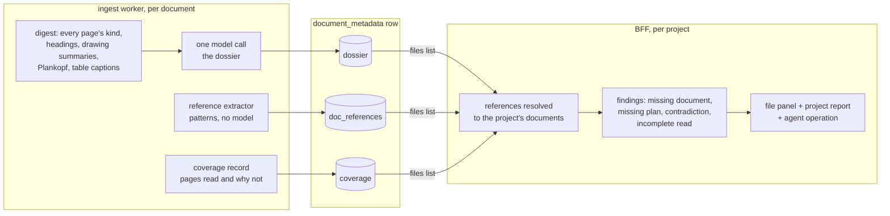

# The document dossier, its references and its reading coverage

What ingestion knows about one document beyond its chunks, as three JSON records on
the `document_metadata` row, and what the BFF derives from them for the project.
Where it comes from: [`ingestion-north-star.md`](../roadmap/ingestion-north-star.md)
(layers L2 and L3). How a document is read before it: [`ingestion-pipeline.md`](ingestion-pipeline.md).



All three are optional and fail open: a document without them reads exactly as it
did before. Keys are English; values a person reads (names, quotes, addresses) are
the document's own words.

## `dossier`

Written by `aiq_agent.knowledge.dossier` from one model call over the document's
digest (not its first and last chunk). Its `summary` becomes the document summary
when the call succeeds; when it fails the old summary call runs as before.

```json
{
  "version": 1,
  "document_type": "submission_drawing",
  "title": "Grundriss Erdgeschoss",
  "summary": "Einreichplan des Erdgeschosses im Maßstab 1:100 mit fünf Wohnräumen.",
  "parties": [{"role": "architect", "name": "Atelier Lindner Architektur ZT GmbH"}],
  "dates": [{"kind": "plan_date", "date": "2025-03-12"}],
  "place": {"address": "Hubergasse 14", "municipality": "Wien", "state": "Wien"},
  "facts": [
    {"key": "storeys_above_ground", "value": "4", "unit": null, "page": 1, "quote": "4 oberirdische Geschosse"}
  ]
}
```

| Field | Vocabulary (`dossier.py`, mirrored in `frontends/ui/src/lib/documents/dossier.ts`) |
|---|---|
| `document_type` | `submission_drawing` `construction_drawing` `site_plan` `zoning_plan` `building_description` `fire_safety_concept` `structural_analysis` `energy_certificate` `building_physics` `soil_report` `expert_report` `permit` `application` `meeting_minutes` `correspondence` `offer` `invoice` `contract` `specification` `schedule` `calculation` `photo` `legal_text` `other` |
| `parties[].role` | `client` `architect` `engineer` `authority` `contractor` `author` `other` |
| `dates[].kind` | `issued` `plan_date` `received` `valid_until` `meeting` `deadline` `other` |
| `facts[].key` | `building_class` `storeys_above_ground` `storeys_below_ground` `building_height` `gross_floor_area` `usable_floor_area` `plot_area` `floor_area_ratio` `site_coverage_ratio` `units` `parking_spaces` `use` `construction_method` `escape_route_length` `room_height` `energy_class` `heating_demand` |

Bounds: 8 parties, 8 dates, 24 facts, 240 characters per quote. A value outside its
vocabulary is dropped, never stored as free text: two documents can only contradict
each other on a key both use.

## `doc_references`

Written by `knowledge_layer.references` from the document's text and its drawings'
annotations. No model call.

```json
[
  {"kind": "norm", "key": "önorm b 1600", "label": "ÖNORM B 1600", "pages": [3, 7]},
  {"kind": "law", "key": "§ 33 baybo", "label": "§ 33 BayBO", "pages": [2]},
  {"kind": "plan", "key": "ep-05", "label": "EP-05", "pages": [1]},
  {"kind": "document", "key": "fire_safety_concept", "label": "Brandschutzkonzept", "pages": [4]}
]
```

`kind` is `norm` (DIN, EN, ISO, ÖNORM, OIB-RL, VDI, TRVB), `law` (`§` with the law's
abbreviation), `plan` (a plan number the text points at: "siehe Plan EP-05", "Detail
3/A-501") or `document` (a named document type; `key` is a `document_type`). At most
60 entries, pages ascending.

## `coverage`

Written by the ingest worker for every PDF from what it read.

```json
{"pages": 40, "text": 30, "transcribed": 5, "drawings": 5, "drawings_read": 3, "not_read": 2,
 "reasons": {"render_cap": 2}}
```

`not_read` counts pages whose content is in no chunk: a drawing past the render cap,
a vision or transcription call that failed, a scan past the transcription cap.
`reasons` keys: `render_cap`, `vision_failed`, `transcription_failed`,
`transcription_cap`.

## Findings (BFF)

`frontends/ui/src/lib/documents/findings.ts` derives them from the project's
documents list, pure and on read, and `GET /api/projects/{id}/document-findings`
serves them (operation `project-document-findings`).

| Kind | When |
|---|---|
| `missing_document` | a `document` reference whose type no document in the project has |
| `missing_plan` | a `plan` reference no document's Plankopf number or file name matches |
| `contradiction` | two current (not superseded) documents state one fact key with different values |
| `incomplete_read` | a document's coverage has `not_read > 0` |

Every finding names the documents and pages it rests on. It is a pointer for a
person, never a verdict.
