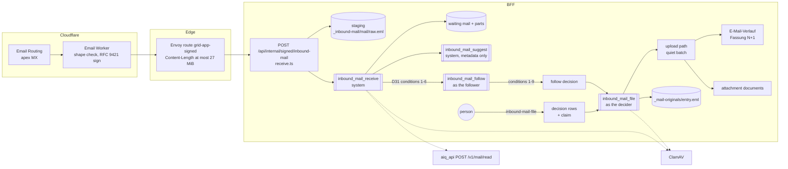
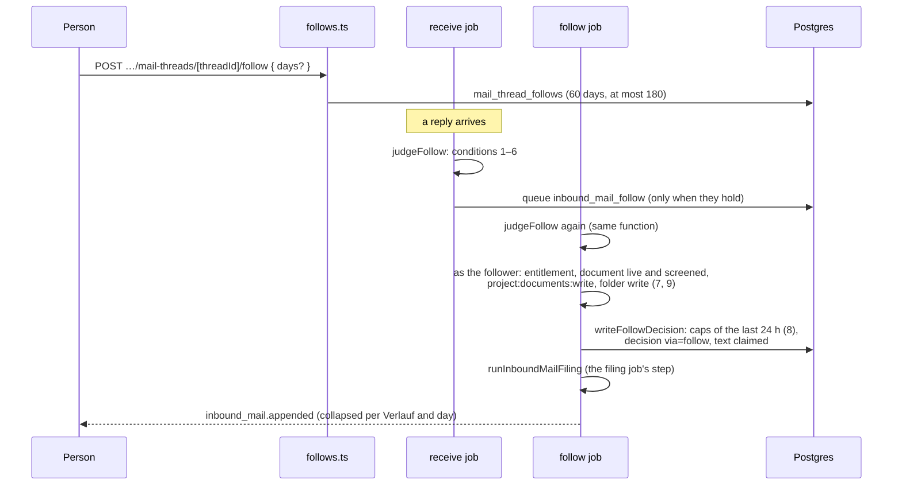

# Project mail: the E-Mail-Eingang and the E-Mail-Verläufe

Every project of an office that has the feature gets an address,
`<slug>.<token>@piloti.at`. Mail sent to it waits in the project's
**E-Mail-Eingang** until a person with write access to the project's documents
files each part of it, its text and each attachment. A filed text becomes a
section of the conversation's one document, the **E-Mail-Verlauf**, and the
message's original `.eml` is kept beside it as evidence. A person may follow a
Verlauf, so that later replies' text is appended without a click.

Why it is built this way: [ADR-0134](../adr/0134-mail-sent-to-a-project-waits-until-a-person-files-it.md)
(review, threads, originals, following) and
[ADR-0135](../adr/0135-project-mail-arrives-through-cloudflare-email-routing-and-a-signed-worker.md)
(transport). The scanner: [ADR-0133](../adr/0133-attachments-from-outside-are-scanned-in-cluster-by-clamav.md).
The Outlook archive renders into the same Verläufe: [`mail-import.md`](mail-import.md).
The tables: [`schema.md`](../database/schema.md#project-mail-migration-0186-adr-0134).
Operating it: [`kubernetes.md` §3c](../deployment/kubernetes.md#3c-project-mail-cloudflare-email-routing-adr-0135).

## The flow, from the edge to filing

Legend: rounded boxes `[[…]]` are BFF jobs on `bff_job_queue`, cylinders are
objects in the organization's bucket or rows, dashed arrows are calls that make
no model call. Nothing left of „decision rows“ can file: the webhook, the
receive job, the suggest job and the sweeps import no filing code
(`review-first.spec.ts`).

## Receiving: the webhook

`POST /api/internal/signed/inbound-mail` (`frontends/ui/src/lib/inbound-mail/receive.ts`)
is an `internalApiRoute` guarded by an RFC 9421 signature
(`GRID_INBOUND_MAIL_SIGNING_KEYS`) and excluded from the Next proxy, so it
streams the body. In order, before a byte of the body is read:

1. the signature (method, URL, Content-Digest, Content-Length, both envelope
   headers), by the route factory;
2. the pause switch (`GRID_INBOUND_MAIL_PAUSED=true`): 503;
3. the envelope headers, percent-decoded; a malformed escape is a 400 without
   a verdict (the Worker's bug, retried);
4. the token, resolved under the platform bypass (ids only); unknown, revoked or
   a deleted project: 404 with the reject verdict, charged to the
   `inbound-mail-unknown-address` bucket (300/h per signing key);
5. the organization's scope, then its `inbound-mail` flag read from WorkOS; off
   is the same 404 and text, a failed lookup a 503;
6. the signed length against 26 MiB: 413 with the verdict;
7. the rate limits per signing key (3,000/h), organization (600/h) and address
   (120/h), and the byte caps on staged raw bytes (1 GiB per address, 5 GiB per
   organization): 429;

then:

8. a `receiving` row naming the bucket and the exact key (ADR-0043);
9. the body streamed to `raw.eml`, counted and hashed;
10. the byte count must equal the signed length (else 503 `body-truncated`) and
    the bytes must hash to the signed digest (else 401 `bad-digest`);
11. the delivery key (`deliveryKey` in `mime.ts`: the authored headers and the
    body, so a relay's prepended lines do not make a redelivery new); a mail
    the address already holds answers 200 and its second copy is erased;
12. `received` and the receive job (`inbound_mail_receive`, job id = mail id) in
    one transaction;
13. 202.

The Worker bounces only a 4xx carrying `x-inbound-verdict: reject`; everything
else is a retry for the sending server (`shared/inbound-mail-contract.json`).
One log line per delivery, ids and codes only; a refusal is a PostHog
`inbound_mail_refused` with its `reason`.

## Reading and holding: the receive job

`lib/inbound-mail/receive-job.ts`, run as the system
(`SYSTEM_ACTORS.inboundMail`), bulk priority. Each run asks again:

1. load the row and read `raw.eml`;
2. **scan the whole raw message** (`ScanMail yes`) and store the verdict; a
   mail is never `waiting` unscanned (CHECK `inbound_mails_waiting_is_scanned`);
3. drop auto-replies, delivery reports and loops (`dropped`, raw erased); mark
   list and bulk mail `automatic`;
4. **authenticate the sender** (`sender-auth.ts`, mailauth 8 without an IP, so
   SPF is never read): trust, reason, signer domain, signed headers, flags;
5. read the MIME tree (`mime.ts`, postal-mime 4 and `file-type`) against the
   office's accepted types; find the member by exact address, or an outsider's
   display name that is a member's (`claims_member_name`);
6. the **Namensprüfung** on each attachment's name and the base subject: a
   match is the part's flag `name_stop`, never a drop;
7. **scan each attachment**;
8. **the Python reader**, `POST /v1/mail/read` (no model): own text, quoted
   blocks, calendar invitations; then the content check on the own text after
   the signature was removed (`content_findings`);
9. **redact every other project's address** in the subject, participants, text,
   quotes and invitations; the receiving project's own address is kept, so a
   filed section that quotes it shows it (a Verlauf's headings and participant
   lines name people by name and domain, never by address);
10. **match the project's threads** and look the Message-ID up
    (`message_id_reused`, `already_filed`); ids and strengths only
    (`thread_match`);
11. stage the attachments and `read.json`, insert the parts, `waiting`;
12. **following**: conditions 1–6 of D31 (`judgeFollow`); only when they hold is
    `inbound_mail_follow` queued;
13. announce (`inbound_mail.waiting`), publish the project change to the agent
    door, audit `inbound_mail.received`, PostHog `inbound_mail_received`, and
    queue Piloti's suggestion unless the sender is unconfirmed, impersonating,
    or the mail is automatic.

On the last attempt the mail is held anyway, flagged `unreadable`, with a text
part whose original can be downloaded once its scan is clean: mail is never lost
to a parser bug.

### What a mail is, and its states

| Object | Table | States |
|---|---|---|
| The address | `inbound_mail_addresses` | active; revoked (`rotated`, `switched_off`) |
| A delivery | `inbound_mails` | `receiving` → `received` → `waiting` → `settled`, or `dropped` |
| A part | `inbound_mail_parts` (`message` or `attachment`) | `waiting` → `filing` → `filed`; `waiting` again with `last_failure`; `dismissed` / `expired` → `waiting` (restore, 7 days) |
| A decision | `inbound_mail_decisions` (append-only) | `file`, `dismiss`, `restore`; `via` `app`, `agent`, `piloti_proposal`, `follow` |

Staged objects: `org/<org>/project/<project>/_inbound-mail/<mailId>/raw.eml`,
`…/read.json` and `…/<position>` per attachment. A filed message's original:
`org/<org>/project/<project>/_mail-originals/<entryId>.eml`. Both segments are
reserved in `lib/s3.ts`, and erasure is by the exact keys on rows; only the
project purge deletes by prefix.

### Sender trust

| Label | When |
|---|---|
| `member_verified` | the From address is a member's (exact, ASCII-lowercased) and its domain signed (aligned DKIM pass plus hygiene) |
| `member_unverified` | a member's address, not signed |
| `external_verified` | an outsider, signed |
| `external_unverified` | an outsider, not signed |
| `not_checked` | an archive entry (`mail_thread_entries` only) |

Verified means one DKIM signature that passes, aligns with the single From
domain, covers the whole body (no `l=`), is not in testing mode (`t=y`), has not
expired, signs From, Subject, Message-ID and Date, is not rsa-sha1, with a key of
at least 1024 bits; and the header block holds exactly one ASCII From and no
duplicated singleton field. mailauth reports a body-hash mismatch and an expired
signature as `neutral`; `sender-auth.ts` names them `dkim_fail` and
`dkim_expired`. The stored `authentication_results` line is ours, from DKIM and
DMARC only; a CHECK refuses one containing `spf=`.

Flags: `not_addressed_to_project` (no signed To or Cc names the token on the
inbound domain; a look-alike domain such as `piloti.at.evil.example` does not
count), `bcc_own` (a `member_verified` mail with a signed Date within 24 h of
receipt: the member's own Bcc copy), `stale_date` (signed Date more than 7 days
before receipt), `date_out_of_range` (the Date outside `[received − 30 days,
received + 15 minutes]`; the receipt time is used), `message_id_reused`,
`already_filed` (the same Message-ID and own text already an entry, an archive
entry included), `claims_member_name`.

What the person is asked (`lib/inbound-mail/sender-risk.ts`, computed on the
server and carried on the views as `riskLevel`): `none`; `caution`
(`acknowledgeSender` needed: a member address not signed, a failed or rejected
signature, a verified mail not addressed to the project outside the Bcc case,
a stale date); `impersonation` (a rejected signature, or `claims_member_name`):
no suggestion, nothing pre-selected, never in a bulk decision.

## Deciding

`POST /api/projects/[id]/inbound-mails/file` (`lib/inbound-mail/service.ts`,
`decision.ts`) decides 1–20 mails. It checks every rule synchronously:
`requireFolderWrite` on each target, the accepted type, a clean scan, the
acknowledgements (only with one mail), the name check of a new Verlauf's name
and folder path, the name free or `revisionOf`, `ifMatch`. Then, in one
transaction, it appends the decision rows, claims the listed parts (`waiting →
filing`, compare-and-set, 5-minute claim), dismisses every other waiting part of
those mails, and queues `inbound_mail_file`. It answers 202. Refusals are 409s
with `details.reason` from `INBOUND_MAIL_REFUSALS` (`inbound-mail-wire.ts`).

`via` is read from the call, never the body (`decisionActor`): a Piloti card the
person accepted (`actingProposalId`, set by the proposal applier), an outside
agent acting as the person, or the app.

Defaults, completeness and thread groups are the server's
(`review-defaults.ts`, `thread-groups.ts`, `forwarded.ts`): a part is
`preselected` or not, a mail's `incompleteReason` is null when it can be filed
as suggested alone or in bulk, and a group of waiting mails that would append to
one thread is filed in sent order with the Fassung each becomes.

## Filing

`lib/inbound-mail/file-job.ts`, handler as the decider, interactive. Per mail:
finish a stopped original move; each attachment (claim renewed, bytes read and
SHA-256 checked, re-scanned when the verdict is older than 24 h, folder resolved
as the person, the upload path with the person's chosen type and `mail_origin`);
then the text (`lib/mail-thread/append.ts`); then any attachment filed after
its text is linked to the entry's `pending` row; then settle once every part is
filed (staged objects erased by key, the row scrubbed to ids) and tell. A
failure a retry would repeat becomes the part's `last_failure` and the part
waits again; `inbound_mail.filing_failed` tells the decider.

Each run opens one quiet upload batch per kind (`quiet-batch.ts`), with the
effects of `batch-effects.ts`:

| Upload | Completion | Re-judgement | Intake | Revision notice | Document check |
|---|---|---|---|---|---|
| Inbound attachments | no | no | yes | all | yes |
| Inbound Verlauf append (person or follow) | no | no | no | marks only | no |
| Archive Verlauf render | yes | no | no | marks only | no |

### The E-Mail-Verlauf

`lib/mail-thread/append.ts` under the thread's render lease
(`acquireRenderLease`, 5 minutes; a busy thread answers "not yet" in 15 s
without spending an attempt):

1. a new `mail_threads` row, or the existing one;
2. the entry (`mail_thread_entries`, `source = 'inbound'`, `received_at`,
   `masked_spans` when the person chose „Unkenntlich ablegen“), its Message-IDs
   and one `mail_thread_entry_attachments` row per attachment (D36);
3. `render.ts` over every entry: one `##` section per message, ordered by the
   clamped send time, headings that never change;
4. the upload, same name, `documentType: 'correspondence'`, in the quiet append
   batch: the next Fassung; `first_version_id` set on every entry that had none;
5. the original moved: copied to `_mail-originals/<entryId>.eml`, read back,
   SHA-256 checked, recorded on the entry, and only then the staged raw erased
   (`lib/mail-thread/originals.ts`; `original_move_pending_at` makes it
   retry-safe, sweep 13 finishes it).

A binned, deleted or archived Verlauf document is `last_failure:
thread_document_gone`. A thread at 200 entries or 2 MiB refuses an append
(`thread_full`).

The knowledge layer reads a Verlauf like any Markdown document, one chunk
section per message (`source_format: mail`, lane `project_mail`, label
„E-Mail“), with `document_date` the newest message's send time; a filed
attachment carries `mail_origin` with the sender's trust, so `list_files` and
`read_passage` say „kam mit der E-Mail vom … von …“, with „Domain nicht
bestätigt“ where it applies
([`document-ingestion.md`](../technical-reference/document-ingestion.md)).

### Detach

`POST …/mail-threads/[threadId]/entries/[entryId]/detach`
(`lib/mail-thread/detach.ts`) moves a mis-filed message into another thread or
a new one, as the person, under both render leases. The thread it leaves is
uploaded first, as Fassung N+1 without the section (the one exception to the
superset invariant: earlier Fassungen keep it), then the thread it joins; only
then does the entry's row move (its Message-IDs by `ON UPDATE CASCADE`).
Every follow of the thread it left ends (`detached`).

## Following a Verlauf

The nine conditions are listed in ADR-0134. The follower is the earliest running
follow made before the mail arrived, whichever follow the receive job named.
Condition 8 counts the follow's own appends against its `daily_cap` (default
20) and the project's `via = 'follow'` decisions against 100, over the last 24
hours, under a project advisory lock. A failing condition writes nothing: the
mail waits as without a follow. A follower who lost the project or the folder
ends the follow (`access_lost`); a deleted, archived or binned document ends it
(`document_gone`); a closed project or a held document only makes the mail
wait. One log line per run: `[inbound-mail] follow of mail <id>: <kind>[:<reason>]`.

Ending: `DELETE …/follow` (own: `unfollowed`; `?userId` with `project:manage`:
`revoked_by_manager`), sweep 12 (`expired`, `document_gone`), address rotation
or switch-off (`address_rotated`), detach (`detached`). Every system end goes
through `endFollowBySystem` (`lib/mail-thread/follows.ts`), which audits
`mail_thread.follow_ended`, sends a personless `mail_thread_followed`, settles
the renewal notice and publishes the change.

## Retention: the sweeps

`lib/inbound-mail/sweep.ts`, one more part of
`POST /api/internal/maintenance/reconcile-background-work`, which the scheduler
posts every tick (30 s); at most 50 rows per sweep per tick. Each sweep finds
what is due across organizations under the platform bypass (ids only), then acts
on each row in its tenant, compare-and-set on what it saw; deletes run as the
platform role. One sweep's failure is counted and the next runs. The scheduler
logs one line per sweep that acted, e.g.
`[job-scheduler] background work sweep, project mail expired: checked 3, errors 0, expired 2, parts 5`.

In the order they run:

| # | Name | What | Window | Legal hold |
|---|---|---|---|---|
| 1 | `staleReceptions` | `receiving` untouched: object erased by key, row deleted | 15 min | project hold: skipped |
| 2 | `orphanedReceptions` | `received` with no job: queued again (a dead job is counted `dead`) | 5 min | — |
| 5 | `lapsedClaims` | `filing` past its claim: waits again (`unavailable`), the decider told | the claim (5 min) | — |
| 13 | `stalledMoves` | an original's move that stopped: finished (copy proven, then raw erased); entry gone: raw erased | 15 min | the move erases nothing unproven; the entry-gone branch skips a held project |
| 11 | `audits` | decisions with `audited_at IS NULL`: sent to the trail, marked | 1 min | — |
| 3 | `expired` | `waiting` past `expires_at`: waiting parts `expired` (restorable 7 days), audited | 30 days | — (no erasure) |
| 4 | `expiring` | five days left: `inbound_mail.expiring`, once per mail | day 25 | — |
| 6 | `endedParts` | dismissed and expired parts past 7 days (a dismissed part of `external_unverified` mail at once): bytes erased; a mail nothing of which waits is settled and scrubbed | 7 days | project or custodian hold: erasure deferred (`erasure_deferred_at`), the mail still settles |
| 7 | `rescans` | failed scans of waiting parts and held raw messages, hourly, up to 24 attempts | 1 h | — |
| 10 | `releasedErasures` | erasures a hold deferred, once no hold covers them | — | only rows no hold covers |
| 8 | `keptMails` | settled mails 30 days after settling with no filed part's document alive, dropped mails 30 days after receipt; nothing left to erase, nothing unaudited: deleted | 30 days | project or custodian hold: skipped; trigger `GLH01` backstop |
| 12 | `follows` | running follows past `expires_at` end `expired`, those whose document is gone end `document_gone`; five days before the end `mail_thread.follow_expiring`, once | 60 days, day 55 | — |
| 9 | `threads` | threads whose document is deleted (a binned one keeps its row), over an hour old, no lease, no running follow, nothing unaudited, not waiting for a first archive render: every original erased by key first, then the thread deleted (cascade: entries, attachment rows, Message-IDs, ended follows, their audited decisions and the parts those filed) | 1 h | project hold: skipped; triggers backstop |
| 14 | `caps` | addresses at 80% or 100% of their own or their organization's staged-bytes cap: `inbound_mail.cap_reached` to the managers once per rise; settled below 80% or when revoked | — | — |

Order matters: 11 before 8 and 9 (they wait for the trail, RT-S8); 12 before 9
(9 never deletes a running follow). `sweep.spec.ts` holds the order.

**Legal hold.** Every erasing or deleting set asks
`grid_legal_hold_blocks('project', project_id, organization_id)` in its WHERE;
a mail's bytes also ask `grid_legal_hold_blocks('user', sender_user_id, …)`
(a custodian hold on the member it came from). `grid_legal_hold_blocks('project', …)`
is also true when a hold on any document, folder, conversation or user touches
the project (migration 0115), so **one held document pauses that project's
mail erasure**. Under a hold, ending still happens (expire, settle, scrub); only
erasure and deletion wait. The `BEFORE DELETE` triggers on `inbound_mails`,
`mail_thread_entries` and `mail_thread_entry_attachments` (`GLH01`) are the
backstop, never the filter.

## The seven notices

`lib/inbound-mail/announce.ts`, in-app and push only (`email: never`). Payload
`{ subject: <project name>, variant?, related? }`: no sender, subject or file
name reaches a row or a push. Mail from an unconfirmed domain or automatic mail
adds the variant `unconfirmed`.

| Type | Told to | Row | Link | Push | Settled |
|---|---|---|---|---|---|
| `inbound_mail.waiting` | the member sender (`member_verified`, addressed to the project or their Bcc copy, holding project read), else the project's managers | collapsed per project, actionable | `/files/mail` | requests, normal | nothing waits |
| `inbound_mail.expiring` | the same, once per mail (sweep 4) | collapsed per project, actionable | `/files/mail` | requests, normal | nothing it told about waits |
| `inbound_mail.decided` | the member sender only, when the run filed the mail's last part or the dismissal ended it; variant `dismissed` | per mail | `/files?folder=…` when every file went to one folder the member may open, else `/files` | results, low | — |
| `inbound_mail.filing_failed` | the decider; variant the `last_failure` | per mail, actionable | `/files/mail/<mailId>` | requests, normal | filed again or dismissed |
| `inbound_mail.cap_reached` | the project's managers; variant `nearly_full` or `full` | per address, actionable | `/files/mail` | requests, normal | below 80%, or a new address |
| `inbound_mail.appended` | the follower | per Verlauf and day | the Verlauf document | results, low | — |
| `mail_thread.follow_expiring` | the follower, once (sweep 12) | per follow, actionable | the Verlauf document | requests, low | renewed or ended |

The collapsed rows carry the anchor of their newest emission, so they are
settled by what the project still holds (`settleProjectNotices`), never by one
mail's anchor ([`adding-a-shareable-resource-type.md`](adding-a-shareable-resource-type.md)).
A `member_unverified` mail never notifies the member it names. The Postfach row's
„Wie vorgeschlagen ablegen“ action of the design is not built yet.

## Piloti's suggestion

`lib/inbound-mail/suggest-job.ts` (`inbound_mail_suggest`, system, bulk, job id
uuid5 of the mail). Skipped, with no model call, when `GRID_FILING_SUGGESTIONS`
is off, the mail no longer waits, the sender is `external_unverified`, an
impersonation or automatic mail, the project is closed, nothing is left to
place, or the project's unasked budget says no (`unaskedSpendAllowed`, fail
closed). Placed: waiting attachments with a name, not infected, not
name-stopped, of an accepted type, at most 60; the text only when the mail
matched no thread. Input: those names, the subject masked by the content check,
the sender's domain, the folders every project member may read, and the
office's conventions kept by at least two of its other projects. Never the text
or the bytes. The model call is `judgeMailFiling` → `POST /v1/filing-fit`
(`basis: mail`). The suggestion is stored on the parts that still wait without
touching `updated_at`, which is part of `ifMatch`: a suggestion arriving while
a person reads must not make their decision stale.

## Exposure

All operations live in `frontends/ui/src/lib/agent-api/catalog/mail.ts`, domain
`mail` ([`agent-surface.md`](agent-surface.md)).

| Operation | Outside agents | Piloti |
|---|---|---|
| `inbound-mail-address-get`, `-create`, `-delete`, `-rotate` | yes | yes |
| `inbound-mail-list`, `-get` (metadata only) | yes | yes |
| `inbound-mail-text-get` (masked), `inbound-mail-part-content-get` | yes | no |
| `inbound-mail-file`, `inbound-mail-dismiss` | yes, `requiresPersonConfirmation` | as a card; clean, unflagged parts only |
| `inbound-mail-restore` | yes | yes |
| `inbound-mail-original-get`, `mail-thread-entry-original-get` | withheld (`evidence`) | withheld |
| `mail-thread-list`, `-get`, `mail-thread-entry-detach` | yes | yes (detach as a card) |
| `mail-thread-follow` | `control`-sensitive: only under the office's opt-in and the step-up scope | no |
| `mail-thread-unfollow` | yes | no |

## Security checks, and what each one failing would give

| Check | Where | On failure | If only this check failed |
|---|---|---|---|
| Recipient shape | Worker | `setReject` | nothing: the BFF re-parses |
| RFC 9421 signature, 300 s window | route factory | 401, retry | a leaked key injects mail into review queues; limits, scans, our DKIM verdict and a person's decision still stand |
| Exact length and digest; outside the proxy; 27 MiB at Envoy | webhook, edge | 503 / 401 / 413 | tampered or truncated bytes |
| Token, flag | webhook | 404 + reject | a 60-bit guess, or mail held for an office that has not opted in (it stays in that tenant) |
| Rate limits and byte caps | webhook | 429 | one address floods its own queue; the others keep working |
| DKIM/DMARC and hygiene | receive job | a label | a forged mail claims a domain; no pre-selection, no follow, „nicht bestätigt“ in the Verlauf |
| Name check, risk flags | receive job, `decision.ts` | flag, acknowledgement | an explicit, audited override only |
| ClamAV on attachments and the whole raw message | receive job, filing job, downloads | `infected`: dismiss only; `failed`: re-scan | malware reaches a person |
| Redaction of other projects' addresses | receive job | — | another tenant's token learned (the original stays unredacted and gated) |
| `project:documents:write`, candidates for the viewer | service | 404 | a non-writer reads held mail, or a writer learns restricted names |
| Per-target folder write, type, scan, acknowledgements, `ifMatch` | `decision.ts` | 409 / 403 | a filing the decider was not entitled to |
| `decision_id` FK to a `file`, person-shaped decider, clean card, follower FK, `filed_is_clean`, `waiting_is_scanned` | Postgres | statement refused | a code path that files by itself is refused by the database |
| `requiresPersonConfirmation` | door | refused with a link | an injected outside agent cannot file |
| Filing as the decider (or follower) | job | `last_failure` | nothing past an ordinary upload by that person |
| Static ratchet | `review-first.spec.ts` | CI | — |

HTML is never rendered: the text is shown as text, links inert, previews before
filing only for clean images and PDFs, drawn client-side in the sandboxed
viewer; Office files show their tile until filed (no Gotenberg on a stranger's
file).

## Observability

- PostHog: `inbound_mail_received`, `_refused`, `_dropped`, `_decided`,
  `_address_rotated`, `mail_thread_followed`, `mail_thread_original_downloaded`
  ([`posthog-events.md`](../observability/posthog-events.md)). Ids, codes and
  counts only.
- Langfuse: the suggestion's `filing-fit` generation (`surface: inbound_mail`),
  `piloti-decision` (subject `inbound_mail_suggestion`) and `mail-thread-match`
  ([`langfuse.md`](../observability/langfuse.md)). `/v1/mail/read` makes no
  model call.
- Audit (`lib/audit/schemas.mjs`): `inbound_mail.received`, `.expired`,
  `.part_read`, `.original_read`, `.decided`; `inbound_mail_address.created`,
  `.rotated`, `.deleted`; `mail_thread.follow_started`, `.follow_ended`,
  `.entry_detached`, `.original_read`.
- Operator alerts: `bad-signature`, `body-truncated`, `unavailable`,
  `cap_reached`, and no `received` for 24 h (`kubernetes.md` §3c).

## Where it lives

| What | Code |
|---|---|
| Transport (address, sender authentication, MIME, automatic mail, the Worker contract) | `frontends/ui/src/lib/inbound-mail/{address,sender-auth,mime,automatic-mail,contract}.ts`; hostile corpus `__fixtures__/hostile.ts` |
| Webhook, staging, receive job | `frontends/ui/src/app/api/internal/signed/inbound-mail/route.ts`; `lib/inbound-mail/{receive,staging,receive-job,screening,read-client,malware-scan}.ts` |
| Review service, decisions, candidates, wire | `lib/inbound-mail/{service,decision,candidates,access,address-service,inbound-mail-wire,sender-risk,review-defaults,thread-groups,forwarded}.ts` |
| Filing | `lib/inbound-mail/{file-job,filing-repository,quiet-batch,batch-effects}.ts` |
| Threads | `lib/mail-thread/{mail-threading,render,append,originals,detach,archive,mail-origins,ingest-facts}.ts` |
| Following | `lib/mail-thread/{follows,follow-repository,follow-eligibility}.ts`; `lib/inbound-mail/{follow-candidate,follow-job}.ts` |
| Sweeps and notices | `lib/inbound-mail/{sweep,sweep-repository,announce,notice-repository}.ts` |
| Suggestion | `lib/inbound-mail/{suggest,suggest-job,suggest-scores}.ts`; `lib/filing/judge.ts`; `frontends/aiq_api/src/aiq_api/routes/filing_fit.py` |
| The Python reader | `frontends/aiq_api/src/aiq_api/mail/`, route `routes/mail.py` |
| The UI | `frontends/ui/src/features/inbound-mail/`; the E-Mails tab `features/documents/components/mail-thread/` ([`docs/ux/inbound-mail.md`](../ux/inbound-mail.md)) |
| The edge | `deploy/pulumi/src/platform/{inbound-mail,inbound-mail-worker,email-routing}.*`; `shared/inbound-*.json` |
