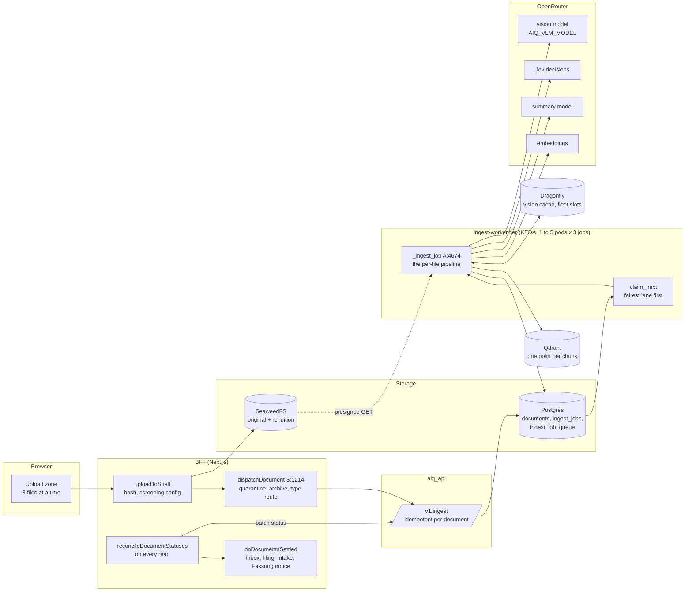
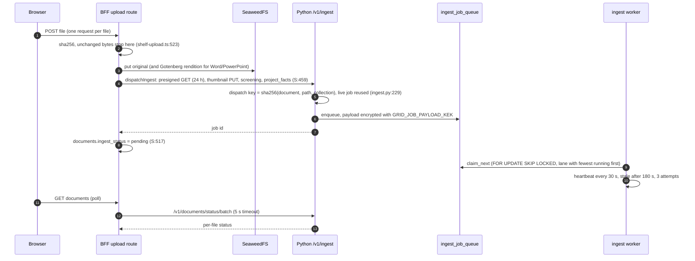
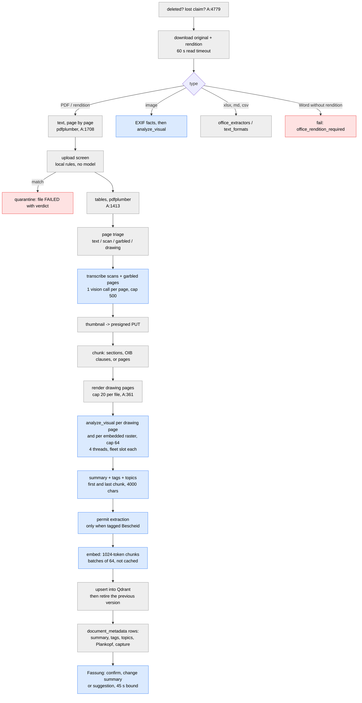
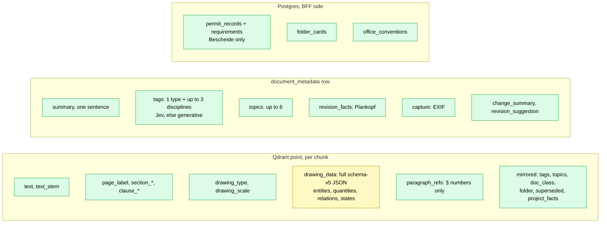
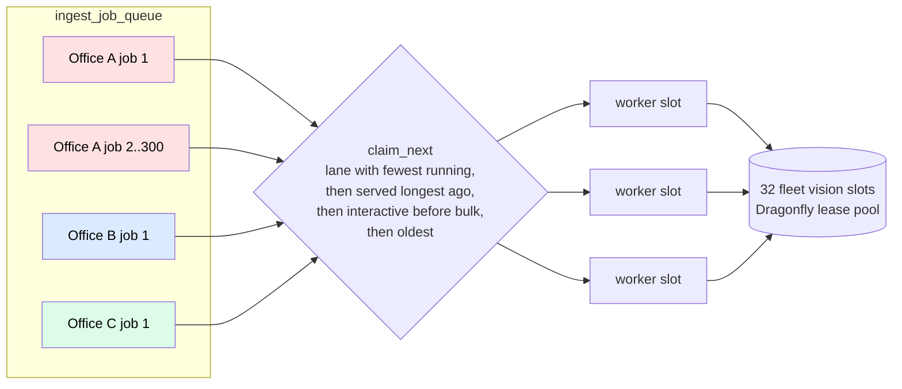

# How a document is read: the ingestion pipeline, drawn

What happens between "an architect drops a file" and "Piloti can cite it", as the
code does it on 2026-10-27. Every box below names the function that owns it, so a
diagram that goes stale is a diff away from being caught. Where this pipeline goes
next is [`docs/roadmap/ingestion-north-star.md`](../roadmap/ingestion-north-star.md).

Older, deeper material is still right and is linked rather than repeated:
[`technical-reference/document-ingestion.md`](../technical-reference/document-ingestion.md)
(the step-by-step reference, with the history of each fix),
[`visual-ingestion.md`](visual-ingestion.md) (the drawing schema and its rules),
ADR-0076 (the queue), ADR-0117 (the page pipeline, proposed, not built).

Short forms: **A** is `sources/knowledge_layer/src/llamaindex/adapter.py`, **S** is
`frontends/ui/src/lib/documents/service.ts`, **D** is
`frontends/aiq_api/src/aiq_api/jobs/ingest_dispatch.py`.

## 1. The whole thing on one page

Three things in this picture decide almost everything about speed and reliability:

1. **One document is one queue row, one claim, one worker thread.** Nothing inside a
   document runs on a second machine (ADR-0117 keeps it that way).
2. **Every vision call in the fleet holds one of `AIQ_VLM_FLEET_CONCURRENCY` slots**
   (32 by default, a lease pool on Dragonfly, A:419). That pool is shared by every
   office on the platform. It is the throughput ceiling, not CPU.
3. **Status is pulled, never pushed.** The BFF learns a document is done when someone
   reads the document list (`reconcile-status.ts:829`), polled every 5 s and then
   every 60 s by an open tab.

## 2. How a file reaches the queue

Every entry point ends in `dispatchDocument` (S:1214): a person's upload, a folder
upload, a new Fassung (`revision_of`), "Erneut lesen", a project re-index (`bulk`
priority), mail import, a quarantine release, an unarchive, a published agent
version. IFC models take a side road (`bim_extract`) and come back as a Markdown
digest. A failure to start is final at once: `markDocumentIngestFailed("Ingestion
could not be started")` (S:526).

## 3. Inside one file

The order below is the order the code runs, with what each stage costs and what
happens when it fails. Grey boxes run on the worker's CPU; blue boxes are a model
call; the dashed line is where the file can stop.

What fails the file, and what only makes it poorer:

| Stage | On failure | User sees |
|---|---|---|
| Download, unreadable PDF, binary or empty content, Word without rendition, no vision key for an image or a scan | the **file** fails, its partial points are discarded, a previous version stays | "Fehlgeschlagen" with a reason; "Erneut lesen" is offered by `retry-policy.ts` |
| Screening match | the file is held in quarantine | the uploader and reviewers see it; nobody else does |
| One OCR page, one vision page, one embedded raster | that **page** is skipped; the file goes on | nothing. The page is simply not in the index |
| Summary, tags, topics, permit, Fassung, thumbnail | skipped after a 30 s (90 s, 45 s) bound | a file with no summary or no tags |
| Pages over the render cap (20) or the raster cap (64) | counted on the file, not read | nothing visible to the person |
| A worker dies or stalls | the claim goes stale after 180 s and another worker takes the job, up to 3 times, then `dead` | "unterbrochen" |

There is **no automatic retry of a failed file**. A 429 or a timeout inside a vision
call is retried in place (A:2274), but a file that failed stays failed until a
person or the `reingest_failed` job asks again.

## 4. Where the time goes

Measured on 2026-10-27 in a dev container, on public documents, with the production
code paths (no Qdrant, so no write stage):

| Document | Pages | Text | Tables | Triage | Pages sent to vision |
|---|---|---|---|---|---|
| OIB-RL 2.1 Erläuterungen 2023 | 18 | 2.2 s | 1.3 s | 0.1 s | 2 drawing |
| WKO slides on OIB-RL 2 | 107 | 1.7 s | 1.5 s | 0.1 s | 9 drawing + 10 scan |

| One vision call, production prompt and model | Seconds |
|---|---|
| HABS sheet, 5 views (`openai/gpt-6-luna`) | 25.4 |
| HABS sheet, 9 views: truncated at 3000 tokens, asked again at 6000 | 56.0 |
| Jev 1.14, same kind of sheet, page kind + views + two boxes | 0.4 to 0.9 |

Production numbers already on record: median job 138 s, mean 154 s, max 427 s; a
133-page CAD PDF spends 103 s in the text pass and 125 s in the table pass before
its first model call (ADR-0117). Vector CAD is where pdfplumber is slow; ordinary
text PDFs are not.

So the shape of a document's wall time is:

```mermaid
gantt
  dateFormat  s
  axisFormat  %S s
  title 20-page drawing set, cold cache, one job (illustrative, from the numbers above)
  section CPU
  text + tables + triage        :a1, 0, 8s
  render 20 pages               :a2, after a1, 6s
  section Vision (4 threads)
  pages 1-4                     :v1, after a2, 25s
  pages 5-8                     :v2, after v1, 25s
  pages 9-12                    :v3, after v2, 25s
  pages 13-16                   :v4, after v3, 25s
  pages 17-20 (one truncation)  :v5, after v4, 56s
  section After
  summary, tags, topics         :s1, after v5, 4s
  embed + write                 :s2, after s1, 5s
```

The vision phase is about 80 % of a drawing set's time, and it is serial in rounds
of four. The fleet sees it differently: **every one of those 20 calls holds one of
the 32 slots every office shares**. At 25 s a call, the whole platform reads about
4,600 drawing pages an hour, and at most 15 documents are in flight at once
(5 pods × 3 jobs, `deploy/pulumi/src/config.ts:2995`). That is the number to watch
when many offices upload at the same time, and why a cheaper first look at every
page is the first move in the roadmap.

What is measured in production today:

- `[ingest-perf]` log line per file: text, tables, screen, ocr (since this change),
  renders, rasters, vision, summary, embedding, write (A:2931). Log only.
- `llm_usage_events` with `activity = ingest` per job: the one queryable cost
  breakdown (roles `ingest_vision`, `ingest_transcription`, `embedding`).
- `document_ingest_finished` in PostHog with `duration_ms`, accurate to one poll
  interval because it is measured when the BFF notices.
- `grid.queue.job_duration_seconds` and claim latency (OTel).
- **Not measured:** Langfuse has no ingest traces at all, so a slow document
  cannot be opened and read stage by stage, and a vision call cannot be scored.

## 5. What is stored, and who reads it

Green is read by retrieval, the UI or the agent; yellow is stored and almost never
read. The richest thing the pipeline produces, the structured reading of every
drawing (`drawing_data`: rooms, quantities with units, relations as triples, the
author, the location), sits on the chunk as an unindexed JSON string. Only the
revision diff and the drawing detail view open it.

What is **not** extracted at ingest at all:

- references between documents: a plan number on another plan, "gem.
  Brandschutzkonzept", DIN, ÖNORM, EN, OIB-RL points (only `§ n` is captured);
- storey (Geschoss) per page, a computed scale, a plan number per chunk;
- anything about the **project**: what this document adds to it, contradicts in it,
  or leaves open. That is read again later by three separate readers (the permit
  extraction, the intake agent of ADR-0111, the experience reader of ADR-0096),
  each with its own model calls and none sharing a stored fact set.

## 6. Fairness across offices

The claim order (ADR-0076) keeps a newcomer's single upload from waiting behind
another office's folder of 300. Two limits sit below it and are not per office:
the 15 document slots and the 32 vision slots. Office A's 300-document folder holds
every slot it reaches until each document finishes, so office B's first document
waits for the next free document slot, then competes for vision slots with
everything already running. Fair claiming bounds that wait to one document's
length. It does not shorten that length, so a long drawing set sets the wait for
everyone.

## 7. The code, by question

| Question | Where |
|---|---|
| Why did this file fail? | `documents.ingest_error`, the job's `file_details`, `[ingest-perf]` and the worker log for the job id |
| Why is this page missing from search? | page triage (`page_triage.classify_page`), the render cap (`AIQ_MAX_RENDERED_PAGES`), a skipped vision or OCR call (warning in the log only) |
| What did it cost? | `llm_usage_events` where `activity = 'ingest'` and the job id |
| Who decides the order of jobs? | `aiq_agent.knowledge.ingest_queue.claim_next`, ADR-0076 and ADR-0079 |
| Where is the vision prompt? | `visual_analysis.build_prompt` over `visual_domains` |
| What runs after a document settles? | `frontends/ui/src/lib/upload-batches/settle.ts` (`onDocumentsSettled`) |
