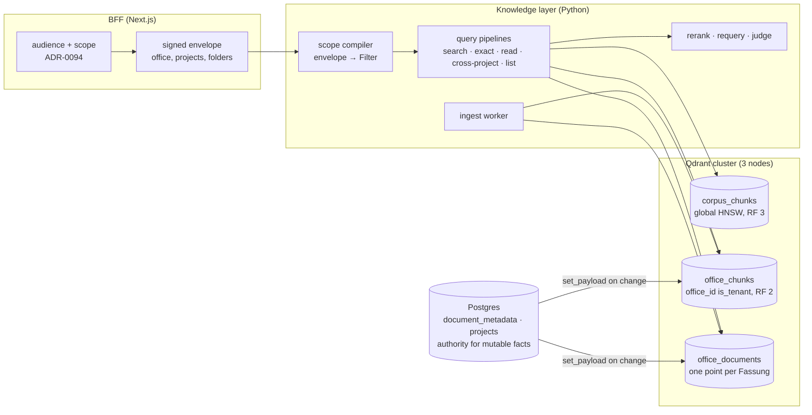

# Retrieval on Qdrant, from first principles

Status: **accepted 2026-10-13; slice 1 built, behind `AIQ_VECTOR_BACKEND`
(default `chroma`).** The two decisions it rests on are
[ADR-0104](../adr/0104-qdrant-replaces-chroma-reached-through-qdrant-client.md)
(the store and the client) and
[ADR-0105](../adr/0105-retrieval-scope-is-a-payload-filter-compiled-in-one-place.md)
(scope as a filter, not a collection). What is built, and where it departs
from the target below, is §12. The gates in §10 are what the flag flip to
`qdrant` waits on in each environment.

This is not a port. A port would copy today's collection-per-scope layout into
Qdrant and keep every workaround that layout made necessary. Instead, this doc
asks what retrieval has to do for an office, sorts each existing mechanism into
domain need or Chroma workaround, and designs the Qdrant version the way
Qdrant's own guidance recommends.

## 1. What retrieval has to do

Piloti answers from three bodies of text: the legal corpus (`baurecht`), the
office's own filing (`buero`, the Büroablage) and its projects (`projekt`).
Retrieval serves these questions, ordered from most to least frequent:

| Question an architect asks | Retrieval shape |
|---|---|
| "Was sagt die OIB-RL 2 zu Fluchtwegen?" | Hybrid semantic + lexical over the corpus, reranked, a few hits per Richtlinie |
| "Was steht in unserem Brandschutzkonzept zu Stiege 2?" | The same, over one project's documents, never another office's |
| "§ 3 Abs. 2", "OIB-RL 2 Punkt 5.1.1" | Exact-term lookup where the string is the signal |
| "Lies Punkt 5.1.1 ganz" | Fetch by structure (Richtlinie, Punkt, page): no ranking, no embedding |
| "Wie haben wir das beim letzten GK4-Holzbau gelöst?" | Office-wide, ranked across projects, filtered by project facts, one result per project |
| "Welche unserer Projekte hatten eine Auflage zur Fluchttreppe?" | The same, plus counts per project |
| "Welche Dokumente gibt es zu …" / list a folder | Listing and facets, no vector at all |

Everything must hold three invariants that Chroma never enforced. The code
enforced them, through collection names:

1. **Office isolation.** A search never returns another office's chunk.
2. **Restricted folders.** A chunk in a restricted folder reaches only people
   cleared for it (ADR-0087). Who counts as cleared is decided by the
   conversation's audience (ADR-0094).
3. **Fassung truth.** A document that a person marked as superseded drops out
   of answers unless someone asks for it (ADR-0099).

## 2. What we have today, sorted

These are the full findings of the 2026-10-13 audit, condensed. Paths are
relative to `sources/knowledge_layer/src/` unless they are absolute.

**Domain needs we keep**, whatever store sits underneath:
- the signed scope envelope (ADR-0047/0084)
- the audience rules (ADR-0094)
- the durable fair ingest queue (ADR-0076/0079)
- OIB hash gating plus `CHUNK_FORMAT_VERSION`
- the query-embedding cache and warm-up, since embedding costs 280–980 ms and
  the store only 50–230 ms (`turn-latency-measured-2026-09.md`)
- the cross-encoder rerank, the requery loop, the coverage judge, and the
  EN→DE glossary expansion
- `keyed_lock` plus retire-after-insert for concurrent re-ingest
- the orphan sweep (multi-store deletes are not atomic)

**Workarounds for Chroma or LlamaIndex-over-Chroma**, which go away:

| Mechanism | Where | Why it exists |
|---|---|---|
| `$contains` exact-term channel, priced by a `collection.get` per term | `llamaindex/hybrid.py`, `adapter.py:6291` | Chroma has no lexical index |
| Postgres `chunk_text` mirror for German FTS, with hits fetched back from Chroma by id | `src/aiq_agent/knowledge/chunk_text_store.py` | Same |
| Cosine recovered from `exp(-d)` | `adapter.py:998, 6393` | LlamaIndex's Chroma score scale |
| RRF *across collections*, rank padding | `register.py:616-850` | N collections give N incomparable score bands |
| 3× over-fetch, then post-filter on `doc_class`, title, folder | `register.py:48, 1132-1173, 2049` | Human-set metadata lives only in Postgres and cannot reach the store |
| `file_name $in/$nin` lists for folders and superseded Fassungen | `register.py:2100, 2115` | Chunks carry no folder or document id |
| `read_passage` embeds a dummy label query to fetch by filter | `read_passage.py:1036` | No fetch-by-filter path was used |
| File listing by scanning all metadatas, page size 5000 | `adapter.py` `_get_all_metadatas` | Chroma doubled as the file registry |
| `_bound_chroma_http` private reach-in | `adapter.py:296` | The chromadb client sets no timeout (2026-10-12 outage) |
| Single-replica StatefulSet | `deploy/pulumi/src/data/chroma.ts` | Open-source Chroma is single node |

**Accidents inherited from the NVIDIA template**, which go away:
- random LlamaIndex node ids, read back after insert
- metadata rendered into the embedded text, with an exclusion list to undo it
  (`adapter.py:778`)
- the 24 h prefix-based TTL reaper on `s_` collections
- no office, document or folder id on any chunk: identity is
  `(collection, file_name)` (`src/aiq_agent/knowledge/schema.py:166`,
  ADR-0087 l. 40)

**One consequence that is a design choice rather than an accident:** moving a
document across a restriction boundary purges and re-embeds it, because the
restriction *is* the collection (ADR-0087). Qdrant makes it a payload update
(§5).

## 3. Target shape



There are three collections, one per data shape. Clients reach each one only
through an alias (`corpus`, `office`, `documents`), so a rebuild is an atomic
alias switch.

| Collection | Holds | Why separate |
|---|---|---|
| `corpus_chunks_v1` | The legal corpus per country profile (`oib_knowledge` today) | No tenant. Every office reads it, so it gets a global HNSW, 1 shard and RF 3, and every node serves it locally |
| `office_chunks_v1` | Every chunk an office owns: Büroablage, projects, restricted folders, conversation uploads | One tenant-partitioned index, which is Qdrant's recommended multitenant layout. `office_id` is indexed `is_tenant`, so each office's data sits together on disk |
| `office_documents_v1` | One point per document Fassung: a summary vector plus document metadata | Document-level search, `with_lookup` joins for grouped results, "similar documents", facets |

What does *not* move: project memory, platform lessons and permit records keep
their `real[]` vectors in `grid_app`. They are small, transactional and
RLS-bound ([`semantic-notes.md`](semantic-notes.md)). The trigger to revisit is
any of them passing about 50k rows per office, or needing to be fused with
document hits in one ranking.

## 4. Points, vectors, payload

### Point identity

`point_id = UUIDv5(NAMESPACE, f"{document_version_id}:{chunk_ordinal}")`. It
is deterministic: re-ingesting a Fassung overwrites its own points and cannot
duplicate them, so no id needs reading back after insert. Retiring a Fassung is
one delete by `document_version_id`.

### Named vectors

| Name | Kind | Source | Storage |
|---|---|---|---|
| `dense` | 3072-d cosine | `openai/text-embedding-3-large`, unchanged from today | Quantized copy (TurboQuant 4-bit, or int8 if the spike says so) in RAM, originals on disk, rescoring on |
| `lexical` | sparse, `modifier: idf` | Server-side `qdrant/bm25`, `language: german`, built from `text` at upsert | Sparse index pinned in RAM |

The embedded text is built explicitly: chunk body plus a short header
(Richtlinie/Punkt title or document title). LlamaIndex no longer renders the
metadata dict into it, and the exclusion list goes away.

**Dimension.** OpenAI documents that the v3 embeddings can be shortened by
truncation plus L2 renormalisation, which is equivalent to the API's
`dimensions` parameter. A 1024-d vector can therefore be *derived from the
stored 3072-d one* with no API call. The spike measures recall at both
dimensions (gate G6). If 1024 holds, it becomes a second named vector filled
from the stored vectors, and `dense` is dropped afterwards (add and delete named
vectors, Qdrant 1.18).

### Payload

The payload is flat and typed. Chunk text is a top-level field. There is no
`_node_content` blob, which would duplicate the text and hide it from the
full-text index.

| Field | Type, index | Meaning |
|---|---|---|
| `office_id` | uuid, `is_tenant` | Owning office (`office_chunks`, `office_documents`) |
| `shelf` | keyword | `buero` / `projekt` / `session`; `baurecht` lives in `corpus` |
| `project_id` | uuid | Project, when shelf is `projekt` |
| `conversation_id` | uuid | Conversation, when shelf is `session` |
| `folder_id`, `folder_ancestors[]` | uuid | Folder and every ancestor, so "this folder and below" is one match |
| `restriction_id` | uuid, or absent | The restricted folder that governs access (ADR-0087). Absent means open |
| `document_id`, `document_version_id` | uuid | The document and its Fassung |
| `superseded` | bool | Mirror of `document_metadata.superseded_by` (ADR-0099) |
| `doc_class` | keyword | Dokumentart, as a person set it or ingestion suggested it |
| `tags[]`, `topics[]`, `disciplines[]` | keyword | Mirror of person-set tags (12 document types, 6 OIB disciplines) |
| `project_status` | keyword | `active` / `paused` / `closed` (ADR-0098) |
| `project_facts.*` | keyword / integer | Fingerprint: `bundesland`, `gebaeudeklasse`, `bauweise`, `nutzungen[]`, `vorhabensart` |
| `content_type`, `chunking` | keyword | text / table / image / drawing; punkt / section / page |
| `evidence` | bool | Replaces `chunking != page` and the YAML change-log list |
| `page`, `page_end`, `section_order` | integer | Locators; `section_order` is `is_principal` for ordered reads |
| `reading_order` | integer | The page a chunk starts on, 0 when it has none; derived at write time, what a structural fetch orders by (§6) |
| `richtlinie`, `punkt_id`, `punkt_path`, `punkt_depth` | keyword / integer | Corpus structure (corpus only) |
| `country`, `edition` | keyword | Corpus profile and OIB edition |
| `file_name`, `title` | keyword, `text` | Display, plus the title-contains filter |
| `text` | `text` index (multilingual tokenizer, German stemmer and stopwords, `ascii_folding`, `phrase_matching`) | Chunk body. Feeds phrase and exact queries |
| `stand` | datetime, `is_principal` on documents | Document date, for recency |

Payload indexes are created *before* the first upsert (Qdrant builds the
filterable HNSW links at index time). **Strict mode** is on with
`unindexed_filtering_retrieve: false`, so a filter on an unindexed field fails
loudly instead of scanning.

### Mutable facts: Postgres stays the authority

`doc_class`, tags, topics, `superseded`, folder placement, restriction, and
project status and facts are all edited by people in Postgres. They are
**mirrored** onto points by filter, never re-embedded:
`set_payload(filter: document_id = X, payload: {...})`, or
`filter: project_id = P` for project facts.

- The write happens in the same request that changes the Postgres row, after
  the commit.
- The mirror carries a `meta_version`, and conditional updates (1.16) refuse to
  apply an older version over a newer one.
- The existing weekly reconcile (`frontends/ui/src/lib/platform/vector-reconcile.ts`)
  grows a payload check: it samples points per document, compares them with
  Postgres and repairs drift.

This removes the 3× over-fetch and the `$in`/`$nin` file lists. Each filter
becomes a pre-filter inside the vector search. The post-filters in
`register.py` stay as a backstop over hits that already match, because a
mirror can lag: a pre-filter may only narrow what the Postgres post-filter
allows, never widen it. A stale fact can therefore cost recall but cannot
show something wrong. The superseded exclusion is the one case where a stale
fact *would* show something wrong (a replaced Fassung back in the ranking), so
the Postgres list still drops those hits after retrieval.

## 5. Access: one scope compiler

Collection names stop being the security boundary, so something else has to be
one. That job goes to a single function:

```python
def compile_scope(envelope: SignedScope, *, purpose: Purpose) -> models.Filter
```

- **The input is the verified envelope only:** office id, reachable project
  ids, cleared restriction ids, conversation id, and shelves. This is the same
  envelope as today, carrying ids instead of collection names.
- **Every filter it returns carries `office_id`.** No code path can omit it.
- **Restricted folders become a filter:**
  `should: [restriction_id is_empty, restriction_id in cleared]`. A tool cannot
  forget the rule because it never writes the filter itself, which is what
  ADR-0087 wanted from separate collections.
- **Superseded Fassungen are excluded unless `purpose` asks for history.**

The ratchet, in descending order of strength:

1. Only `knowledge_layer/qdrant/` imports `qdrant_client`. An import-linter
   contract fails the build for any other importer.
2. The read API pods hold the **read-only API key**. Only ingest workers hold
   the write key.
3. A property test generates random envelopes over a seeded multi-office
   collection and asserts that no result ever has a foreign `office_id` or an
   uncleared `restriction_id` (gate G3).
4. Strict mode rejects unindexed filters.

JWT payload claims can no longer enforce this: Qdrant deprecated the payload
constraint in 1.15. Enforcement therefore stays in our code, which matches
ADR-0055 (one API and one typed client).

**Moving a document across a restriction boundary** becomes one `set_payload`
on `restriction_id`. The purge-and-re-embed placement job (ADR-0087) and its
lag window go away.

## 6. Query pipelines

Every pipeline is a single Query API call, and every one starts from
`compile_scope`. These are sketches; the spike tunes `limit`, weights and `k`.

**`knowledge_search` (hybrid).**

```text
prefetch:
  - query: <dense query vector>, using: dense, limit: 60, filter: scope
  - query: Document(text, model: qdrant/bm25, options: {language: german}),
    using: lexical, limit: 60, filter: scope
    params: { idf: { corpus: { office_id: O } } }   # per-office IDF, 1.19
query: { rrf: { k: 60, weights: [1, 1] } }           # weights tuned on the eval set
then (nested): formula boost
  $score + 0.05 * (doc_class in boosted) + gauss_decay(stand) for recency questions
group_by: document_id, group_size: 3, limit: 16       # replaces the soft per-file cap
```

- The corpus and office collections are queried in one `query_batch`. Their
  hits are fused in the application by RRF, because they are two indexes. The
  cross-encoder then reranks the fused pool, as today.
- Qdrant documents RRF's `k` default as 2, not the canonical 60, so it is
  always set explicitly.
- Fusion inside a prefetch is computed per shard, so fusion stays at the top
  level. That rules out the "then (nested)" formula above on a sharded
  collection: a boost rescores each channel before the fusion instead, and
  grouping is done over the flat fused list (§7 "As built").

**Exact mode.** It runs as `filter: text phrase "…"` (or `text_any`) with no
vector, ordered by `section_order`. Qdrant has no regex. `match="exact"`
today uses `$regex` (`adapter.py:6006`), and the spike checks whether phrase
matching with `ascii_folding` covers its real queries (gate G1b). If it does
not, exact mode keeps reading the Postgres mirror, and the mirror stays for
that one job.

**`read_passage` and the family overview.** `scroll(filter: file_name = F and
the Punkt, page or outline clause, order_by: reading_order)`. No embedding and
no ranking. Built: `BaseRetriever.fetch`, `qdrant/reads.py`.

The order exists for the cut only. The reader sorts what it gets by page, then
Punkt number, then section, line and part, so no single integer can carry its
order, and none needs to: `reading_order` is the leading term of that sort
(the start page, as `Chunk.page_number or 0` reads it), and a cut in it that
never splits a tie keeps exactly the chunks the reader's own sort would have
kept from the whole set. The fetch reads the first N by `reading_order` and
then the rest of the last one's tie group. A point written before the field
existed has no value and `order_by` would skip it, so a set holding one (or a
collection without the index) is ordered client-side from `page_label`, which
the field is derived from. `ensure_collection` adds the missing index on the
next write; the backfill rewrites the payloads.

**Listing and facets.** `facet(key: doc_class | project_id | tags, filter:
scope)` returns the counts. The file list itself stays a Postgres read, because
Postgres is the registry.

**Similar documents.** `query(recommend: positive [document point], using:
summary, lookup_from: documents)` over `office_documents`.

## 7. Cross-project search

### Today

ADR-0094 search is a BFF loop (`frontends/ui/src/lib/cross-project/service.ts`):
- It takes up to 8 projects in hand-weighted fingerprint-similarity order and
  searches them in waves of 4.
- Each project costs one HTTP search per collection, plus one file-listing call
  for tags.
- The merged hits are sorted by **raw score**, although the knowledge layer's
  own merge states that scores are not comparable across collections
  (`register.py:703-722`).

The consequences:

| Limitation | Caused by |
|---|---|
| "Which projects had X" means paging `offset` 8 projects at a time; there is no office-wide top-k | Collection per project |
| Cost grows linearly in projects; "sign every project into scope" was rejected for that reason (ADR-0094 l. 288) | Collection per project |
| Raw-score merge across collections | Collection per project |
| Tag and project-fact filters run after retrieval, with 3× over-fetch | Tags and facts are not on chunks |
| Cleared restricted folders in shared chats are queried, then discarded | Restriction is a collection |
| Folder ACL change means re-ingest with a lag | Restriction is a collection |
| No counts ("6 von 8 Projekten in NÖ") | No shared index to facet |
| Projects past the 500 newest are invisible | `PROJECT_LIST_LIMIT` in the BFF, not the store |
| `gebaeudeklasse` is mostly empty, so similarity is starved | Data quality, not the store |

### On Qdrant

One query over `office_chunks`:

```text
filter: compile_scope(envelope, purpose=cross_project)
        # office_id = O, project_id in reach (or project_status = closed for wide chats),
        # restriction_id empty or cleared, superseded = false
        + optional: project_facts.bauweise = holz, doc_class = detail
prefetch: dense + lexical (as §6), rrf
formula:  $score + 0.10 * (project_facts.gebaeudeklasse = current.gk)
                 + 0.05 * (project_facts.bundesland = current.bl)
group_by: project_id, group_size: 3, limit: 20
with_lookup: documents                       # title, Fassung, date per hit
```

This is the first sketch. Neither the formula over the fusion nor Qdrant's
`group_by` with a fusion holds on 1.19; "As built" below says what runs instead.

What this enables:

1. **Office-wide ranking in one call.** "Wie haben wir das gelöst?" ranks every
   reachable project by relevance. The 8-project page, the waves and offset
   paging go away, and so does the cost argument against wide reach.
2. **Comparable scores.** There is one index and one query, so the raw-score
   merge problem disappears rather than being worked around. The cross-encoder
   reranks the grouped top hits across projects, which today's path never does.
3. **Similarity as a relevance boost, not a walk order.** The fingerprint
   weights become formula terms on relevance. Today they decide which 8 projects
   get searched at all. The weights are still hand-set, but a wrong weight now
   nudges a ranking instead of hiding a project.
4. **Real filters.** "Alle Dachdetails von Holzbauten in NÖ" is a pre-filter
   (`doc_class`, `project_facts.bauweise`, `project_facts.bundesland`) inside
   the vector search. The retriage document asks for exactly this
   (`docs/audit/upload-and-filing-retriage-2026-10-06.md` l. 228).
5. **Counts.** `facet(project_id)` and `facet(project_facts.bundesland)` on the
   same filter give "6 von 8 Projekten in Mödling" without fetching passages.
6. **A cheap catalog.** The `<referenzprojekte>` list (ADR-0094 l. 134) can be
   ranked by a `recommend` over project-level vectors (the mean of a project's
   document summaries in `office_documents`). Today it uses the fingerprint
   alone.
7. **Restrictions without waste.** Uncleared restricted chunks are filtered
   out before scoring instead of fetched and discarded. A folder moved into or
   out of restriction is effective at the next query.

### As built: facts on points, pre-filters, likeness

Items 3 and 4 are built (2026-10-13). Three things the sketch above assumes
did not hold on Qdrant 1.19.2, and the build differs from it there.

**Facts on points.** Every chunk of a project's collections carries
`project_facts.{bundesland, gebaeudeklasse, bauweise, nutzungen, vorhabensart}`
and `project_status`, indexed (`qdrant/schema.py`; a collection created
before them gains the indexes in place, `ensure_indexes`). What is copied is
what the BFF's similarity reads (`similarityFacts`: confirmed facts, else the
agent's suggestion). One endpoint writes it, `PUT
/v1/collections/{c}/project-facts`, which runs a `set_payload` by scope. The
BFF calls it after every profile save or patch (`persistProfile`) and every
lifecycle move (`setProjectStatus`), once per collection of the project. The
call is awaited and never thrown: the person's change is committed, and the
copy never decides access. A new document's ingest job carries the facts
itself, and the weekly vector reconcile pushes every project as backfill and
repair (`cross-project/project-facts-mirror.ts`).

**Pre-filters.** The type and discipline filters of a cross-project search
run inside the query, on the chunks' `tags`. Grouped mode asks each project for
`limit` documents instead of three times that. The BFF's `matchesTags` stays as
a backstop that judges by the document row. The endpoint also takes
`project_facts` and `project_status` filters. The agent's tool does not send
them yet, because its contract (`types.ts`) has no fact filter.

**Likeness: per channel, before the fusion.** The sketch puts `$score + w ×
fact` over the fusion. Qdrant computes a fusion that sits inside a prefetch on
each shard, over that shard's points ("a fusion merges results across all
shards only when it is the main query"), and a main query cannot be both a
fusion and a formula. The fusion has to stay the main query, so a formula
cannot rescore it. With `$score` alone as the formula, nesting matched the
top-level fusion's grouped top 10 at 0.84 on one shard and 0.39 on six;
`office_chunks` is planned at six (§9). Separate likeness channels fused beside
dense and BM25 fail too, because weighted RRF scales a channel's rank, not its
vote: weight `w` adds `1 / (k − 1 + rank / w)`, measured. So each channel is
rescored by a pointwise formula before the fusion:

```text
$score × (1 + 0.05 × Σ weightᵢ · conditionᵢ / most)
```

`conditionᵢ` are the terms of `similarity()` (the Land, the same or a
neighbouring Gebäudeklasse, Bauweise, one and two shared uses, Vorhabensart).
The weights come in the request from `SIMILARITY_WEIGHTS`, so they live in one
place. A project sharing every fact gains 5 % of its own score in each channel.
The ranking is identical on one and six shards (`test_qdrant_boost.py`).
`similar` and `closed` scopes send the current project's boost; `all` and
`named` send none.

**Grouping is done in our code.** Qdrant's group query with a fusion as its
query fuses again for every round of groups it collects. Each round's best
passage scores rank 0, so the groups interleave by round instead of by
relevance. That was true of the slice-1 call and is pinned by a test.
`grouped_search` now asks for one flat fused ranking and groups it in order.
The route then orders DOCUMENTS across projects by their best fused score. It
used to list every document of the best project before the next project's, so
one project's weak documents filled the BFF's first page.

**Capability before cost.** The BFF asks `GET
/v1/collections/search/capability` (remembered for a minute per process)
before it authorizes a page of 40 projects. On Chroma it learned that from the
409 only after 40 authorizations, then planned the fallback's 8 again.

**Counts (item 5) are not built.** A facet counts chunks matching a filter, not
passages relevant to the question: without a phrase or a relevance threshold,
"6 von 8" would count projects that hold documents of the type, not projects
that answered. The answer already says which projects its hits come from and
how many were searched (`projectsSearched`). Counts wait for a lexical phrase
condition the agent can ask for.

What stays as it is:
- the audience rules
- recording at hand-out and the 409 on an audience change
- the Jev hit judge

These are policy. They decide what goes into the envelope, and Qdrant only
executes it. Two things need product decisions this design does not take:

- Whether `read_passage` may open another project's document (today it cannot,
  `tools/cross_project/register.py:27-31`). Points carry `document_id` and the
  compiler can authorize per hit, so it becomes technically possible.
- Lifting the 500-project listing cap. For wide chats the envelope can say
  `project_status = closed` instead of listing ids, so the cap stops mattering
  there.

## 8. Client layer

`qdrant-client` (async, gRPC) is used directly inside `knowledge_layer/qdrant/`.
LlamaIndex stays for loaders, parsing and chunking only:

- `llama-index-vector-stores-qdrant` 0.10.4 issues dense and sparse as two
  requests and fuses them client-side (`relative_score_fusion`).
- It uses no `prefetch`, server-side fusion, formula, `group_by`, MMR or server
  BM25.
- It stores the node as a `_node_content` JSON string, so the text cannot carry
  a full-text index.
- Our adapter already bypasses its Chroma sibling about 40 times.

The `BaseRetriever` / `BaseIngestor` seam (ADR-0072) stays. The backend behind
it changes, which is the path ADR-0072 itself named for this case.

## 9. Deployment

| Setting | Value | Reason |
|---|---|---|
| Version | 1.19.x, upgraded minor by minor | Self-hosted cannot skip minors. Snapshots restore only into the same or next minor |
| Nodes | 3, one per data node, anti-affinity | 2 nodes cannot keep Raft quorum through one failure |
| Pulumi | Own StatefulSet in `deploy/pulumi/src/data/qdrant.ts`, modelled on `chroma.ts` | Data stores here are raw StatefulSets. `qdrant-helm` 1.19.2 serves as the oracle, diffed on each minor upgrade |
| Pod management | `Parallel` | OrderedReady can deadlock cluster bootstrap |
| Probes | readiness `/readyz`, liveness `/livez`, never liveness on `/readyz` | `/readyz` fails during Raft catch-up, and as liveness it cascades restarts |
| Grace period | 120 s; memory request = limit | WAL flush; OOM during optimization is the top reported failure |
| `office_chunks` | 6 shards, RF 2, `write_consistency_factor` 2 | OSS cannot reshard, so 6 fits 1/2/3/6 nodes. The ingest queue already retries. The factor is under review: drilled, it fails every write to a missing peer's shards and leaves that peer's replicas silently behind when it returns (§12) |
| `corpus_chunks` | 1 shard, RF 3 | Small and read by every query |
| Size, start | 4 vCPU / 16 GB per node, data PVC on the Lightbits class at 2× data | Today's whole store fits in a 20Gi PVC and 3–6 Gi RAM |
| Security | API key plus read-only key from Secrets, `enforce_internal_auth`, p2p TLS via cert-manager, NetworkPolicy on 6333/6334/6335 | Open-source Qdrant is open by default |
| Backups | CronJob: a snapshot of every shard of every collection to a SeaweedFS bucket (`snapshots_config` s3, `endpoint_url`); `GET /aliases` recorded beside them (`aliases/`) by the same job | No cluster-wide snapshot exists, and aliases are not in snapshots. Restore, per peer and per shard, is drilled in the runbook |
| Metrics | OTel collector Prometheus receiver, scraping each peer's keyless metrics port (`service.metrics_port`, 6336) by its headless name, re-exposed on the collector's `:8889`; alert rules in the `qdrant-alert-rules` ConfigMap | No Prometheus or metrics backend runs today, so the series are consumable but nothing stores them or evaluates the rules yet. `/metrics` reports only the peer it is called on. On 6333 it needs the key; the metrics port needs none, so the collector holds no Qdrant credential |
| Quotas | `storage.quotas`: writes refused (507) above 90% of the memory limit or 85% of the volume | An OOM kill mid-optimisation or a full WAL becomes a refused write the ingest queue retries, and `quota_exceeded` says which |
| Operations | [`qdrant-runbook.md`](../deployment/qdrant-runbook.md): restore, peer replacement, resync, growth, rebuild, OOM, quotas, upgrade, key rotation, the flag flip | Gate G4. Drilled on 2026-10-13 against real containers, with timings |
| Growth | Add a node, then `replicate_shard` / `move_shard`. A shape change means a new collection, a scroll-and-upsert copy of stored vectors, and an alias switch | No resharding or auto-rebalancing in OSS |
| Large office | Tiered multitenancy (1.16) promotes one office to its own shard. It requires custom sharding chosen at collection creation | Decided in the spike from the largest office's point count (Q4) |

New environment variables (`AIQ_QDRANT_URL`, `AIQ_QDRANT_API_KEY`,
`AIQ_QDRANT_READ_ONLY_KEY`) get their rows in
[`environment-variables.md`](../deployment/environment-variables.md) in the
change that adds them.

**Observability (ADR-0089).** Every pipeline call is a Langfuse span
`retrieve.<pipeline>` carrying, as metadata:
- the collection alias
- the prefetch limits
- the fusion and its weights
- the filter *fields* used (never values)
- the server-reported `time`, and hit and group counts

Isolation-test failures and strict-mode rejections are scores.

## 10. Spike: gates before anything is built

The spike runs on a copy of production data, which takes no re-embedding (§11).
Each gate is a number with the place it is measured.

| Gate | Pass when | Measured by |
|---|---|---|
| G1 answer quality | No regression on the answer suite; per-expectation diff reviewed | `task be:eval:answer-suite`, Chroma vs Qdrant |
| G1b lexical | Qdrant German BM25 recall ≥ Postgres `german` FTS on the lexical query set, including `§`, `5.1.1`, ALLCAPS codes and compounds; exact mode served by phrase match | `task be:eval:retrieval` lexical channel, extended with these queries |
| G2 latency | p95 store time per `knowledge_search` ≤ today's 230 ms with one Query API call | Langfuse `retrieve.knowledge_search` |
| G3 isolation | 50k random envelopes, zero foreign `office_id` or uncleared `restriction_id`; strict mode rejects an unindexed filter | New property test in the knowledge-layer suite |
| G4 operations | SeaweedFS snapshot upload and restore works; killing a pod mid-ingest at RF 2 loses no acknowledged write; node-replacement drill timed and written as a runbook | Spike runbook |
| G5 memory | A full backfill and optimization run stays under the memory limit without OOM | Pod metrics during backfill |
| G6 dimension | Recall at 1024-d derived from the stored 3072-d vectors is within 1 point of 3072-d | `be:eval:retrieval` dense channel on the production embedder |

Open questions the spike answers:

- **Q1.** Does `is_tenant` with `m: 0, payload_m: 16` keep project-filtered
  latency within G2, or does it need ACORN?
- **Q2.** Are chunk ids persisted anywhere outside the store (citations,
  `already_read`, Langfuse scores)? If yes, keep `legacy_chunk_id` on points for
  one release.
- **Q3.** Can Qdrant BM25 retire the Postgres `chunk_text` mirror entirely, or
  does exact mode keep it?
- **Q4.** How many points does the largest office hold, and is that enough to
  justify custom sharding now?

## 11. Migration: copy, don't re-index

Chroma holds the ids, the 3072-d embeddings, the chunk text and the metadata.
The backfill pages through each collection, as
`scripts/backfill_chunk_text.py` already does, and upserts into Qdrant. Each
record is enriched with what the collection name only implied, read from
`grid_app`:

- collection → `office_id`, `project_id`, `folder_id`, `restriction_id`,
  `conversation_id`
- `file_name` → `document_id`, `document_version_id`
- the current tags, `doc_class`, `superseded`, and project status and facts

It makes no re-parse, no VLM call and no embedding call. The lexical sparse
vector is computed by Qdrant from `text` at upsert.

Rollout, each step behind a flag:

1. **Infrastructure.** StatefulSet, secrets, snapshots, metrics.
2. **Write path.** The scope compiler, the client, and ingest dual-writing
   Chroma and Qdrant.
3. **Backfill** of existing data, with counts per old collection and sampled
   text and metadata compared.
4. **Read switch** per pipeline: shadow-compare first, then the answer suite
   before and after, then cut over.
5. **Removal:** Chroma, the `$contains` channel, the mirror (if Q3 says so), the
   post-filters, the TTL reaper, `_bound_chroma_http`, `exp(-d)` recovery and
   the placement re-ingest. Chroma stays read-only for one week before deletion.

The cross-project BFF loop is rewritten on the new `cross_project` pipeline in
step 4. Its API to the agent tool (`project_lookup`) does not change.

## 12. Build status

### Built in slice 1

| Part | Where |
|---|---|
| The store: two collections behind aliases, dense + German BM25, TurboQuant, strict mode, payload indexes created before data | `sources/knowledge_layer/src/qdrant/schema.py`, `store.py` |
| Every read filter from one function, refusing an empty scope | `qdrant/scope.py` |
| Hybrid search in one Query API call (dense, BM25 with per-scope IDF, exact-term phrase channels, RRF k=60) and the true cosine per hit | `qdrant/search.py` — `hybrid_search` |
| Retrieval, exact search (`find_text`) and the health check reading Qdrant under `AIQ_VECTOR_BACKEND=qdrant`; the chunk contract unchanged | `llamaindex/adapter.py` — `_qdrant_chunks`, `_find_text_sync`, `health_check` |
| Every Chroma write mirrored (insert, retire, discard, delete file, delete collection), vectors copied, never re-embedded | `qdrant/mirror.py`, wired beside each Postgres text-mirror call in the adapter |
| Person-set facts (tags, topics, Dokumentart, Fassung, folder) mirrored onto points when they change | `aiq_agent/knowledge/factory.py` — `_mirror_facts` |
| Backfill with `--prune`, `--verify`, `--facts-only`, `--dry-run` | `qdrant/backfill.py`, `scripts/backfill_qdrant.py` |
| Cross-project search: a page of up to 40 projects in ONE grouped query, ordered by the fused ranking; Chroma falls back to the 8-project loop | `POST /v1/collections/search`; BFF `cross-project/service.ts` — `searchPageAtOnce` |
| Infrastructure: 3-peer StatefulSet, Raft bootstrap, API and read-only keys, snapshots to SeaweedFS with retention, NetworkPolicies, the policy-pack allowance for `Parallel`; Compose service behind `--profile qdrant` | `deploy/pulumi/src/data/qdrant.ts`, `deploy/compose/docker-compose.yaml` |
| Trace metadata: `vector_backend` on every `retrieve.knowledge_search` span | `register.py` |
| `knowledge_search` pre-filters under `qdrant`: `doc_class = X` (the stored class over the chunk's guess, as `_hit_doc_class` resolves), `superseded != true` on user shelves unless `file_name=` names a file, `folder` as one match on `folder_ancestors` (case-folded paths, `/`-bounded). No 3× over-fetch and no `file_name $in/$nin` lists for them. The Postgres post-filters stay as a backstop, and the Postgres superseded list still drops hits a lagging mirror let through. The span carries `prefiltered: [fields]` | `qdrant/prefilter.py`; `register.py` — `search` |
| Payload indexes added to an existing collection on first read or write (`ensure_payload_indexes`), so a new indexed field needs no rebuild | `qdrant/schema.py`, `store.py` — `exists`, `ensure` |
| Structural reads by filter: `read_passage` (Punkt, page, outline, the whole-document fallback) and the family overview scroll by filter, ordered by `reading_order`, with no embedding and no ranking; Chroma keeps the embedded probe. `family_read` (`fetch` or `retrieve`) on the `retrieve.knowledge_search` span | `BaseRetriever.fetch`, `qdrant/reads.py`, `read_passage._structural_fetch` |
| Project facts and status on every chunk of a project, indexed; pushed on profile save, lifecycle move and ingest, swept weekly | `PUT /v1/collections/{c}/project-facts`, `qdrant/payload.py` — `project_payload`; BFF `cross-project/project-facts-mirror.ts` |
| Cross-project tag pre-filters and the current project's likeness inside the one grouped query (§7 "As built") | `qdrant/boost.py`, `qdrant/search.py` — `grouped_search`; BFF `cross-project/service.ts` — `searchPageAtOnce` |
| Grouped answers ordered document by document across projects; the capability asked before a page is authorized | `routes/document_search.py` — `_ranked_group_hits`, `GET /v1/collections/search/capability` |
| Operations: every peer scraped by the collector on a keyless metrics port, 13 alert rules held to the collector's real export, quotas, the alias record beside the snapshots, alias-based rebuilds, a second key for rotation, the low-memory load mode, and a runbook whose procedures were drilled against real containers | `data/qdrant.ts`, `data/qdrant-alerts.ts`, `platform/otel-collector.ts` — `metricsPipeline`; `qdrant/rebuild.py`, `scripts/qdrant_rebuild.py`; [`qdrant-runbook.md`](../deployment/qdrant-runbook.md) |

### Where slice 1 departs from the target, and why

* **Scopes are still logical collection names.** `scope` is the old
  collection name (`proj_…`, `<proj>_r…`, `s_…`), so the BFF contract, the
  signed envelope and restricted-folder placement (ADR-0087) are unchanged.
  `office_id`, `project_id` and `grid_document_id` are on every point written
  through ingestion, but the backfill only knows the ones a collection name
  carries (the Büroablage's office). Moving the envelope to ids, and
  restriction to a `restriction_id` field, is slice 2.
* **Chroma stays the write-side record.** Its ids decide version retirement
  and partial-attempt cleanup, so Qdrant mirrors it and point ids are the
  Chroma chunk ids (which also keeps citations and `already_read` digests
  valid). Deterministic `UUIDv5(document_version_id, ordinal)` ids arrive with
  the slice that removes Chroma.
* **Registry reads stay on Chroma.** File listings, text samples, visual
  details and page reads still read Chroma, which still holds everything.
  None of them is on a chat turn's path: the text sample feeds the
  post-ingest summary backstop, the visual details a document route, and
  `collection_pages.read_pages` the project-close and permit backfills. None
  embeds anything either.
* **Some filters still run after retrieval.**
  * `title_contains` stays a post-filter with the 3× over-fetch. It is a
    case-insensitive substring of the file name or display title, and
    Qdrant's full-text index matches tokens (`schutz` is in
    `Brandschutzkonzept` but is not one of its tokens), so a token pre-filter
    would drop documents the substring rule keeps.
  * `file_name=` also stays a post-filter with the over-fetch, because either
    name may contain the other.
  * Cross-project search's tag and project-fact filters now run inside its
    query, with the BFF's `matchesTags` kept as a backstop. `knowledge_search`
    has no tag parameter.
  * `match="exact"` keeps its file lists.
* **`folder_ancestors` holds paths, not folder ids.** The envelope still
  speaks paths (ADR-0049), so the field holds case-folded paths. Qdrant
  1.19's keyword `prefix` match was the alternative. It is case-sensitive and
  crosses the `/` boundary (`Brandschutz` matches `Brandschutzkonzepte`), so
  it would need a folded copy of the path and two conditions. Points written
  before the field existed carry no ancestors, and a folder search misses them
  until `scripts/backfill_qdrant.py --facts-only` has run.
* **A cleared Dokumentart is not mirrored.** When a person clears the stored
  `doc_class`, the payload keeps the old class, because the chunk's own guess
  that the post-filter falls back to cannot be recovered from the payload. A
  `doc_class=` search can then miss that document until it is re-ingested.
  The post-filter keeps a wrong class from being shown.
* **A located passage scores 1.00.** On Chroma its `Relevance Score:` is the
  cosine to the probe label, which measured nothing; a structural fetch has no
  query, so every chunk it returns matches, as `find_text`'s do.
* **Rescoring is off.** §4 says "rescoring on". No search sets it, and Qdrant
  does not rescore TurboQuant candidates by default: served cosines were off by
  0.012 at 256 dimensions and 0.037 at 8 (measured 2026-10-13), top level and
  nested alike. With `rescore: true` the error was 0. Turning it on changes
  every ranking, so it goes through the answer suite (gate G1) on the
  production embedder rather than riding along here.
* **One API key.** The read-only key is configured on the server and not
  used by the backend (ADR-0105, Confirmation), because no tier is read-only
  today. Every backend tier builds the same process-wide client with the one
  key (`store.make_client`) and reaches a write path: ingestion mirrors every
  Chroma write (`mirror.mirror_file`, the ingest worker), the API's deletes
  mirror theirs (`delete_file`, `delete_scope`), and a changed tag, topic,
  Dokumentart or Fassung is copied onto points wherever it changes
  (`factory._mirror_facts`, reached from the chat agent's tools as well as the
  API), each of which may create a collection on first use
  (`QdrantStore.ensure`). Handing a tier `AIQ_QDRANT_READ_ONLY_API_KEY` needs
  two things first: a second client in `store.py` that the read paths
  (`retrieval.search`, `search_grouped`, `term_frequencies`, `find_text`,
  `healthy`, `QdrantStore.exists`, `check_identity`) use with the read-only
  key, and a tier with no write path at all, which means moving the facts
  mirror and the deletes behind the ingest worker. Two keys in one process buy
  nothing: whoever has the process has both.
* **Corpus at RF 2, not on every peer.** `create_collection` gives both
  collections `AIQ_QDRANT_REPLICATION_FACTOR`; §9 wants the corpus on every
  peer. The runbook adds the third replica with one `replicate_shard` (drilled,
  4 s).
* **`write_consistency_factor` equals RF (2), and that fails badly during a
  peer outage.** Drilled 2026-10-13 against three real 1.19.2 peers: with one
  peer down, every write touching a shard with a replica there failed (HTTP
  500), while the part of the batch that reached the surviving replicas stayed
  applied. No replica was marked Dead, so when the peer returned nothing
  repaired it: 300 points written during the outage left the collection at
  546 by exact count, depending on which replica answered. The same outage
  against factor 1 acknowledged every write, marked the missing replicas Dead
  (so `collection_dead_replicas` and its alert see it), and the returning peer
  recovered them by itself: 600 of 600. Factor 1's cost is a window in which an
  acknowledged write sits on one replica only. Under `dual` the backfill heals
  either way (Chroma is the record); under `qdrant` the factor decides whether
  every rolling restart under ingest needs the runbook's resync. The factor is
  changeable on a live collection (`PATCH /collections/<name>`, drilled), so
  this is a decision, not a migration.
* **The Postgres `chunk_text` mirror stays** until gate G1b shows Qdrant's
  BM25 and phrase matching cover it; the Chroma path still reads it.

### Next

0. Decide `write_consistency_factor` (above) before `vectorBackend=qdrant`
   reaches an environment that ingests.
1. Each environment: `qdrantEnabled`, `vectorBackend=dual`, deploy, run
   `scripts/backfill_qdrant.py --prune --verify` until every collection is in
   step, run the gates in §10, then `vectorBackend=qdrant`.
2. Slice 2: ids in the envelope, `restriction_id`, folder ids in
   `folder_ancestors`, fact filters in the agent's cross-project contract, and
   the envelope saying `project_status = closed` instead of listing ids for
   wide chats (the facts are on the points for it now).
3. Slice 3: ingestion writes Qdrant only, deterministic ids, registry reads
   from Postgres and Qdrant, Chroma, the `$contains` channel and the text
   mirror removed.
