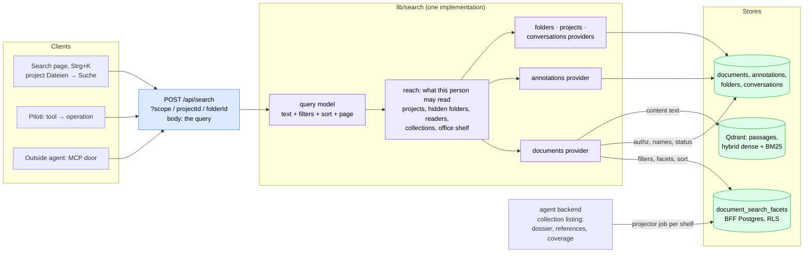

# Search: find anything the office has, from anywhere

Status: designed, 2026-10-27; slices below are built in order. Decision record: [ADR-0133](../adr/0133-search-is-one-query-over-a-projection-beside-the-index.md).
What a document knows about itself: [`document-dossier.md`](../architecture/document-dossier.md).

## What Planfred is trying to be

Planfred sells plan management to Austrian and German planning teams. Its
promise, in its own copy, is a project hub where "plans update automatically"
and "plan and document lists are easy to generate". Its features say what job a
customer hires it for:

- **Everyone works on the current plan.** The list shows the latest Index of
  each plan; older ones move into the plan's history on their own.
- **The Planliste costs nothing.** A blog post's whole story is a secretary who
  no longer stays late to update and print the plan list. One button does it.
- **Who has what, provably.** Upload notifier, dispatch log, access log per
  participant: who received which Index, who downloaded it.
- **Release is visible.** A traffic light per plan: review requested, comment
  attached, approved.
- **Findability through filters.** The uploader's role is set at upload and is
  the primary filter; then phase (folder), object, tags. Counts update as you
  filter.

([plan management](https://planfred.com/en/features/plan-management),
[plan list](https://www.planfred.com/en/blog/overtime-hours-thanks-to-plan-list-creation))

So the underlying intent: **"I can always lay my hands on the right document,
in its valid state, and prove it."** Plan management is the means.

### Where it stops short of that intent

1. **It only knows what somebody typed.** Role is the uploader's, tags are
   curated by hand, the plan key is whatever coding the office uses. A file
   nobody tagged is findable by its name and folder only. The filters describe
   the filing, not the document.
2. **It cannot look inside.** No full-text search is described; plans are found
   by filters. "Where did we write the escape route length?" has no answer.
3. **One project at a time.** "Which of our projects had a Brandschutzkonzept
   for Gebäudeklasse 4 in Wien?" is a question an office asks when it bids for
   the next job, and a project-scoped plan server cannot answer it.
4. **No relations.** A plan that says "siehe EP-05" does not link to EP-05; a
   Bescheid's Auflage does not know which plans it governs. Nothing tells you
   that a referenced plan is missing.
5. **Plans, not the work around them.** The comments, the review, the
   decisions and the conversations about a plan are found by opening the plan.

## The north star

Lena is the project lead of a residential building in Wien. It is Tuesday.

- **08:55, Strg+K, from anywhere.** She types `Fluchtweg GK 4`. The panel shows,
  grouped: three documents across two projects with the passage and page
  ("Fluchtweglänge max. 40 m … S. 7"), an open annotation of her colleague on
  EP-03 saying the stair is 2 m too far, and yesterday's conversation with Piloti
  about OIB-RL 2. Each line says where it lives. Enter opens the passage at the
  page.
- **09:10, the Jour fixe.** In the project she switches to the register: every
  current plan, one row each, Plannummer, Index, Planstand, Maßstab, Verfasser,
  Dokumentart, sorted by Plannummer. Filter "Einreichplan", export, done. The
  Planliste is a view of what Piloti read, not a list someone maintains.
- **09:30.** "Which documents cite ÖNORM B 1600?" is a filter, across the
  office. So is "everything that references EP-05" and "documents stating
  Gebäudeklasse 4 that are not the current Fassung".
- **10:00, Piloti.** She asks in chat "find me Statiken from past timber
  projects in Wien". Piloti runs the same search she would, with the same
  filters, under her rights, through the same API an outside agent uses over
  MCP.
- **Always.** Nothing she may not open is counted, named or quoted: not a
  restricted folder, not a colleague's upload still held in screening, not a
  conversation that read a restricted folder.

What makes this better than Planfred is not a richer filter bar. It is that the
filters come from reading: the type, parties, plan number, Index, scale, place,
facts and references are what ingestion found in the document (the dossier),
so a file nobody tagged is as findable as one somebody did; and that the same
query reaches every shelf and every kind of thing the office works with.

## Design

### One query model

`lib/search/search-wire.ts` is the contract every client shares, and the agent
operation's schema is the same zod object:

- `text`: free text. Matched against names, titles, summaries, parties,
  references and plan numbers (Postgres full text and prefix), and against the
  documents' content (Qdrant's hybrid search over the passages the index already
  holds). Results group per document with the best passage and its page.
- `kinds`: `document`, `annotation`, `folder`, `project`, `conversation`.
  Absent: all of them.
- `filters`: the document filters below; `annotation` filters (status,
  assignee, author); common ones (dates, person).
- `sort` and `dir`: relevance when there is text, else any register column.
- `limit` and `cursor`, `nextCursor` back (ADR-0131 rule 3).

Scope is a query parameter, as the documents API has it (`scope`, `projectId`,
`folderId`; ADR-0131 rules 4 and 5): absent is the whole office, `projectId` one
project, `scope=office_shelf` the Büroablage, `folderId` a subtree.

### One reach

`lib/search/reach.ts` answers "what may this person read" once per search, with
the gates the listing already uses: `listProjects` (`project:view`, closed
projects as `requireProjectAccess` decides them), `getProjectFolderAccess`
(hidden folders and the restricted collections the reader is cleared for),
`shelfReaderFor` (who sees held uploads), and the office shelf's reader. Every
provider takes the reach; none asks a gate of its own. The documents predicate is
`documentVisibleTo` with the `projects` reader the projects grid already counts
with, so the search and the grid cannot disagree.

### Where each filter runs, and why

| Question | Where | Why |
|---|---|---|
| who may read it, which shelf, folder, status, uploader, upload date, file type, archived | `documents` (BFF Postgres) | authorization lives there; ADR-0086/0087/0088 are SQL predicates on it |
| type, parties, place, facts, references, Plankopf, capture, coverage, current Fassung | `document_search_facets` (BFF Postgres, new) | a projection of the dossier keyed by document id, so a filter and the authorization are one query, with facet counts over exactly what the reader may see |
| content | Qdrant, through the backend's grouped search | the passages and their pages are only there |

The dossier itself stays where ingestion writes it (`document_metadata` in the
agent database). Filtering it there would mean the agent database deciding
visibility it cannot see, or the BFF shipping every readable document id to it;
counting there would count what the reader may not open. ADR-0133 records this.

Postgres decides which documents are in a result; Qdrant only ranks their
passages. With text, the content search is pre-filtered for recall: by
`grid_document_id` in the SQL candidates when they are few, else by the payload
fields ingestion mirrors onto every chunk (`document_type`, `references`,
`dossier_facts`). No Qdrant count is ever shown.

The projection is derived, never authored. A row is written when its document
settles, from the reading the status reconciliation already parses; a BFF job
(`search_facets_sync`) refreshes a whole shelf as the backstop, queued when a
search finds the shelf's fingerprint (document count and newest change) moved,
at most once per shelf per interval, the pattern `office_conventions` uses. The
projector fails closed: a listing that came back without the reading blanks
nothing. A shelf never synced is still searched by name, status and content,
and the answer says its facets are being built.

### What "everything" covers in this change

| Kind | Matched on | Who sees it |
|---|---|---|
| document | name, dossier, plan facts, references, content | the reach's documents predicate |
| annotation | body and replies | annotations on documents in reach |
| folder | name, description | folders in reach that are not hidden |
| project | name, address | projects in reach |
| conversation | title, topic tags | the conversation list's own rule, generalized from one project to the reach; withheld conversations (ADR-0088) are never matched |

The providers live in `lib/search/providers.ts`. Annotations are joined to
`documents` under the same `reachWhere` the document search uses, so a mark on
a document in a hidden folder or on someone else's held upload is never found.
Conversations: across the office, every project in reach plus the rows with no
project (the list's rule for those); in a project, that project's rows only;
on the office shelf or in a folder, none. A withheld conversation is dropped
before it is counted.

Tasks, task runs, proposals and project memory are not searched yet: each has
its own subject-access rule (a run's subject document, a memory's restricted
folders) that needs its own provider and test. Message bodies are not searched
yet for the same reason.

## Slices

1. **Facts become filterable.** Migration, projector, job, staleness. Serves
   "a file nobody tagged is as findable".
2. **One core, one API, one operation.** Query model, reach, providers, facet
   counts, `POST /api/search`, operation `workspace-search` for outside agents
   and Piloti, the content search pre-filtered by the structured filters
   (`document_ids` when 1,000 or fewer, else `reading_types` and `refers_to`).
   Serves "the same search for Lena, Piloti and an outside agent".
3. **The page.** Global page with Strg+K, the same organism in a project's
   Dateien, result list with passages and a register view. Serves 08:55 and
   09:10.
4. **The Planliste.** CSV and XLSX export of the current register. Serves 09:10.
5. **Saved searches** per person, shareable within the office. A row of
   `saved_searches` (migration 0186) holds the question only: the scope and
   the body without its cursor, never a result. Running a shared one is an
   ordinary search by the reader, with the reader's reach, so sharing a
   question shares nothing the reader could not already find. Only the owner
   renames, shares or deletes one; anyone else's answers 404.
   `GET/POST /api/search/saved`, `PATCH/DELETE /api/search/saved/[id]`,
   operations `saved-search-list`, `-create`, `-update`, `-delete`
   (`lib/search/saved-search-*.ts`).

### Where the page is

One organism, `frontends/ui/src/features/search` (`SearchWorkspace`), at every
scope; the question lives in the URL (`?q=…&type=…&view=register&sort=…`), so
a search is a link and Back walks its filters.

The register is the 09:10 view by default: without words it reads by
Plannummer (documents without a number last, either way), „Nur aktuelle
Fassung“ is on (`current=0` turns it off; the list's default is off, and
`current=1` turns it on there), and it shows Plannummer, Index, Titel,
Planstand, Maßstab, Dokumentart, Verfasser, Projekt (office scope only) and
Status. The column menu adds Ordner, Hochgeladen and Seiten; the choice is
`cols=` in the URL, in the register's order. Every column header sorts. The
export carries every column whatever is shown, and its menu says so. On a
phone the register is a stack: Plannummer and Index over the title, the other
chosen columns on a line under it, the order in a menu.

- `/app/search`: the whole office. The rail's „Suche“ (`g u`), the header's
  magnifier, and ⌘K, whose first row carries what was typed
  (`/app/search?q=…`). The project facet narrows it to one project.
- A project's Dateien and the Büroablage: „Suche“ in the header switches the
  listing to the search (`?mode=search`), scoped to the shelf and the open
  folder (`?folder=`).
- `/dev/search`: the organism over a fixture answer, list and register.

A hit opens where the workspace already shows it: a document in its shelf's
preview (`?doc=`), an annotation in the review at the mark. The passage's page
is not in the link yet: the Dateien preview has no page parameter.

### Piloti

Piloti reaches the search as every other client does: `workspace-search` is
offered on its workspace door, so it filters, sorts and counts exactly as the
person would, under the person's rights. Its native `list_files` and
`knowledge_search` stay as they are: they read the turn's own inventory and
return citable passages, which this search does not (a passage here is a
pointer to read). Making `list_files` take its structured filters from the core
is the next step, once the answer suite measures it (ADR-0127's eval set).

Next, not in this change: tasks and memory as kinds, `list_files` on the core,
Planfred-style "who received which Index" from the version access log, the
Files pane's semantic search (`POST /api/documents/search`) moved onto the core.

## Measured

`task fe:search:latency` seeds a throwaway Postgres migrated with the repo's
chain and times the repository functions themselves, as `grid_app_rw` under
row-level security, pool and per-statement `SET LOCAL` included
(`frontends/ui/src/lib/search/search-latency.integration.spec.ts`; a spec
rather than a script, so it measures the SQL the builders make, not a copy).
The office: three organizations, the measured one with 120 projects and
20,000 documents (5% held, 3% archived, 10% superseded, 2% in a hidden
folder), 40,000 more beside it; ANALYZEd after the seed.

2026-10-27, 4 vCPU Xeon @ 2.3 GHz, PostgreSQL 16, 40 runs after 3 warm-ups, ms
(second run, after the facets of a text search became one statement):

| Query | p50 | p95 |
|---|---|---|
| office, no text, first page by plan number, with total (18,105 matched) | 93 | 107 |
| office, text „Brandschutz“ with 50 content hits, by relevance | 94 | 112 |
| office, two types + building class 3–5 + cites „ÖNORM B 1600“ | 54 | 68 |
| the same, cites as the token `norm:önorm b 1600` | 40 | 48 |
| one project's register, current only, by plan number, 100 rows | 6 | 10 |
| facet counts, all eight dimensions, office-wide | 124 | 152 |
| facet counts, all eight dimensions, text „Brandschutz“ (one statement) | 82 | 94 |

The first run measured the text facets as eight statements side by side: 199/231.

What the time is, from `EXPLAIN (ANALYZE, BUFFERS)`: every office-wide
statement visits each matched document once (about 18,000 here) and joins its
projection row by key; the planner estimates the matched set at about 340
rows, so it joins in nested loops, and forcing hash joins saved little (99 to
82 ms on the page). The eight facet counts are eight such statements in
parallel on four cores, about 50 ms each alone. No index changes that: the
filters that are not authorization are a minority of the work, and under
row-level security the planner never uses an index for a non-leakproof
operator (`@>`, `&&`, `@@`, `LIKE`), which is why 0185 carries B-trees only.

Counting all eight facets in one statement over a materialized match is
slower without text (210 ms on one core) and faster with it, because the text
predicate then runs once instead of eight times; so a text search counts that
way (`facetCountsOnce`) and a search without text side by side
(`facetCountsSideBySide`), and the integration spec holds both to one answer.
Measured, not built: sorting the matched ids first and joining the display
columns to the page alone (a deferred join) took the page from 104–119 to
59–69 ms.
