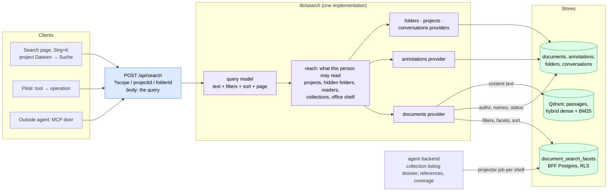

# Search: find anything the office has, from anywhere

Status: designed, 2026-10-27; slices below are built in order. Decision record: [ADR-0136](../adr/0136-search-is-one-query-over-a-projection-beside-the-index.md).
What a document knows about itself: [`document-dossier.md`](../architecture/document-dossier.md).

## What Planfred is trying to be

Planfred sells plan management to Austrian and German planning teams. Its
promise, in its own copy, is a project hub where "plans update automatically"
and "plan and document lists are easy to generate". Its features say what job a
customer hires it for:

- **Everyone works on the current plan.** The list shows the latest Index of
  each plan; older ones move into the plan's history on their own.
- **The Planliste costs nothing.** A blog post's whole story is a secretary who
  no longer stays late to update and print the plan list. One button does it.
- **Who has what, provably.** Upload notifier, dispatch log, access log per
  participant: who received which Index, who downloaded it.
- **Release is visible.** A traffic light per plan: review requested, comment
  attached, approved.
- **Findability through filters.** The uploader's role is set at upload and is
  the primary filter; then phase (folder), object, tags. Counts update as you
  filter.

([plan management](https://planfred.com/en/features/plan-management),
[plan list](https://www.planfred.com/en/blog/overtime-hours-thanks-to-plan-list-creation))

So the underlying intent: **"I can always lay my hands on the right document,
in its valid state, and prove it."** Plan management is the means.

### Where it stops short of that intent

1. **It only knows what somebody typed.** Role is the uploader's, tags are
   curated by hand, the plan key is whatever coding the office uses. A file
   nobody tagged is findable by its name and folder only. The filters describe
   the filing, not the document.
2. **It cannot look inside.** No full-text search is described; plans are found
   by filters. "Where did we write the escape route length?" has no answer.
3. **One project at a time.** "Which of our projects had a Brandschutzkonzept
   for Gebäudeklasse 4 in Wien?" is a question an office asks when it bids for
   the next job, and a project-scoped plan server cannot answer it.
4. **No relations.** A plan that says "siehe EP-05" does not link to EP-05; a
   Bescheid's Auflage does not know which plans it governs. Nothing tells you
   that a referenced plan is missing.
5. **Plans, not the work around them.** The comments, the review, the
   decisions and the conversations about a plan are found by opening the plan.

## The north star

Lena is the project lead of a residential building in Wien. It is Tuesday.

- **08:55, Strg+K, from anywhere.** She types `Fluchtweg GK 4`. The panel shows,
  grouped: three documents across two projects with the passage and page
  ("Fluchtweglänge max. 40 m … S. 7"), an open annotation of her colleague on
  EP-03 saying the stair is 2 m too far, and yesterday's conversation with Piloti
  about OIB-RL 2. Each line says where it lives. Enter opens the passage at the
  page.
- **09:10, the Jour fixe.** In the project she switches to the register: every
  current plan, one row each, Plannummer, Index, Planstand, Maßstab, Verfasser,
  Dokumentart, sorted by Plannummer. Filter "Einreichplan", export, done. The
  Planliste is a view of what Piloti read, not a list someone maintains.
- **09:30.** "Which documents cite ÖNORM B 1600?" is a filter, across the
  office. So is "everything that references EP-05" and "documents stating
  Gebäudeklasse 4 that are not the current Fassung".
- **10:00, Piloti.** She asks in chat "find me Statiken from past timber
  projects in Wien". Piloti runs the same search she would, with the same
  filters, under her rights, through the same API an outside agent uses over
  MCP.
- **Always.** Nothing she may not open is counted, named or quoted: not a
  restricted folder, not a colleague's upload still held in screening, not a
  conversation that read a restricted folder.

What makes this better than Planfred is not a richer filter bar. It is that the
filters come from reading: the type, parties, plan number, Index, scale, place,
facts and references are what ingestion found in the document (the dossier),
so a file nobody tagged is as findable as one somebody did; and that the same
query reaches every shelf and every kind of thing the office works with.

## Design

### One query model

`lib/search/search-wire.ts` is the contract every client shares, and the agent
operation's schema is the same zod object:

- `text`: free text. Matched against names, titles, summaries, parties,
  references and plan numbers (Postgres full text and prefix), and against the
  documents' content (Qdrant's hybrid search over the passages the index already
  holds). Results group per document with the best passage and its page.
- `kinds`: `document`, `annotation`, `folder`, `project`, `conversation`.
  Absent: all of them.
- `filters`: the document filters below; `annotation` filters (status,
  assignee, author); common ones (dates, person). A kind a set filter cannot
  narrow is set aside, and the answer says so (`setAside`, below).
- `sort` and `dir`: relevance when there is text, else any register column.
- `limit` and `cursor`, `nextCursor` back (ADR-0131 rule 3).

Scope is a query parameter, as the documents API has it (`scope`, `projectId`,
`folderId`; ADR-0131 rules 4 and 5): absent is the whole office, `projectId` one
project, `scope=office_shelf` the Büroablage, `folderId` a subtree.

### One reach

`lib/search/reach.ts` answers "what may this person read" once per search, with
the gates the listing already uses: `listProjects` (`project:view`, closed
projects as `requireProjectAccess` decides them), `getProjectFolderAccess`
(hidden folders and the restricted collections the reader is cleared for),
`shelfReaderFor` (who sees held uploads), and the office shelf's reader. Every
provider takes the reach; none asks a gate of its own. The documents predicate is
`documentVisibleTo` with the `projects` reader the projects grid already counts
with, so the search and the grid cannot disagree.

### Where each filter runs, and why

| Question | Where | Why |
|---|---|---|
| who may read it, which shelf, folder, status, uploader, upload date, file type, archived | `documents` (BFF Postgres) | authorization lives there; ADR-0086/0087/0088 are SQL predicates on it |
| type, parties, place, facts, references, Plankopf, capture, coverage, current Fassung, what a Fassung changed | `document_search_facets` (BFF Postgres, new) | a projection of the dossier keyed by document id, so a filter and the authorization are one query, with facet counts over exactly what the reader may see |
| content | Qdrant, through the backend's grouped search | the passages and their pages are only there |

The dossier itself stays where ingestion writes it (`document_metadata` in the
agent database). Filtering it there would mean the agent database deciding
visibility it cannot see, or the BFF shipping every readable document id to it;
counting there would count what the reader may not open. ADR-0136 records this.

Postgres decides which documents are in a result; Qdrant only ranks their
passages. With text, the content search is pre-filtered for recall: by
`grid_document_id` in the SQL candidates when they are few (and by their file
names, for the passages written before that field or copied from Chroma, which
carry none), else by the payload fields ingestion mirrors onto every chunk
(`document_type`, `references`, `dossier_facts`). No Qdrant count is ever shown.

A content hit is one of two kinds. Its passage holds a word of the query (the
BM25 or an exact-term channel ranked it): `matchedOn` says `content`. Or it is
only near in meaning (an English question over a German document, a synonym):
`matchedOn` says `meaning`, and the backend keeps it only above a cosine floor
(`MEANING_ONLY_MIN_COSINE` in `aiq_api/routes/document_search.py`, measured on
the deployed embedder), because the fusion always fills its candidates from the
dense channel and a word nobody wrote would otherwise return the nearest
passages as hits.

The words are matched in one German spelling: ä ö ü ß and ae oe ue ss are the
same letters in a name, in the reading's full-text vector (both through
`grid_fold_german`, migration 0188) and in the BM25 channel, which asks both
spellings and keeps the one the documents hold
(`german_text.umlaut_spellings`).

The projection is derived, never authored. A row is written:

- **when its document settles**, from the reading the status reconciliation
  already parses (`reconcile-status.ts`). A re-upload under the same name is a
  new version of the same document: it is read again and settles again, so its
  row is rewritten, never marked superseded. A Fassung filed at upload
  (`revisionOf`) is linked when the new file is read; the documents its listing
  entry says it `supersedes` are rewritten from the same listing at that moment.
- **when a person changes what it derives**, after the write landed: tags and
  topics (`updateDocumentTags`), a Fassung link confirmed or taken back
  (`setRevisionLink`, both documents). The service calls
  `refreshSearchRows` (`lib/search/refresh-rows.ts`), which reads the
  collection fresh and rewrites those rows before the answer goes back, so the
  person's next search sees the change. It never fails the write: a listing it
  cannot read marks the shelves stale (`markShelvesStale`) and the next search
  queues their refresh.
- **by the backstop**: a BFF job (`search_facets_sync`) refreshes a whole shelf,
  queued when a search finds the shelf's fingerprint (document count and newest
  change) moved, the sync older than an hour, or the shelf marked stale, at
  most once per shelf per interval, the pattern `office_conventions` uses. It
  catches what the agent writes on its own side.

`superseded` is the listing's `superseded_by`, which only a person's
confirmation writes; Piloti's `revision_suggestion` never counts. Name, folder,
status and lifecycle are not projected: the search reads them from `documents`
in the same query, so a rename, a move, an archive or a role declared in the
project (roles are not a search facet) is current without a rewrite.

The projector fails closed: a listing that came back without the reading
blanks nothing, and a document with no reading at all has no row, so a Fassung
decision about it reaches the search only once it has one. A shelf never synced
is still searched by name, status and content, and the answer says its facets
are being built.

### What changed, and what is not read yet

Planfred's question about a new Index is "what is new in it"; its answer is a
history entry. Ours is the facts. A new Fassung's dossier carries `changes`
(per fact key `{key, before, after, page}`, against the Fassung it replaced:
a re-upload under the same name or the one linked at upload,
[`document-dossier.md`](../architecture/document-dossier.md)), and the
projection keeps them as `changed_facts` with their keys in
`changed_fact_keys`. So "which documents changed a fact recently" is two
filters: `factsChanged` (any fact) or `changedFacts` (these keys), with
`uploaded` for "recently", because the change is as new as the Fassung that
carries it. The keys are also a facet (`changedFact`, „Geänderte Angaben“), and
a hit says what changed („Gegenüber der Vorfassung: Fluchtweglänge 38,50 m →
42,10 m“).

Only documents ingested since the comparison landed carry it; nothing
backfills the older ones, and the dossier writes `changes` only when something
differs. An empty list therefore says "nothing changed, or nothing was
compared", never "unchanged", and the filter finds only positive answers. The
predecessor's file name (`changed_against`) is not projected: the version
chain the preview already shows names it better.

A facet counts only what Piloti read: a document without a projection row
(still reading, failed, uploaded before its shelf's first sync) is in no count
and found by no reading filter. So the answer carries `unread`, the documents
in scope without a row, counted with the facets over the reach alone (a reading
filter admits none of them, so counting under it would always say 0), and the
rail says it in one line under the facets: „3 Dokumente noch nicht gelesen, in
den Zahlen oben nicht enthalten.“ It is information the counts cannot show
(design language, principle 9), so it stays, and it is absent when it is 0.
`building` remains the per-shelf note above the results.

### What "everything" covers in this change

| Kind | Matched on | Who sees it |
|---|---|---|
| document | name, dossier, plan facts, references, content | the reach's documents predicate |
| annotation | body and replies | annotations on documents in reach that the document filters admit |
| folder | name, description | folders in reach that are not hidden |
| project | name, address | projects in reach |
| conversation | title, topic tags | the conversation list's own rule, generalized from one project to the reach; withheld conversations (ADR-0088) are never matched |

The providers live in `lib/search/providers.ts`. Annotations are joined to
`documents` (and its search row) under the same `documentSearchWhere` the
document search uses, the reach and the document filters together, so a mark on
a document in a hidden folder or on someone else's held upload is never found,
and with „Dokumentart: Einreichplan“ set only the marks on Einreichpläne are.
Conversations: across the office, every project in reach plus the rows with no
project (the list's rule for those); in a project, that project's rows only;
on the office shelf or in a folder, none. A withheld conversation is dropped
before it is counted.

#### A filter narrows every row shown, or the kind is set aside

A chip claims a narrowing, so every row under it honours it. A filter on what a
document is (`filters`, `setAsideKinds` in `search-wire.ts`) narrows the
documents and, through their document, the annotations. A folder, a project or
a conversation carries nothing such a filter asks about, so while one is set
those kinds are not searched, and the answer names them in
`setAside: { folder: 'document_filters', … }`. An annotation filter (status,
kind, assignee, author) narrows only annotations, so it sets the documents and
the other kinds aside the same way (`annotation_filters`); with the documents
set aside there are no facet counts, so no count disagrees with a row. Two
document filters set nothing aside: `projectIds` cuts the reach every kind
reads, and `includeArchived` only widens. A kind the words would not have
searched anyway (a folder without text) is not named.

The list shows a set-aside kind's tab disabled, titled „Mit diesen Filtern
nicht durchsucht“, and one line above the results says which filters apply
and which kinds wait: „Die Filter gelten für Dokumente und ihre Anmerkungen.
Ordner, Projekte und Chats werden so lange nicht durchsucht.“ The line earns
its place (principle 9): a disabled tab alone does not say why, and a silent
gap reads as „no folder matched“.

Tasks, task runs, proposals and project memory are not searched yet: each has
its own subject-access rule (a run's subject document, a memory's restricted
folders) that needs its own provider and test. Message bodies are not searched
yet for the same reason.

## Slices

1. **Facts become filterable.** Migration, projector, job, staleness. Serves
   "a file nobody tagged is as findable".
2. **One core, one API, one operation.** Query model, reach, providers, facet
   counts, `POST /api/search`, operation `workspace-search` for outside agents
   and Piloti, the content search pre-filtered by the structured filters
   (`document_ids` when 1,000 or fewer, else `reading_types` and `refers_to`).
   Serves "the same search for Lena, Piloti and an outside agent".
3. **The page.** Global page with Strg+K, the same organism in a project's
   Dateien, result list with passages and a register view. Serves 08:55 and
   09:10.
4. **The Planliste.** CSV and XLSX export of the current register. Serves 09:10.
5. **Saved searches** per person, shareable within the office. A row of
   `saved_searches` (migration 0186) holds the question only: the scope and
   the body without its cursor, never a result. Running a shared one is an
   ordinary search by the reader, with the reader's reach, so sharing a
   question shares nothing the reader could not already find. The question
   itself still names projects (its scope, its `projectIds` filter), so the
   list hides a colleague's search scoped to a project the reader may not
   view and drops such projects from its filter (`savedSearchForReader`): the
   reader never learns a project exists that the projects list hides. Only the owner
   renames, shares or deletes one; anyone else's answers 404. A colleague's
   shared one carries `ownerName`, from the office's people directory
   (`lib/sharing/directory.ts`), so the list says whose question it is. Under
   each name one muted line says what the search asks, the words quoted and
   the filters in the chips' words, a Dokumentart or a switch by its value
   alone (`savedSearchSummary`), so a name alone
   never has to be trusted. One's own carries a ⋯ (Teilen or Nicht mehr
   teilen, Umbenennen, Löschen), not a switch in the row. A
   delete in the page is held for the undo toast's window and sent when it
   closes (`useUndoableArchive`), so „Rückgängig“ never has to re-create one.
   `GET/POST /api/search/saved`, `PATCH/DELETE /api/search/saved/[id]`,
   operations `saved-search-list`, `-create`, `-update`, `-delete`
   (`lib/search/saved-search-*.ts`).

### Where the page is

One organism, `frontends/ui/src/features/search` (`SearchWorkspace`), at every
scope; the question lives in the URL (`?q=…&type=…&view=register&sort=…`), so
a search is a link and Back walks its filters.

The register is the 09:10 view by default: without words it reads by
Plannummer (documents without a number last, either way), „Nur aktuelle
Fassung“ is on (`current=0` turns it off; the list's default is off, and
`current=1` turns it on there), and it shows Plannummer, Index, Titel,
Planstand, Maßstab, Dokumentart, Verfasser, Projekt (office scope only) and
Status. The column menu adds Ordner, Hochgeladen and Seiten; the choice is
`cols=` in the URL, in the register's order. Every column header sorts. The
export carries every column whatever is shown, and its menu says so. On a
phone the register is a stack: Plannummer and Index over the title, the other
chosen columns on a line under it, the order in a menu.

- `/app/search`: the whole office. The rail's „Suche“ (`g u`) and the header's
  magnifier open it. The project facet narrows it to one project.
- ⌘K, from anywhere: what is typed is searched live (150 ms after the last
  key, three hits of each kind, no facet counts; in a project, that project),
  the hits grouped by kind and drawn by the page's own row components
  (`HitRow` inside the palette's option), compact there: the name, one line of
  where and what, the passage only on the row the arrows are on. Enter opens
  the first. The last search row, „Alle Treffer für …“, opens the page with
  the question (`/app/search?q=…`); it stays pinned at the list's foot while
  hits run past it, and ⌘↵ (Strg+Enter) reaches it from any row. With nothing typed the palette says in one line what the
  search reaches and offers the recent searches (this browser, five) and the
  saved ones. The palette's commands stay below. On the search page itself ⌘K
  focuses the page's field, which is the same search.
- A hit in the list is at most three lines: the name, the searched words set
  apart in it; one muted line of where it lives (the shelf's mark only when
  the scope does not already say it, then the folder) and what it is
  (Dokumentart, Plannummer, Index, Maßstab, Planstand); then the passage with
  its page. „Gefunden in …“ shows only on a row that shows nothing that
  matched.
- The field is a WAI-ARIA combobox: ↑ ↓ move an active option while focus
  stays in the field (`aria-activedescendant`), each kind's rows are a listbox
  (the register's rows, its table), and the active row carries a 2px ink rule.
- A project's Dateien and the Büroablage: one field in the header. Typing
  filters the listing by name; Enter opens the search (`?mode=search&q=…`),
  scoped to the shelf and the open folder (`?folder=`). There is no second
  „Suche“ button beside it.
- `/dev/search`: the organism over a fixture answer, list and register,
  filtered and sorted in memory to match what is set (`searchFixtureAnswer`),
  so a capture never contradicts its chips. `?scope=project`,
  `?state=empty|loading|error`, `?filters=open`, `?composer=1` (the
  composer's `#` picker).

The rail starts with Plannummer and Index on one row and „Nur aktuelle
Fassung“, always open; the counted facets follow; the rest folds under
„Weitere Filter“. A filter has one control: what the rail counts (Beteiligte,
Verweist auf, Dateityp) is chosen in its group, a party's name is typed inside
the Beteiligte group, and an opened long list is narrowed by a field over it.
„Nur aktuelle Fassung“ is the rail's switch in the list and the switch above
the table in the Planliste, which shows no chip for it. Under `md` the rail is
a bottom sheet behind „Filter“ with „Alle entfernen“ and „N Treffer zeigen“
pinned at the foot. Dates are typed in the page's locale
(`components/ui/date-input.tsx`), not in the browser's.

#### Completions: the filters offer what the office holds

A typed filter is only as good as the spelling a person guesses: „Lindner“
finds nothing when the documents say „Atelier Lindner ZT GmbH“ and the field
only matched what was typed after Enter. So every free-text filter completes
from the documents: a party's name in Beteiligte (and a further reference in
Verweist auf, under its thirty counted values), Plannummer, Index, Maßstab,
Ort, and an Angabe's value. Each value shows how many documents hold it,
spelled as the documents most often spell it; taking one applies the filter at
once. What was typed and not taken still applies on Enter or blur, as before.

- **One capability, three clients.** `POST /api/search/suggest`
  (`lib/search/suggest.ts`, `suggest-repository.ts`) and the operation
  `workspace-search-suggest`, offered on both doors: an outside agent and
  Piloti ask for the exact party name or norm token before they filter,
  instead of guessing it. Body: `dimension` (`party` with an optional `role`,
  `place`, `cites`, `scale`, `planNumber`, `planIndex`, `fact` with its
  `factKey`), `prefix`, and the search's `filters`; scope is the query, as for
  the search. Answer: at most ten `{ value, label, count }`, most documents
  first, then by label. A `cites` value is the `kind:key` token the filter
  takes; its label is the document's own spelling.
- **The same reach and filters as the search.** One statement under
  `documentSearchWhere`, the predicate the page and the facet counts use: a
  value of a document in a hidden folder, someone else's upload held in
  screening, a project the reader cannot open or another office is never
  named or counted (`document-repository.integration.spec.ts`, „completions“).
  The dimension's own filter is left out (`filtersBeside`), so with one party
  chosen the others still show; a fact leaves out only its own key. The words
  of the search are not asked: a completion counts what a filter would admit,
  and the content search that words start is no part of a keystroke.
- **Matched on the start of any word**, case, accents and the marks between
  words ignored (`lib/search/suggest-fold.ts`, one `translate()` table shared
  by the browser and the SQL): „lind“, „LIND“ and „Lind“ find „Atelier Lindner
  ZT GmbH“, „sud“ finds „Ingenieurbüro Süd“, „onorm“ „ÖNORM B 1600“. A
  drawing number matches as its filter does, squashed from the start („EP0“
  finds „EP-05“ and „EP 05“, which are one value). Spellings that fold alike
  are one value; their counts add up, so a document that writes one name two
  ways counts twice for it.
- **Bounded.** B-tree only and no new index: under row-level security none
  serves `LIKE` (0185, `docs/contributing/gotchas.md`). The matched documents
  are read once, as a facet count reads them, each value counted per exact
  spelling, and only the distinct spellings are folded and matched (a
  `MATERIALIZED` CTE keeps the planner from folding every occurrence). Ten
  values at most; the route's `Server-Timing` says `sql`.
- **The field** (`components/ui/suggest-input.tsx`) is the WAI-ARIA combobox
  with list autocomplete the address field already is: focus stays in it,
  ↑ ↓ move the active option, Enter takes it, Escape closes the list and
  nothing else. Nothing is active until an arrow is pressed, so Enter on what
  was typed keeps its old meaning. It asks only while it has focus, 150 ms
  after the last key; a list field (Index, Maßstab) completes the entry being
  typed and leaves out the ones already in it. The source is the surface's
  (`SuggestSourceProvider`): the connected search asks the route at its scope
  and under its filters, `/dev/search` answers from its fixture office.
- PostHog's `search_suggestion_picked` says which filter, the rank taken and
  how many characters were typed, never the value
  ([`posthog-events.md`](../observability/posthog-events.md)).

Not in this change: the „Alle zeigen“ field over a long counted list still
narrows the thirty values the rail holds (Verweist auf gets the completing
field under it instead); the uploader, whose names live in the people
directory rather than in SQL, is chosen from its counts only.

The toolbar is set as the Dateien header is: the view as an icon pair, saved
searches as one quiet button whose list ends in „Diese Suche speichern“ (a
popover; on a phone a bottom sheet), and the Planliste's export as an icon in
the Planliste only. The Planliste has hairlines and no stripes, the keyboard's
row in the accent fill; „Ersetzt“ sits on the name in every view, and Status
is a column the reader adds, showing only the exceptions („Wird gelesen“,
„Nicht lesbar“).

A hit opens where the workspace already shows it: a document in its shelf's
preview (`?doc=`), an annotation in the review at the mark. A document hit
with a passage opens at it: `?doc=<id>&page=7&highlight=<passage>`
(`features/documents/lib/document-locus.ts`). `page` and `highlight` are the
two things a citation hands the same pdf.js viewer, so the preview opens at the
passage's page with the passage lit up, matched as fuzzily as a citation's (and
looked for on the neighbouring pages when the page number is off by a cover
sheet). The link carries the passage's first 200 characters, cut at a word.
The place belongs to the document `doc` names: opening another document, or a
folder, takes `page` and `highlight` off the address with the review's params.
A preview that is not a PDF (an image, a text file) ignores both.

A document hit also leads on, through its ⋯ in the list, the register and the
phone's stack (the house's `ActionMenu`, `features/search/components/hit-actions-menu.tsx`),
in the order and the words of a Dateien row's ⋯: „Öffnen" goes where the
row's link goes, at the passage; „Piloti fragen" starts a chat about the file in its project through the one
ask (`askAboutFile`), the question prefilled with the passage's page when the
hit was found by one; „Aktuelle Fassung öffnen", on a superseded hit, asks the
document's status for the newer Fassung this reader may open (the hit carries
only that one exists) and opens it on the same shelf; „Offene Punkte" opens
the document's Prüfansicht, and closing it returns to the search; „Im Ordner
zeigen" opens the folder it lies in on its shelf; „Link kopieren" puts the
document's own absolute address on the clipboard (without the passage or the
way back, which are this reader's), and a toast says it did. A
Büroablage document has no chat to start, so it offers no „Piloti fragen".
With a row marked, Shift+F10 or the menu key opens its ⋯ while the focus
stays in the field. Each action is an operation that already exists
(`agent-ask-create`, `document-status`, `annotation-list`); none is new.

In the chat composer, `#` and a word search the workspace for a document as
`@` finds a person (`useDocumentReference`): the palette's live results,
documents only, in the chat's project. A pick writes the name into the
message („Grundriss EG“, the name the agent retrieves by) and makes the
document the message's subject, as „Piloti fragen" does. `/dev/search?composer=1`
shows the picker.

A document or annotation hit comes back to the search. Its link carries
`back`, the search page's own address (query, filters, kinds, view, sort),
the way Offene Punkte and the Postfach send a reader into a review
(`features/documents/lib/open-review.ts`): closing the preview
(`hooks/use-preview-channel.ts`) or the review goes there, by Back when the
entry behind is that search, else by replacing the address with it. `back` is
only ever a path of the app (`appReturnPath`). A folder, a project and a
conversation have nothing to close; Back walks to the search, whose URL holds
it all. The ⌘K palette's hits carry no `back`: what lies under the palette is
not a search. The scroll position is not restored: the answer is fetched
afresh, and its further pages with it.

### Piloti

Piloti reaches the search as every other client does: `workspace-search` is
offered on its workspace door, so it filters, sorts and counts exactly as the
person would, under the person's rights. Its native `list_files` and
`knowledge_search` stay as they are: they read the turn's own inventory and
return citable passages, which this search does not (a passage here is a
pointer to read). Making `list_files` take its structured filters from the core
is the next step, once the answer suite measures it (ADR-0127's eval set).

When a person browses their files in chat (`surface_documents` with
`mode=many`), Piloti asks `workspace-search` once per shelf the turn reads
(this project, the office shelf), and the `document_grid` card it shows carries
the question (`search`: text and scope) and an „In der Suche öffnen“ link to
the search page asking it, so the rest of the result is one click away. A run
with no signed request context (an eval, the CLI) browses the vector corpora as
before and links nothing. The search text is written in the documents'
language; English is only for finding an operation.

The Files pane's semantic search asks the core too: `POST /api/search` with the
shelf as its query and `kinds: ['document']`. `POST /api/documents/search` and
the operation `document-search` are gone; the old name leads to
`workspace-search` for one release, its fields rewritten.

Next, not in this change: tasks and memory as kinds, `list_files` on the core,
Planfred-style "who received which Index" from the version access log.

## Measured

`task fe:search:latency` seeds a throwaway Postgres migrated with the repo's
chain and times the repository functions themselves, as `grid_app_rw` under
row-level security, pool and per-statement `SET LOCAL` included
(`frontends/ui/src/lib/search/search-latency.integration.spec.ts`; a spec
rather than a script, so it measures the SQL the builders make, not a copy).
The office: three organizations, the measured one with 120 projects and
20,000 documents (5% held, 3% archived, 10% superseded, 2% in a hidden
folder), 40,000 more beside it; ANALYZEd after the seed.

2026-10-27, 4 vCPU Xeon @ 2.3 GHz, PostgreSQL 16, 40 runs after 3 warm-ups, ms
(second run, after the facets of a text search became one statement):

| Query | p50 | p95 |
|---|---|---|
| office, no text, first page by plan number, with total (18,105 matched) | 93 | 107 |
| office, text „Brandschutz“ with 50 content hits, by relevance | 94 | 112 |
| office, two types + building class 3–5 + cites „ÖNORM B 1600“ | 54 | 68 |
| the same, cites as the token `norm:önorm b 1600` | 40 | 48 |
| one project's register, current only, by plan number, 100 rows | 6 | 10 |
| facet counts, all eight dimensions, office-wide | 124 | 152 |
| facet counts, all eight dimensions, text „Brandschutz“ (one statement) | 82 | 94 |
| completion, a party „atel“, office-wide (third run) | 80 | 104 |
| completion, a reference „önorm“, office-wide (third run) | 96 | 107 |
| completion, a drawing number „ep“ under „Nur aktuelle Fassung“ (third run) | 53 | 71 |

The completions' first form folded every party of every matched document
before matching (Postgres pushed the match below the per-spelling count):
340 to 450 ms p50 for a party. Counting per spelling first, behind a
`MATERIALIZED` fence, and folding only the distinct spellings brought it to
one facet count's time.

The first run measured the text facets as eight statements side by side: 199/231.

What the time is, from `EXPLAIN (ANALYZE, BUFFERS)`: every office-wide
statement visits each matched document once (about 18,000 here) and joins its
projection row by key; the planner estimates the matched set at about 340
rows, so it joins in nested loops, and forcing hash joins saved little (99 to
82 ms on the page). The eight facet counts are eight such statements in
parallel on four cores, about 50 ms each alone. No index changes that: the
filters that are not authorization are a minority of the work, and under
row-level security the planner never uses an index for a non-leakproof
operator (`@>`, `&&`, `@@`, `LIKE`), which is why 0185 carries B-trees only.

Counting all eight facets in one statement over a materialized match is
slower without text (210 ms on one core) and faster with it, because the text
predicate then runs once instead of eight times; so a text search counts that
way (`facetCountsOnce`) and a search without text side by side
(`facetCountsSideBySide`), and the integration spec holds both to one answer.
Measured, not built: sorting the matched ids first and joining the display
columns to the page alone (a deferred join) took the page from 104–119 to
59–69 ms.

In production the same split is measured per search: the route's
`Server-Timing` header names `sql` and `content` (the wait on
`POST /v1/collections/search`), PostHog's `search_issued` carries both with the
browser's `duration_ms`, and the content query is the Langfuse observation
`retrieve.workspace_search` with its pre-filter mode and candidate counts
([`posthog-events.md`](../observability/posthog-events.md),
[`langfuse.md`](../observability/langfuse.md)).
