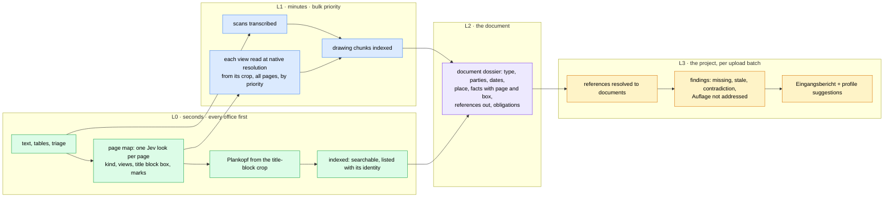

# Ingestion north star: from "file uploaded" to "Piloti knows what this brings the project"

Status: proposed, 2026-10-27. Current state, drawn: [`docs/architecture/ingestion-pipeline.md`](../architecture/ingestion-pipeline.md).
Every claim about today below is measured or cited there.

Piloti is the workspace a planning office runs its projects in. Ingestion is the
moment a document joins a project, and today it ends at "indexed": the file can be
searched. The office expects more from a colleague who just received 240 files
from a predecessor's project. They expect to hear what arrived, what it means for
the project, what is missing, and what does not add up.

## The scene

It is 16:05. Lena drops the folder of a project her office takes over: 240 files,
Einreichpläne in two Indizes, a Statik, a Bescheid, mail, photos. Twelve other
offices are uploading at the same moment.

- **16:05:10.** Every file is in the list with what it is, not what it is called:
  "Grundriss EG · EP-03 · Index C · 1:100 · 12.03.2025", "Baubescheid MA 37 ·
  7 Auflagen", "Foto · Baustelle · 14.09.2026". She can search all of it.
- **16:06.** Piloti posts the **Eingangsbericht** to the project:
  > 240 Dokumente gelesen. Das ist die Einreichung vom März 2025 mit Statik und
  > Baubescheid. **Fehlt:** das Brandschutzkonzept. Drei Pläne und Auflage 4 des
  > Bescheids verweisen darauf. **Fassungen:** EP-01 bis EP-09 liegen in Index B und
  > C vor, C ist aktuell, B ist abgelegt. **Widerspruch:** die Baubeschreibung nennt
  > 4 Geschosse, Schnitt A-A zeigt 5 (S. 1, Feld rechts oben). **Für das Projekt:**
  > Gebäudeklasse 4, Wien, Holzrahmenbau, übernommen in den Steckbrief, zur
  > Bestätigung.
- **16:07.** She opens Grundriss EG. The section marks A and B are links to
  Schnitt A-A and B-B. The margin lists what this plan references (OIB-RL 2,
  Brandschutzkonzept, EP-05) and what references it (Auflage 2 of the Bescheid).
- **16:20.** The deep reading of every drawing view is done. She was never waiting
  on it, and neither were the twelve other offices.

Technology is the enabler here, never the objection. The slices below are what we
can build, measure and ship now, each naming the part of the scene it serves.

## What is wrong today, said plainly

Measured or read in the code on 2026-10-27; details and line numbers in the
architecture doc.

1. **One expensive call per drawing page, and all offices share 32 of them.** A
   vision call on a real multi-view sheet took 25 s; a denser one ran past its
   3000-token budget, was asked again from the start and took 56 s. Each call holds
   one of the fleet's 32 vision slots, so the platform reads about 4,600 drawing
   pages an hour in total, and at most 15 documents are in flight across every
   office. Time to searchable for a new upload depends on everyone else's
   drawings.
2. **Pages past 20 are not read.** `AIQ_MAX_RENDERED_PAGES = 20` per file. A
   60-sheet Einreichung loses 40 sheets of drawing content without telling anyone.
3. **The document is understood from its cover and its last page.** Summary, tags
   and topics see the first and last chunk, 4000 characters. Tags are 12 coarse
   types: no Baubeschreibung, Brandschutzkonzept, Energieausweis, Protokoll.
4. **The richest output is shelved.** The schema-v5 reading of each drawing (rooms,
   quantities with units, relations as triples, author, location) is stored as an
   unindexed JSON string. Retrieval never reads it; it becomes no fact anywhere.
5. **No references, so no relations.** The only reference extracted is `§ n`.
   "siehe EP-05", "gem. Brandschutzkonzept", ÖNORM B 1600, OIB-RL 2 Punkt 3.2 and
   the section marks on a plan are invisible. Fassung links are the only edges
   between documents.
6. **Findings exist only at question time.** Contradictions, missing documents and
   unmet Auflagen are found only if someone asks the right question. Three later
   readers (permit extraction, the intake agent, the experience reader) each read
   the same documents again with their own model calls, and none stores a fact the
   others reuse.
7. **Reliability is per page silent and per file manual.** A failed vision or OCR
   page is skipped with a log warning; the person sees a complete-looking document.
   A transient failure fails the file until somebody presses "Erneut lesen".
   Status reaches the browser only by polling.
8. **We cannot see it.** ADR-0089 says everything is observable in Langfuse;
   ingestion has no Langfuse trace. Stage seconds were a log line, and the OCR
   stage was missing from it (fixed in this change).
9. **We pay twice.** A truncated drawing reply was regenerated from scratch (budget
   raised in this change). Embeddings are not cached, so moving a document between
   collections re-embeds every chunk.
10. **Bugs the map turned up.** Photos never kept their EXIF capture date and
    camera: a reset after the image branch wiped them (fixed in this change, with a
    test). One sheet's summary came back in French: the prompt asks for "the
    document's language" and the model guessed.
11. **No ingestion eval.** We cannot say whether a prompt or model change made
    extraction better. The answer suite measures answers, not what the reader
    extracted.

## What others do

- **Decompose, then read each piece at its own resolution.** nv-ingest, Docling,
  Unstructured and the drawing tools (Bluebeam, Togal, Kreo) all render, detect
  regions (views, title block, legend), crop, then read each region. Our schema asks
  the vision model to segment a whole sheet in one reply; the region detector is the
  documented gap ([`visual-ingestion.md`](../architecture/visual-ingestion.md#direction-not-yet-built)).
- **A cheap first stage, an expensive second.** Visual retrieval pipelines put a fast
  first pass (BM25 or one vector) in front of late-interaction scoring
  ([Mixpeek](https://mixpeek.com/guides/visual-document-retrieval)). The PULSAR
  pipeline (2026) skips unchanged documents by hash, keeps three priority queues and
  renders pages twice: 150 dpi for retrieval, 500 dpi for grounding
  ([arXiv 2608.28572](https://arxiv.org/pdf/2608.28572)).
- **Relations are built at ingest.** LightRAG and GraphRAG extract entities and
  relations per chunk when the document arrives and update the graph incrementally
  ([Neo4j on LightRAG](https://neo4j.com/blog/developer/under-the-covers-with-lightrag-extraction/)).
  In construction, Trunk Tools' Cortex (June 2026) builds a graph that links which
  spec section governs which submittal, across drawings, specs, RFIs and minutes
  ([Trunk Tools](https://trunktools.com/blog/best-construction-drawing-management-software/)).
  Bluebeam's batch linking turns sheet numbers on drawings into links between sheets.
- **Context on every chunk.** Contextual retrieval prepends a short, document-aware
  context to each chunk before embedding and BM25 (Anthropic, 2024). Our section
  paths do part of this already, for text documents only.
- **A decision model can look.** Jev 1.14 (TypeSafe, October 2026) takes images and
  answers `choice`, `noul`, `score` and a new `box`. Image input sits behind an
  experimental header and TypeSafe does not recommend it for production yet
  ([OpenRouter docs](https://openrouter.ai/docs/guides/community/jev),
  [release coverage](https://pasqualepillitteri.it/en/news/26048/jev-1-14-image-input-box-typesafe-warns)).

### Jev 1.14 on our pages, measured

`task be:eval:decisions:vision` (new in this change) asks four questions of each
page: what kind of page, which view, where the title block is, where the drawing
is.

| Set | Page kind | View | Title block | Drawing | Per page |
|---|---|---|---|---|---|
| Fixture drawings, exact gold, 4 pages | 4/4 | 4/4 | IoU 0.88-0.92, coverage 1.0 | coverage 1.0 | 0.5 s, $0.0002 |
| Real HABS sheets (Library of Congress), 5 pages, checked by eye | 5/5 | multi-view 5/5 | strip found on all 5 | within a few % where checked | 0.5 s, $0.0001 |

The current vision model takes 25 s for the same kind of sheet. Jev cannot read a
dimension or a room name; it can say what a page is and where to look, about 50
times faster and roughly a hundred times cheaper. That is the job of a first stage.

## The design: read in layers, so nobody waits for the deep read

The layers are separate claims on the queue. L0 runs at `interactive` priority for
every office before any L1 work, so a newcomer's upload is searchable in seconds
whatever another office is doing. L1 runs at `bulk` and yields. L2 and L3 run when a
document's L1 settles, and L3 once per upload batch rather than once per file.

### L0: one look at every page

One Jev request per page carries the page map: kind (drawing, text, table, photo,
form), the main view, the view count, a box for the title block, a box per view, and
yes/no for section marks and detail callouts. On the fixtures and the real sheets it
was right where it was checked. From the map:

- the title-block crop goes to the vision model alone: a small image, a short reply,
  the Plankopf in seconds instead of as a by-product of the 25 s full-sheet read;
- pages past today's cap of 20 are mapped and queued for L1 instead of dropped;
- photos, blank pages and repeated cover sheets are known before any expensive call.

ADR-0064 holds: a decision only adds. The page map chooses where to look first and
at what resolution; it never stops a page from being read. With today's cap of 20,
the map adds the reading of every page beyond it.

### L1: read each view, not each sheet

The crop of each view goes to the vision model at native resolution. A crop is a
fraction of a sheet, so the reply is shorter, the slot is held for less time and the
resolution ceiling on dense A0 sheets goes away (the documented gap #1 of
`visual-ingestion.md`). The schema and the parser do not change: a crop is a page
with one segment. Pages are read in priority order: title-block page first, then
plans and sections, then details, then everything else.

### L2: the document dossier

One generative call per document over a digest of the whole thing instead of its
first and last chunk: every page's L0 kind, each view's L1 summary, the section
headings, the Plankopf, the tables' captions. It writes one stored, typed record:

- a fine document type from an extensible vocabulary (Einreichplan, Polierplan,
  Baubeschreibung, Brandschutzkonzept, Statik, Bescheid, Protokoll, Energieausweis,
  Gutachten, Angebot, Rechnung, Foto…), mapped to today's tags so nothing breaks;
- parties, dates, place, the project it names;
- **facts** with their evidence (page, box, verbatim): Gebäudeklasse, Geschosse,
  GFZ, Höhen, Stellplätze, Fluchtweglängen, U-Werte. The `drawing_data` quantities
  that sit unread today become rows here;
- **references out** (below) and **obligations** (the permit extraction, generalised).

The permit extraction, the intake agent and the experience reader read the dossier
instead of the documents again.

### References (Verweise)

| Kind | Example | How |
|---|---|---|
| Norm | ÖNORM B 1600, DIN 4109-1, EN 1992, OIB-RL 2 Punkt 3.2 | patterns, resolved against the norm registry |
| Law | § 33 BayBO, § 62 BO für Wien | `§` plus the law's abbreviation |
| Plan | "siehe EP-05", "Detail 3/A-501" | patterns built from the project's own plan numbers (every Plankopf the project holds) |
| Document | "gem. Brandschutzkonzept", "lt. Statik" | document-type words, resolved by the dossier's type |
| Drawing mark | section line A-A, detail bubble 3/A-501 | the page map finds them (section marks: 0.99 on the HABS sheet that has them), L1 reads the label |

Stored as edges `(from document, page, box, kind, as written, resolved document,
confidence)` in Postgres behind one HTTP API (ADR-0055), so the UI, the agent's
tools and the MCP door read the same graph. A reference that resolves to nothing is
not an error. It is the first finding.

### L3: findings at extraction, and the Eingangsbericht

When a batch settles, one project job reads the dossiers and the reference graph:

- **missing:** referenced by a document, held by none;
- **stale:** a reference resolves to a Fassung that a newer one superseded;
- **contradiction:** two documents state one fact differently (4 vs 5 Geschosse,
  GFZ 0.8 vs 0.85), both sides with page and box;
- **obligation:** a Bescheid's Auflage that no later document addresses.

Each finding is a proposal a person confirms or dismisses (ADR-0105), never a
verdict. The job writes the Eingangsbericht to the project timeline and the inbox,
and offers profile facts as suggestions through the Projekterfassung (ADR-0111),
which then starts from dossiers instead of searching.

## Speed and many offices at once

The design above is mostly about this. The levers, in order of effect:

1. **Hold a vision slot for less time.** A crop instead of a sheet, a budget sized so
   a reply is never generated twice (done for the full-sheet read in this change).
2. **Make fewer vision calls.** The page map answers "what is this page" at about
   1 % of the cost; blank, photo and duplicate pages are known before a slot is taken.
3. **Separate time to searchable from time to fully read.** L0 interactive, L1 bulk.
   The number that matters to an office is p95 time to searchable under load, and
   L0 holds no vision slot except for one small title-block crop.
4. **Fair share at the slot, not only at the claim.** ADR-0076 is fair about which
   document starts. Inside the vision pool, one office's 15 running documents can
   still hold all 32 slots. A per-lane share of the pool (weighted, work-conserving,
   the claim queue's rule applied to slots) closes that.
5. **Overlap CPU with vision** (ADR-0117, proposed): on vector CAD the 228 s of
   pdfplumber stops adding to the vision time.
6. **Never pay twice.** Embeddings cached by model and text hash beside the vision
   cache; deterministic point ids so a retry overwrites; a new Fassung re-reads only
   the pages whose pixels changed (the vision cache is keyed by page bytes; the page
   map makes the comparison explicit).

## Reliability

- **A coverage record per file.** Pages total, read as text, transcribed, read by
  vision, mapped only, skipped and why. The file card says "38 von 40 Seiten
  gelesen" and offers the missing two again; nothing is silently partial.
- **Automatic retry of transient failures**, classified by the existing
  `retry-policy.ts` vocabulary, with backoff, at `bulk` priority, bounded.
- **Push, not poll.** Status over the live channel (ADR-0110), so a finished
  document appears when it finishes, not at the next 60 s poll.
- **A Langfuse trace per ingest job**, a span per stage, a generation per model
  call, scores for coverage and parse rate. ADR-0089 already requires it.
- **An ingestion eval.** A golden set of real-shaped documents with what the reader
  must extract: Plankopf fields, page kinds, references, facts. Prompt and model
  changes are judged against it, like the answer suite judges answers.

## Slices

Each slice ships alone, names the part of the scene it serves and the number that
says it worked.

| # | Slice | Serves | Measured by |
|---|---|---|---|
| 0 | **This change.** The pipeline drawn; EXIF capture stored; OCR timed; drawing reply budget sized so a dense sheet is not generated twice; Jev vision eval | "We cannot see it", "we pay twice" | the eval's floors; `[ingest-perf]` carries `ocr=` |
| 1 | Ingest trace in Langfuse + per-file coverage record + `be:eval:ingest` golden set | everything after it | p50/p95 per stage and file type; pages read % |
| 2 | Page map (L0) behind the vision eval; Plankopf from the title-block crop; map every page past the render cap | 16:05:10, "Index C · 1:100" | vision calls per document; Plankopf field accuracy; time to searchable |
| 3 | Two-speed queue: L0 interactive, L1 bulk; per-lane share of the vision pool | twelve offices at once | p95 time to searchable for one upload while another office uploads 300 |
| 4 | References and the document graph, deterministic extractors first | section marks as links, "what references this" | precision and recall on a labelled set; share of plan references resolved |
| 5 | Document dossier (L2): fine type, facts with evidence, lift `drawing_data` | "das ist die Einreichung vom März 2025" | type accuracy on the golden set; facts with valid evidence |
| 6 | Project findings (L3) and the Eingangsbericht | 16:06 | finding precision on planted traps (the intake eval's fixture has them) |
| 7 | Crop-level L1 reading | 16:20 on A0 sheets | dimension and label recall on the visual eval (`task be:eval:answer-suite -- --set visual`) |
| 8 | Visual retrieval channel (page-image embeddings) | questions whose answer is only in the picture | visual eval, with and without `look` |

Slices 1 and 2 come first because every later one needs the trace to be judged and
the page map to be cheap. Slice 3 is what makes the platform feel fast to every
office at once, and it depends on 2 because L0 has to be cheap enough to run first
for everyone.

## Open questions

- **Jev images are experimental.** If TypeSafe changes the image format or limits,
  the page map degrades to today's path (no map, full-sheet read). That is the same
  fail-open every decision already has. Re-run `be:eval:decisions:vision` on each
  release before relying on a new one.
- **Where the dossier lives.** `document_metadata` (Python) or a BFF table behind
  the workspace API (ADR-0055). The graph and the findings belong to the BFF; the
  dossier probably does too, written through an internal route like the permit
  records.
- **Fine document types and the tags people edit.** The new vocabulary must map
  onto today's tags so a person's corrections survive (`tags_set_by = 'person'`).
